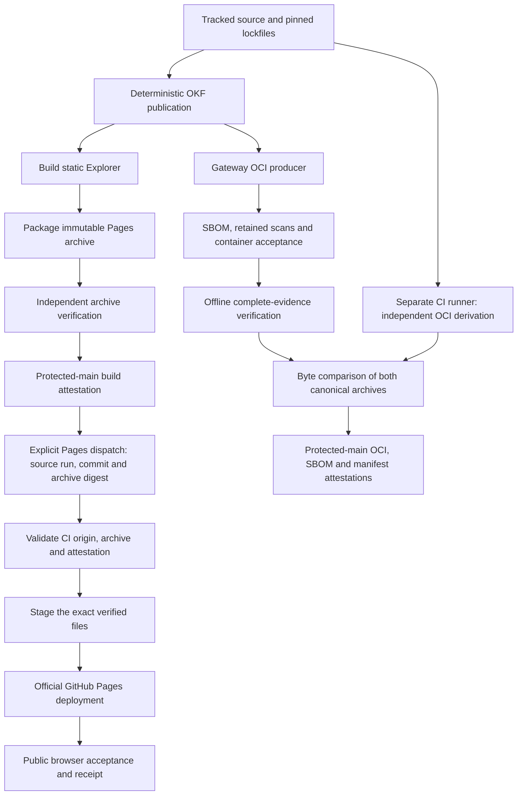
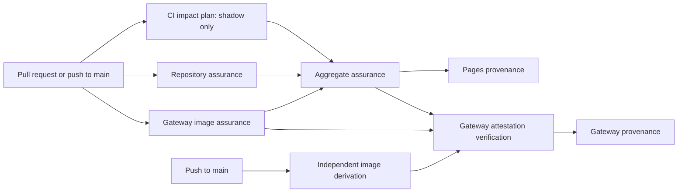
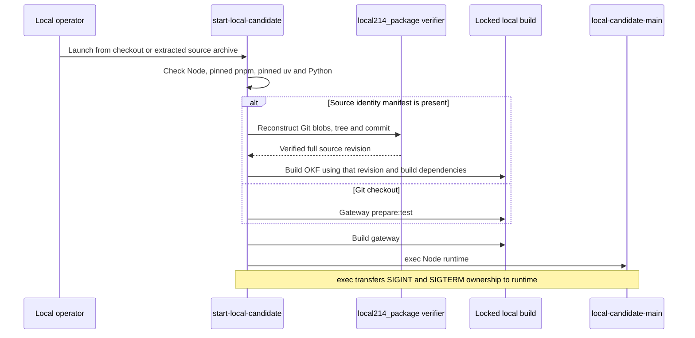
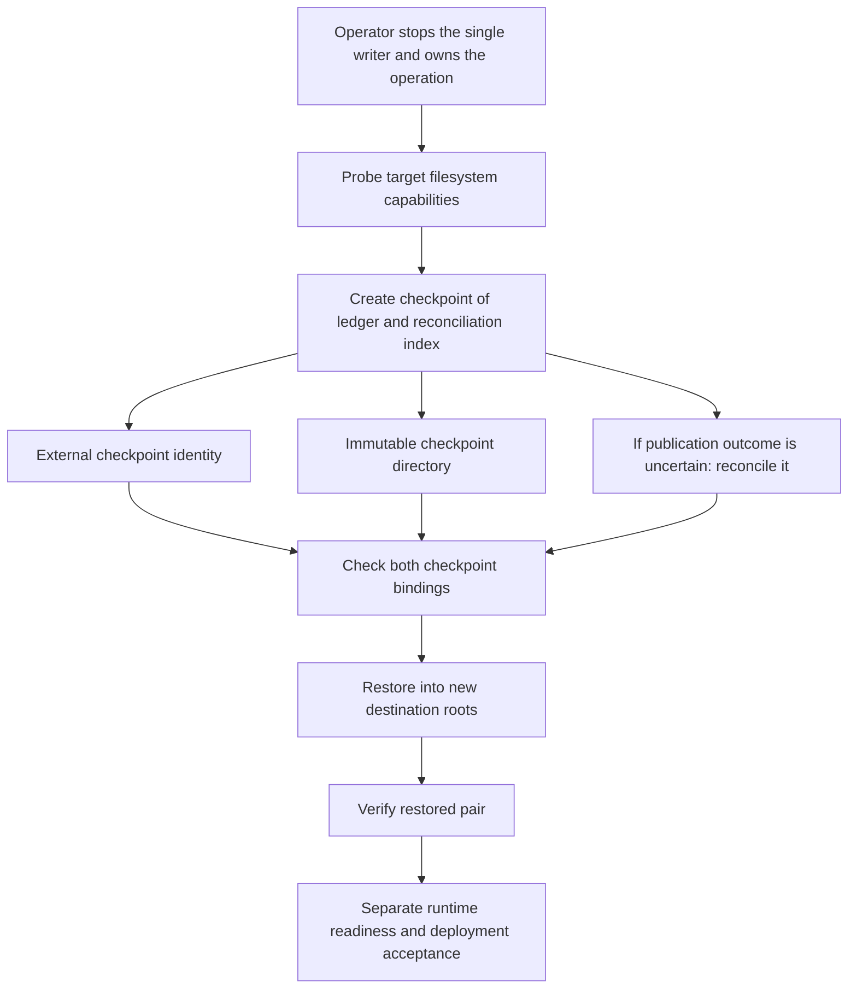
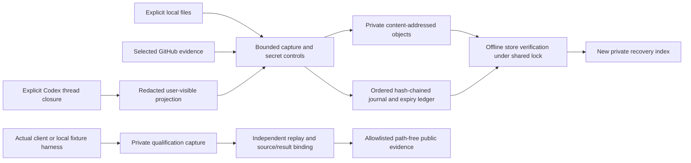

# Build, assurance and operations architecture

This chapter describes the implementation at Git commit
`97bc45635a91064cd78f06bf0848ad7636f05439`. Every Git source link below is pinned
to that commit; line numbers deliberately describe the reviewed implementation,
including where this documentation adds explanatory comments later. It describes
implemented mechanisms, not a claim that a deployment or live host check passed.

## Three operational evidence boundaries

| Boundary | Inputs and outputs | Authority of a successful check |
| --- | --- | --- |
| Product evidence | The runtime's public receipt ledger and private reconciliation index; checkpoint commands delegate to `packages/evidence`. | Integrity and consistency of the saved pair. Restore reports deployment readiness as `not-evaluated`. [Operator results](https://github.com/chris-page-gov/gis-ai-go/blob/97bc45635a91064cd78f06bf0848ad7636f05439/scripts/evidence_checkpoint_operator_common.mjs#L59-L96). |
| Build and release evidence | Tracked source, locked dependencies, generated catalogue, archive/image, SBOM, scan reports and acceptance records. | Identity, reproducibility and the explicitly tested runtime controls. Protected-main provenance is a further CI step. [Assurance pipeline](https://github.com/chris-page-gov/gis-ai-go/blob/97bc45635a91064cd78f06bf0848ad7636f05439/scripts/run_gateway_image_assurance.py#L416-L576), [provenance jobs](https://github.com/chris-page-gov/gis-ai-go/blob/97bc45635a91064cd78f06bf0848ad7636f05439/.github/workflows/ci.yml#L462-L629). |
| Private delivery evidence | Explicit local files, selected GitHub evidence and redacted user-visible Codex projections; private content-addressed objects and journal. | Preserved bytes, source bindings and projection coverage. It is not the product ledger or a score of the AI's performance. [Store boundary](https://github.com/chris-page-gov/gis-ai-go/blob/97bc45635a91064cd78f06bf0848ad7636f05439/scripts/capture_delivery_evidence.py#L1-L8), [offline verifier](https://github.com/chris-page-gov/gis-ai-go/blob/97bc45635a91064cd78f06bf0848ad7636f05439/scripts/verify_delivery_evidence.py#L4287-L4329). |

These stores have different callers, privacy classifications and meanings of
“verified”. Their common use of hashes does not make them interchangeable.

## Build and release flow

The static product and gateway image are separate products of the source tree.
`package.json` orchestrates [the local checks](https://github.com/chris-page-gov/gis-ai-go/blob/97bc45635a91064cd78f06bf0848ad7636f05439/package.json#L14-L65).
The OKF builder validates source locks and schemas before generating its public
metadata projection ([build entry](https://github.com/chris-page-gov/gis-ai-go/blob/97bc45635a91064cd78f06bf0848ad7636f05439/scripts/build_okf.py#L1313-L1340)).
`package_pages.py` inventories regular files, checks catalogue checksums and writes
fixed archive metadata; it does not use the current clock to identify the product
([inventory](https://github.com/chris-page-gov/gis-ai-go/blob/97bc45635a91064cd78f06bf0848ad7636f05439/scripts/package_pages.py#L92-L151),
[archive construction](https://github.com/chris-page-gov/gis-ai-go/blob/97bc45635a91064cd78f06bf0848ad7636f05439/scripts/package_pages.py#L347-L522)).
The independent Pages verifier checks the archive without extracting or rebuilding
it ([verification](https://github.com/chris-page-gov/gis-ai-go/blob/97bc45635a91064cd78f06bf0848ad7636f05439/scripts/verify_pages_archive.py#L364-L651)).

Pages deployment consumes a retained archive from a successful exact-commit main
CI run. The workflow checks the protected workflow identity, run, artefact and
attestation, then stages those bytes and uses the official Pages transport
([source selection](https://github.com/chris-page-gov/gis-ai-go/blob/97bc45635a91064cd78f06bf0848ad7636f05439/.github/workflows/pages.yml#L67-L147),
[archive and provenance verification](https://github.com/chris-page-gov/gis-ai-go/blob/97bc45635a91064cd78f06bf0848ad7636f05439/.github/workflows/pages.yml#L187-L217),
[staging and deployment](https://github.com/chris-page-gov/gis-ai-go/blob/97bc45635a91064cd78f06bf0848ad7636f05439/.github/workflows/pages.yml#L307-L355)). Rollback
selects an earlier accepted archive through the same workflow; it does not
rebuild an old source tree. A separate public browser job checks the deployed
identity and emits its own record ([public verification](https://github.com/chris-page-gov/gis-ai-go/blob/97bc45635a91064cd78f06bf0848ad7636f05439/.github/workflows/pages.yml#L357-L489)).

Gateway assurance writes into a private quarantine directory. Its ordered phases
are OKF build, OCI package, OCI verify, second local build, SBOM, vulnerability
scan and container acceptance. Only complete evidence that passes final
verification is renamed into `artifacts/gateway`; failures remove the unpublished
output ([phase orchestration and promotion](https://github.com/chris-page-gov/gis-ai-go/blob/97bc45635a91064cd78f06bf0848ad7636f05439/scripts/run_gateway_image_assurance.py#L416-L576)).
`gateway_image.py` contains the build-context allowlist, pinned builder checks,
OCI normalisation and root filesystem inspection
([source/context identity](https://github.com/chris-page-gov/gis-ai-go/blob/97bc45635a91064cd78f06bf0848ad7636f05439/scripts/gateway_image.py#L3669-L3833),
[pin validation](https://github.com/chris-page-gov/gis-ai-go/blob/97bc45635a91064cd78f06bf0848ad7636f05439/scripts/gateway_image.py#L3856-L4323),
[archive validation](https://github.com/chris-page-gov/gis-ai-go/blob/97bc45635a91064cd78f06bf0848ad7636f05439/scripts/gateway_image.py#L4334-L4660)).

The image SBOM, retained Trivy database/report, Grype Node advisory calibration,
runtime-library donor evidence and container acceptance are a closed manifest,
not optional files discovered by a loose directory glob
([subject inventory](https://github.com/chris-page-gov/gis-ai-go/blob/97bc45635a91064cd78f06bf0848ad7636f05439/scripts/gateway_evidence.py#L23-L68),
[complete verifier](https://github.com/chris-page-gov/gis-ai-go/blob/97bc45635a91064cd78f06bf0848ad7636f05439/scripts/verify_gateway_image_evidence.py#L494-L591)).
An additional independent runner derives the image from the same source.
The verifier compares actual bytes as well as both checksum declarations
([independent CI](https://github.com/chris-page-gov/gis-ai-go/blob/97bc45635a91064cd78f06bf0848ad7636f05439/.github/workflows/ci.yml#L387-L460),
[comparison](https://github.com/chris-page-gov/gis-ai-go/blob/97bc45635a91064cd78f06bf0848ad7636f05439/scripts/verify_gateway_provenance.py#L269-L304)). Independence is
intentional: consolidating producer and verifier derivation logic would weaken
the evidence even if it reduced duplicated code.

## Assurance dependency graph

The impact planner describes which lanes *would* be relevant, but emits
`mode: "shadow"` and `enforced: false`. Empty, unmatched or force-full changes,
and protected-main changes, select full assurance. The workflow still runs its
current assurance jobs and the aggregate requires all three producers to succeed
([planner](https://github.com/chris-page-gov/gis-ai-go/blob/97bc45635a91064cd78f06bf0848ad7636f05439/scripts/plan_ci_impact.py#L353-L442),
[aggregate](https://github.com/chris-page-gov/gis-ai-go/blob/97bc45635a91064cd78f06bf0848ad7636f05439/.github/workflows/ci.yml#L303-L327)). A future optimisation must
change that policy explicitly; a suggestion from the planner is not permission
to skip a gate.

The local `check` command includes type checks; TypeScript, Python, interoperation,
frontend and browser suites; two clean static-release builds; version/changelog,
public-read, schema, link and secret checks; deterministic DOT rendering; SBOM;
OKF+ verification; and experience-browser checks
([command composition](https://github.com/chris-page-gov/gis-ai-go/blob/97bc45635a91064cd78f06bf0848ad7636f05439/package.json#L14-L65)). Image assurance remains its
own CI job. Tests under `tests/contract` primarily verify rejection boundaries
and cross-document identities; `tests/interoperability` exercise processes,
transports and qualification harnesses. A test fixture labelled synthetic cannot
satisfy a live provider or independent-host gate.

## Local source edition and runtime launch

The source edition is a separate evaluation artefact, not a supported public
release. Packaging requires a clean committed checkout, regular tracked files,
complete source-tree identity and fixed byte/file ceilings. The current bounds
are 65,536 files, 32 MiB per source file and 512 MiB total; the identity document
has a 32 MiB ceiling. These limits include the large OKF+ metadata source tree
([constants and source capture](https://github.com/chris-page-gov/gis-ai-go/blob/97bc45635a91064cd78f06bf0848ad7636f05439/scripts/local214_package.py#L1-L176)).
Verification reconstructs Git identity from the extracted bytes before the
launcher trusts the named revision
([verification](https://github.com/chris-page-gov/gis-ai-go/blob/97bc45635a91064cd78f06bf0848ad7636f05439/scripts/local214_package.py#L221-L278),
[launcher](https://github.com/chris-page-gov/gis-ai-go/blob/97bc45635a91064cd78f06bf0848ad7636f05439/scripts/start-local-candidate#L1-L46)). Generated runtime output is
built after that verification. The workbench launcher builds the gateway and
workbench before executing its own runtime
([workbench launch](https://github.com/chris-page-gov/gis-ai-go/blob/97bc45635a91064cd78f06bf0848ad7636f05439/scripts/start-public-data-workbench#L1-L11)).

## Product evidence checkpoint and deployment operations

The command-line parser requires every declared value and assertion flag exactly
once and rejects unknown flags. The stopped-writer and exclusive-owner flags are
operator assertions: they do not discover or terminate another writer
([closed parser](https://github.com/chris-page-gov/gis-ai-go/blob/97bc45635a91064cd78f06bf0848ad7636f05439/scripts/evidence_checkpoint_operator_common.mjs#L15-L38),
[create command](https://github.com/chris-page-gov/gis-ai-go/blob/97bc45635a91064cd78f06bf0848ad7636f05439/scripts/create_evidence_checkpoint.mjs#L12-L40),
[restore command](https://github.com/chris-page-gov/gis-ai-go/blob/97bc45635a91064cd78f06bf0848ad7636f05439/scripts/restore_evidence_checkpoint.mjs#L12-L40)). Filesystem
probes exercise private permissions, hard links, no-replace behaviour and
synchronisation on one caller-identified filesystem
([probe implementation](https://github.com/chris-page-gov/gis-ai-go/blob/97bc45635a91064cd78f06bf0848ad7636f05439/scripts/check_evidence_filesystem_capabilities.mjs#L134-L249)).
The rehearsal uses synthetic observations and a child fixture writer; it proves
the recovery procedure locally, not properties of an untested deployment mount
([rehearsal](https://github.com/chris-page-gov/gis-ai-go/blob/97bc45635a91064cd78f06bf0848ad7636f05439/scripts/rehearse_evidence_checkpoint_recovery.mjs#L93-L237)).

Deployment admission is an offline cross-document verifier. It requires transport
evidence before accepting live-provider evidence, and requires *both* exact
filesystem capability records when transport evidence is supplied. It checks
schema, source/image identities, digests, observation windows and classification;
it does not make a fresh DNS, TLS or provider request
([admission rules](https://github.com/chris-page-gov/gis-ai-go/blob/97bc45635a91064cd78f06bf0848ad7636f05439/scripts/verify_deployment_admission.py#L360-L514)).
The local Compose candidate has one replica, a loopback port, an internal
network, read-only root, dropped capabilities, resource ceilings and separate
ledger/index volumes ([Compose contract](https://github.com/chris-page-gov/gis-ai-go/blob/97bc45635a91064cd78f06bf0848ad7636f05439/deploy/gateway/compose.candidate.yaml#L1-L59)).
The `infra` directories contain documentation placeholders rather than provisioned
infrastructure ([environments](https://github.com/chris-page-gov/gis-ai-go/blob/97bc45635a91064cd78f06bf0848ad7636f05439/infra/environments/README.md#L1-L3),
[modules](https://github.com/chris-page-gov/gis-ai-go/blob/97bc45635a91064cd78f06bf0848ad7636f05439/infra/modules/README.md#L1-L3)).

## Private preservation and qualification

`EvidenceStore` owns an exclusive file lock, recovers pending transactions before
reading the durable journal, rejects duplicate immutable source identities and
refreshes the expiry ledger ([writer lifecycle](https://github.com/chris-page-gov/gis-ai-go/blob/97bc45635a91064cd78f06bf0848ad7636f05439/scripts/capture_delivery_evidence.py#L2159-L2225)).
Codex ingestion captures a bounded, redacted projection and retains omission and
coverage facts; the original session is not a general-purpose public input
([projection entry](https://github.com/chris-page-gov/gis-ai-go/blob/97bc45635a91064cd78f06bf0848ad7636f05439/scripts/capture_delivery_evidence.py#L5107-L5128),
[closure capture](https://github.com/chris-page-gov/gis-ai-go/blob/97bc45635a91064cd78f06bf0848ad7636f05439/scripts/capture_delivery_evidence.py#L6055-L6090)).
Offline verification acquires a shared lock and validates the journal, objects,
source semantics and projection generations
([verification entry](https://github.com/chris-page-gov/gis-ai-go/blob/97bc45635a91064cd78f06bf0848ad7636f05439/scripts/verify_delivery_evidence.py#L4055-L4329)).
The recovered index first verifies the store, selects an authenticated captured
generation and checks the journal snapshot again; it emits into a new private
output directory outside the checkout
([index boundary](https://github.com/chris-page-gov/gis-ai-go/blob/97bc45635a91064cd78f06bf0848ad7636f05439/scripts/index_recovered_delivery_evidence.py#L1-L7),
[index transaction](https://github.com/chris-page-gov/gis-ai-go/blob/97bc45635a91064cd78f06bf0848ad7636f05439/scripts/index_recovered_delivery_evidence.py#L1309-L1357)).

Qualification scripts preserve distinct kinds of evidence: local deterministic
evaluations; local HTTP preflight; legacy and strict-modern STDIO readiness;
Claude capability; exact-five capability; and ChatGPT tunnel observations.
Versioned historical harnesses remain consumers of recorded evidence and are not
dead simply because a newer host lane exists. The strict compiler derives
readiness/capability from verified private events and publishes a closed
projection ([compiler](https://github.com/chris-page-gov/gis-ai-go/blob/97bc45635a91064cd78f06bf0848ad7636f05439/scripts/compile_qual_206_strict_modern_evidence.py#L667-L827)).
The exact-five verifiers independently check result/receipt material and runtime
closure ([Claude](https://github.com/chris-page-gov/gis-ai-go/blob/97bc45635a91064cd78f06bf0848ad7636f05439/scripts/verify_qual_206_claude_exact_five_capability.py#L655-L703),
[ChatGPT](https://github.com/chris-page-gov/gis-ai-go/blob/97bc45635a91064cd78f06bf0848ad7636f05439/scripts/verify_qual_206_chatgpt_tunnel_exact_five.py#L484-L568)).
Host harnesses have explicit platform, executable, budget and invocation
conditions; reading or running synthetic tests does not establish a fresh real
client observation ([Claude arguments](https://github.com/chris-page-gov/gis-ai-go/blob/97bc45635a91064cd78f06bf0848ad7636f05439/scripts/qual_206_claude_capability_harness.mjs#L373-L441),
[tunnel arguments](https://github.com/chris-page-gov/gis-ai-go/blob/97bc45635a91064cd78f06bf0848ad7636f05439/scripts/qual_206_chatgpt_tunnel_exact_five_harness.mjs#L422-L486)).

WEB216 scripts support the workbench through offline corpus import, deterministic
experiments, captured CPIH validation, exact-integer synthetic geography joins,
storage comparisons, hosted bundle packaging and local Worker probes. These
roles do not grant permission to import arbitrary code or make arbitrary provider
calls ([corpus boundary](https://github.com/chris-page-gov/gis-ai-go/blob/97bc45635a91064cd78f06bf0848ad7636f05439/scripts/web216_corpus.py#L1-L7),
[CPIH validator](https://github.com/chris-page-gov/gis-ai-go/blob/97bc45635a91064cd78f06bf0848ad7636f05439/scripts/web216_current_cpih.py#L77-L150),
[geography boundary](https://github.com/chris-page-gov/gis-ai-go/blob/97bc45635a91064cd78f06bf0848ad7636f05439/scripts/web216_geography_contract.py#L1-L9),
[storage boundary](https://github.com/chris-page-gov/gis-ai-go/blob/97bc45635a91064cd78f06bf0848ad7636f05439/scripts/web216_storage_experiment.py#L1-L2)).

## Formal behavioural specifications

These are specifications of implemented checks, not machine-checked proofs of
the whole deployment. Let `H(x)` mean SHA-256 of bytes `x`, `B(s)` mean an artefact
built from source identity `s`, and `Accept(x)` mean that the named verifier
returns successfully.

| ID | Preconditions | Postcondition / invariant | Implementing evidence |
| --- | --- | --- | --- |
| OPS-1: source edition | Clean committed source; permitted tracked regular files; within explicit bounds. | `tree(materials) = declared_tree` and `GitHash(commit_object) = declared_commit`; every material's SHA-256 and Git blob identity match its bytes. Generated outputs are excluded from the source inventory. | [Capture](https://github.com/chris-page-gov/gis-ai-go/blob/97bc45635a91064cd78f06bf0848ad7636f05439/scripts/local214_package.py#L114-L176), [verification](https://github.com/chris-page-gov/gis-ai-go/blob/97bc45635a91064cd78f06bf0848ad7636f05439/scripts/local214_package.py#L221-L278). |
| OPS-2: Pages identity | Checked distribution; exact repository, base path, version and source commit; permitted bounded inventory. | `Accept(archive)` binds catalogue root, publication files, archive digest and receipt to the same identity. A matching receipt alone does not authenticate a GitHub build. | [Packager](https://github.com/chris-page-gov/gis-ai-go/blob/97bc45635a91064cd78f06bf0848ad7636f05439/scripts/package_pages.py#L186-L293), [independent verifier](https://github.com/chris-page-gov/gis-ai-go/blob/97bc45635a91064cd78f06bf0848ad7636f05439/scripts/verify_pages_archive.py#L364-L651), [attestation gate](https://github.com/chris-page-gov/gis-ai-go/blob/97bc45635a91064cd78f06bf0848ad7636f05439/.github/workflows/pages.yml#L203-L217). |
| OPS-3: deterministic release | Same source and locked build inputs, two clean allowed generated roots, fixed build environment. | `B1(s) = B2(s)` byte-for-byte for the three canonical release files; disagreement fails. | [Rebuild loop](https://github.com/chris-page-gov/gis-ai-go/blob/97bc45635a91064cd78f06bf0848ad7636f05439/scripts/check_release_reproducibility.py#L304-L383), [mutation tests](https://github.com/chris-page-gov/gis-ai-go/blob/97bc45635a91064cd78f06bf0848ad7636f05439/tests/contract/test_release_reproducibility.py#L78-L103). |
| OPS-4: independent image | Producer and independent archive/checksum files are bounded regular files. | `bytes(A) = bytes(I)` and `H(A) = declared(A) = declared(I) = H(I)` before the provenance path continues. | [Comparison](https://github.com/chris-page-gov/gis-ai-go/blob/97bc45635a91064cd78f06bf0848ad7636f05439/scripts/verify_gateway_provenance.py#L269-L304), [substitution tests](https://github.com/chris-page-gov/gis-ai-go/blob/97bc45635a91064cd78f06bf0848ad7636f05439/tests/contract/test_gateway_provenance.py#L224-L301). |
| OPS-5: evidence promotion | Expected output location, private quarantine identity, all ordered phases succeed. | Final public artefact directory appears only after complete-evidence verification; failure never promotes a partial evidence directory. | [Orchestration](https://github.com/chris-page-gov/gis-ai-go/blob/97bc45635a91064cd78f06bf0848ad7636f05439/scripts/run_gateway_image_assurance.py#L416-L576). |
| OPS-6: safe Pages staging | Independently verified archive and expected digest; fresh output root. | Re-read archive digest still matches; observed staged file bytes equal verified logical file bytes; directory/file identities remain bound. | [Materialisation](https://github.com/chris-page-gov/gis-ai-go/blob/97bc45635a91064cd78f06bf0848ad7636f05439/scripts/stage_pages_payload.py#L337-L387), [second digest check](https://github.com/chris-page-gov/gis-ai-go/blob/97bc45635a91064cd78f06bf0848ad7636f05439/scripts/stage_pages_payload.py#L390-L431). |
| OPS-7: checkpoint assertions | Every required path flag and both operator assertions appear once. | Create/restore output is canonical and path-free; restore success implies verified checkpoint/pair but leaves deployment readiness unevaluated. | [Parser/results](https://github.com/chris-page-gov/gis-ai-go/blob/97bc45635a91064cd78f06bf0848ad7636f05439/scripts/evidence_checkpoint_operator_common.mjs#L15-L126). |
| OPS-8: admission dependency | Optional transport, live and filesystem records supplied. | `live ⇒ transport`; `transport ⇒ ledger_fs ∧ reconciliation_fs`; supplied identities, hashes, classification and times agree. Success is an offline contract result. | [Admission](https://github.com/chris-page-gov/gis-ai-go/blob/97bc45635a91064cd78f06bf0848ad7636f05439/scripts/verify_deployment_admission.py#L360-L514). |
| OPS-9: private journal | Store initialised; writer has exclusive lock; event and object bounds hold. | Sequence starts at zero; `previous_event_sha256` links each event to its predecessor; event hash is domain-separated canonical content; immutable source identities cannot repeat. | [Journal validation](https://github.com/chris-page-gov/gis-ai-go/blob/97bc45635a91064cd78f06bf0848ad7636f05439/scripts/capture_delivery_evidence.py#L2094-L2127), [writer](https://github.com/chris-page-gov/gis-ai-go/blob/97bc45635a91064cd78f06bf0848ad7636f05439/scripts/capture_delivery_evidence.py#L2159-L2225), [crash tests](https://github.com/chris-page-gov/gis-ai-go/blob/97bc45635a91064cd78f06bf0848ad7636f05439/tests/contract/test_delivery_evidence_preservation.py#L547-L642). |
| OPS-10: shadow planning | Valid full Git identities and bounded canonical changed paths. | Main, empty, unknown or explicitly full changes select full assurance; output remains `mode=shadow ∧ enforced=false`; it cannot skip workflow jobs. | [Planner](https://github.com/chris-page-gov/gis-ai-go/blob/97bc45635a91064cd78f06bf0848ad7636f05439/scripts/plan_ci_impact.py#L353-L442), [aggregate](https://github.com/chris-page-gov/gis-ai-go/blob/97bc45635a91064cd78f06bf0848ad7636f05439/.github/workflows/ci.yml#L303-L327). |

## Operational contracts explained for a beginner

A contract says what a component may receive, what it promises to return and what
must remain true. For example, the checkpoint command requires four path values
and two explicit confirmations. Missing a confirmation is an invalid command;
a successful restore promises a verified saved pair, while the result explicitly
says it has not evaluated deployment readiness. Those distinctions are part of
the interface, not incidental messages
([real parser and result examples](https://github.com/chris-page-gov/gis-ai-go/blob/97bc45635a91064cd78f06bf0848ad7636f05439/scripts/evidence_checkpoint_operator_common.mjs#L15-L96)).

A JSON Schema checks the shape of a record: required fields, allowed values and
which extra fields are forbidden. It does not prove that a machine was reached
or that an observation is truthful. This repository layers semantic verifiers on
top. The deployment verifier checks that several individually valid documents
refer to the same source, image, observation and filesystem; the Pages workflow
then separately verifies GitHub provenance. A synthetic fixture can pass schema
validation and still be unsuitable as release evidence
([schema validation](https://github.com/chris-page-gov/gis-ai-go/blob/97bc45635a91064cd78f06bf0848ad7636f05439/scripts/validate_contracts.py#L41-L76),
[synthetic fixture guard](https://github.com/chris-page-gov/gis-ai-go/blob/97bc45635a91064cd78f06bf0848ad7636f05439/scripts/validate_contracts.py#L207-L227),
[admission relationships](https://github.com/chris-page-gov/gis-ai-go/blob/97bc45635a91064cd78f06bf0848ad7636f05439/scripts/verify_deployment_admission.py#L360-L514)).

| Contract family used here | Actual example and enforcing consumer |
| --- | --- |
| Image receipt, image evidence manifest, vulnerability scan and container acceptance | Exact file roles and byte/hash bindings in [the inventory](https://github.com/chris-page-gov/gis-ai-go/blob/97bc45635a91064cd78f06bf0848ad7636f05439/scripts/gateway_evidence.py#L23-L68), checked by [the complete evidence verifier](https://github.com/chris-page-gov/gis-ai-go/blob/97bc45635a91064cd78f06bf0848ad7636f05439/scripts/verify_gateway_image_evidence.py#L494-L591). |
| Pages archive, manifest, provenance, site receipt, checksum ledger and SBOM | The packager defines these documents in [one archive build](https://github.com/chris-page-gov/gis-ai-go/blob/97bc45635a91064cd78f06bf0848ad7636f05439/scripts/package_pages.py#L370-L522); [the separate verifier](https://github.com/chris-page-gov/gis-ai-go/blob/97bc45635a91064cd78f06bf0848ad7636f05439/scripts/verify_pages_archive.py#L364-L651) enforces their identities and closed inventories. These are also code-enforced contracts, even where there is no standalone root schema. |
| Checkpoint manifest, external checkpoint, create, restore, check, reconciliation and recovery-rehearsal results | [Create](https://github.com/chris-page-gov/gis-ai-go/blob/97bc45635a91064cd78f06bf0848ad7636f05439/scripts/create_evidence_checkpoint.mjs#L12-L40) and [restore](https://github.com/chris-page-gov/gis-ai-go/blob/97bc45635a91064cd78f06bf0848ad7636f05439/scripts/restore_evidence_checkpoint.mjs#L12-L40) wrap the evidence package; the [rehearsal](https://github.com/chris-page-gov/gis-ai-go/blob/97bc45635a91064cd78f06bf0848ad7636f05439/scripts/rehearse_evidence_checkpoint_recovery.mjs#L93-L237) tests the combined sequence. |
| Filesystem capability, deployment plan, remote HTTPS acceptance and deployed live-provider evidence | [The offline admission verifier](https://github.com/chris-page-gov/gis-ai-go/blob/97bc45635a91064cd78f06bf0848ad7636f05439/scripts/verify_deployment_admission.py#L95-L124) loads schemas; [its semantic phase](https://github.com/chris-page-gov/gis-ai-go/blob/97bc45635a91064cd78f06bf0848ad7636f05439/scripts/verify_deployment_admission.py#L360-L514) checks relationships that field types alone cannot establish. |
| Qualification capture, event, session, readiness and capability contracts | [Strict compiler](https://github.com/chris-page-gov/gis-ai-go/blob/97bc45635a91064cd78f06bf0848ad7636f05439/scripts/compile_qual_206_strict_modern_evidence.py#L830-L960), [Claude verifier](https://github.com/chris-page-gov/gis-ai-go/blob/97bc45635a91064cd78f06bf0848ad7636f05439/scripts/verify_qual_206_claude_exact_five_capability.py#L1143-L1363) and [tunnel verifier](https://github.com/chris-page-gov/gis-ai-go/blob/97bc45635a91064cd78f06bf0848ad7636f05439/scripts/verify_qual_206_chatgpt_tunnel_exact_five.py#L1101-L1307) consume distinct versioned evidence. Historical versions remain separately interpretable. |
| Local source edition identity and local edition profile | [The source verifier](https://github.com/chris-page-gov/gis-ai-go/blob/97bc45635a91064cd78f06bf0848ad7636f05439/scripts/local214_package.py#L221-L278) checks Git objects and material inventory; [the profile checker](https://github.com/chris-page-gov/gis-ai-go/blob/97bc45635a91064cd78f06bf0848ad7636f05439/scripts/check_local214_profile.py#L19-L52) checks profile/gate structure and explicitly does not prove observations. |
| CI impact map and plan | [Map loading](https://github.com/chris-page-gov/gis-ai-go/blob/97bc45635a91064cd78f06bf0848ad7636f05439/scripts/plan_ci_impact.py#L199-L332) validates closed objects, sorted unique values and dependency graph; [planning](https://github.com/chris-page-gov/gis-ai-go/blob/97bc45635a91064cd78f06bf0848ad7636f05439/scripts/plan_ci_impact.py#L353-L442) produces a non-enforcing decision record. |
| Private preservation store, event, expiry ledger, Codex projection/generation and recovered index | The [private writer](https://github.com/chris-page-gov/gis-ai-go/blob/97bc45635a91064cd78f06bf0848ad7636f05439/scripts/capture_delivery_evidence.py#L2159-L2225), [offline verifier](https://github.com/chris-page-gov/gis-ai-go/blob/97bc45635a91064cd78f06bf0848ad7636f05439/scripts/verify_delivery_evidence.py#L4055-L4329) and [index builder](https://github.com/chris-page-gov/gis-ai-go/blob/97bc45635a91064cd78f06bf0848ad7636f05439/scripts/index_recovered_delivery_evidence.py#L1309-L1357) enforce filesystem, identity and semantic contracts in Python. They are not public runtime receipt schemas. |
| WEB216 experiment contracts | [CPIH validation](https://github.com/chris-page-gov/gis-ai-go/blob/97bc45635a91064cd78f06bf0848ad7636f05439/scripts/web216_current_cpih.py#L77-L150), [bounded synthetic geography join](https://github.com/chris-page-gov/gis-ai-go/blob/97bc45635a91064cd78f06bf0848ad7636f05439/scripts/web216_geography_contract.py#L228-L389), and [pinned corpus loading](https://github.com/chris-page-gov/gis-ai-go/blob/97bc45635a91064cd78f06bf0848ad7636f05439/scripts/web216_corpus.py#L243-L288) constrain offline workbench inputs. |

## Review coverage and refactoring boundaries

The operations inventory covers 207 owned files: 84 root scripts, 104 Python
files parsed as ASTs and 52 JavaScript/TypeScript files parsed for syntax, together
with `.github`, `deploy`, `infra` and supporting test data. Review combines
AST/name-reference inspection of Python sources and entrypoint/import/consumer
inspection of JavaScript and shell. Deep manual review
focuses on the build/release, filesystem publication, checkpoint, private
preservation and source-identity boundaries linked above. Test names, consumers
and selected rejection cases were inspected as behavioural evidence; that does
not mean every test assertion or every line of the large privacy parsers was
manually audited. `scripts/okf_plus/` and experience/Sites-specific scripts are
covered by their component review. Inventory of these paths is not a claim that
all supported platforms, live hosts, Docker builds or deployments ran here.

The detailed repository review records the following operations findings:

- **OP-01:** four private helpers have definition-only references in tracked
  repository source and tests; remove after preserving a static reference check.
- **OP-02:** `gateway_image.py` mixes diagnostic privacy parsing, process control,
  context admission and OCI/root-filesystem verification. Extract cohesive internal
  modules while retaining independent evidence derivation.
- **OP-03:** private capture combines filesystem ownership, journal transactions,
  secret handling, Codex projection and GitHub acquisition in one module. Give the
  shared storage/projection primitives an explicit internal API and keep verifier
  semantic checks independently readable.
- **OP-04:** `validate_contracts.main` is a 957-line fixture-construction and
  validation sequence. Split by contract family, preserve the closed schema
  inventory and negative mutations, and aggregate labelled results centrally.
- **OP-05:** five AST-unused imports can be removed after checking that none is an
  intentional re-export. This is a maintenance improvement, not evidence of a
  runtime failure.

Comments added by this review clarify the assertion/observation distinction,
quarantine publication, private-store ownership and source-edition identity.
No execution logic, schema, qualification boundary or historical evidence is
changed by this documentation work.
