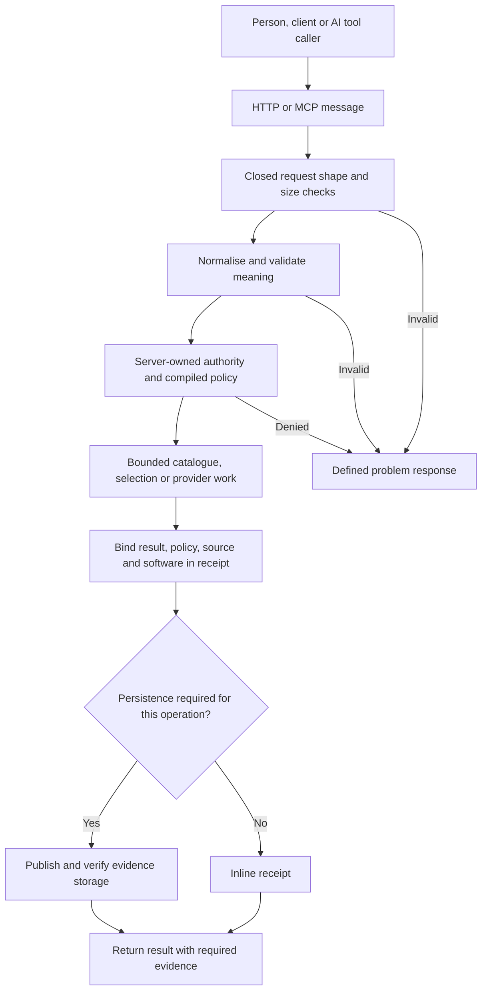
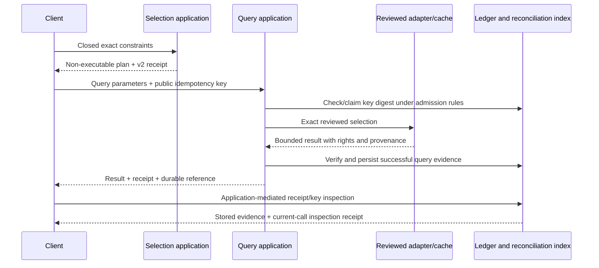

# Contracts: a beginner's guide and implementation reference

This guide describes the contracts implemented at Git commit
`97bc45635a91064cd78f06bf0848ad7636f05439`. All source references resolve to that
immutable commit. The [complete register](CONTRACT_REGISTER.md) lists every
maintained JSON Schema, exported TypeScript interface/type, embedded schema site
and non-test Python dataclass discovered in that tree, plus the pilot SQL storage
constraints. Its 469 TypeScript declarations comprise 438 project-authored
declarations and 31 declarations in the pinned vendor dependency. The latter
occur in three declaring modules within the five-file TypeScript snapshot and
are explicitly labelled as dependency contracts. The
[machine-readable inventory](contracts.json) records their exact locations and
literal reference evidence. It distinguishes definition, use, validation and
release status; finding a schema does not prove that a service is running.

Later [validation repairs](../implementation/VALIDATION_REPAIRS.md) require the
OKF+ schema files and add the intake descriptor/producer conformance gate. The
register and source references here continue to describe the review baseline.

## What a contract means

A software contract is an agreement between two pieces of code. One side promises
to send a particular kind of message; the other promises to check it and return a
particular kind of result or a defined error. A paper form is a useful analogy:
it has named boxes, required answers and rules such as “enter a whole number
between 1 and 100”. GIS AI GO adds rules about who may ask, which data may be used,
how much work is allowed and what evidence accompanies the answer.

For example, the actual [`catalogue.search` request schema][search-schema]
accepts this request:

```json
{"query":"deaths","limit":5}
```

`query` must be a non-empty string of at most 256 Unicode characters. `limit`
must be an integer between 1 and 100. The schema's
`additionalProperties: false` means “do not accept boxes this form does not
define”. Thus `{"query":"deaths","limit":101}` fails the size rule, and
`{"query":"deaths","provider_url":"https://example.org"}` fails the closed
property rule. The extra URL does not become permission to make a network call.
An empty object is permitted: all these request fields are optional. The
[application supplies the page-size default of 20][search-normalisation]; JSON
Schema's `default` annotation does not itself insert a value.

A message can pass its JSON Schema and still fail a more meaningful check. The
request below fits the string-length rule but contains eleven normalised words:

```json
{"query":"one two three four five six seven eight nine ten eleven"}
```

The [application rejects more than ten terms][search-normalisation]. The
[schema's own comment][search-schema] explicitly delegates this rule to runtime
code. The [query-limit tests][search-tests] check this distinction. A schema is
therefore one part of the contract, rather than a complete replacement for code.

## The seven kinds of agreement in this repository

| Contract kind | What it promises | Actual example | What it does not establish |
|---|---|---|---|
| JSON Schema | The fields, primitive types, permitted constants and structural bounds of JSON. `$ref` reuses another named definition. | [Closed idempotent `data.query` request][query-schema] refers to the parameter schema. | An event happened, the digest is correct, or the caller is authorised. |
| TypeScript interface/type | Checked TypeScript callers use the expected fields and return values during compilation. | [`ExecutionRequest` and `ExecutionResult`][execution-types]; [`ProviderAdapter` and `AsyncProviderAdapter`][adapter-types]. | Validation of JSON received at runtime. Types are erased in JavaScript. `readonly` is not a runtime freeze. |
| Runtime semantic validation | Relationships and limits that require code or current state are enforced. | [Catalogue normalisation][search-normalisation], [fixed provider URL checks][egress], [Python request and geometry checks][execution-service]. | Authority outside the explicitly configured service boundary. |
| Policy and authority | The server's bounded authority profile and policy decide whether an operation is allowed. | [Compiled public policy][policy] and [server-created authority context][authority]. | A caller-provided “allow” field, or a provider's metadata, granting permission. |
| Evidence and persistence | A result is bound to its inputs, policy, source and software; storage follows a defined publication/recovery protocol. | [Domain-separated digests][digests], [receipt validation][receipt-verification], [ledger and reconciliation contracts][ledger-schema]. | Cryptographic attestation, source truth or the ability to recreate discarded result material. |
| Transport and SDK protocol | HTTP routes, MCP tools/resources and adapter methods expose specific message shapes and lifecycle rules. | [OpenAPI projection][openapi], [MCP registration][mcp-registration], [adapter's seven operations][adapter-types]. | Every documented profile being registered, released or reachable. |
| SQL storage constraints | Database rows obey storage-level field, identity and size rules even when written through another caller. | [Private pilot table constraints][pilot-sql] restrict allowance fields and receipt JSON bytes. | The SQL schema alone enforcing every provider quota, rate limit or receipt-count limit; atomic admission statements enforce those additional rules. |

Python's [`ExecutionBoundary` dataclass][execution-boundary] is another typed
agreement between internal components. Its annotations and defaults describe
state; the [execution service][execution-service] checks hostile requests. A
dataclass alone does not validate incoming JSON.



This diagram describes the governed application path. The experimental Sites
pilot and browser page tools have their own smaller contracts below; they do not
inherit every durable-evidence guarantee from this picture.

## The contracts in use, by boundary

The table is the reading order. The [register](CONTRACT_REGISTER.md) gives every
file and symbol rather than requiring readers to infer coverage from these
families. Root schema filenames are versioned selectively: an unversioned
filename can still contain a versioned `$id` and `schema` discriminator.

| Boundary | Producer, consumer and enforcement | Contracts and actual examples |
|---|---|---|
| Published metadata and Explorer | Python OKF builders produce metadata; the shared TypeScript catalogue parser consumes and validates it for the Explorer and gateway snapshot. | [`CatalogueBundle`, `CatalogueRecord`, facets, graph and timeline models][catalogue-types], [strict parser][catalogue-parser], [small catalogue fixture][catalogue-fixture], `okf-publication-bundle` schema. Record count, source relationships, safe links and legal boundary wording receive runtime checks. |
| Catalogue search/describe | A client sends a closed request. The catalogue application validates it, applies the catalogue policy and returns a result or a bounded problem. | `catalogue-search-request`, `catalogue-describe-request`, `catalogue-result`, `catalogue-problem`; [success/tamper tests][catalogue-tests]. |
| Anonymous authority and policy | Server constructors and compiled policy JSON produce v1 catalogue, v2 selection/query and v3 inspection authority/decision objects. Receipt verifiers check their identity and expected values. | The nine `public-authority-context*`, `public-policy*` and `public-policy-decision*` schema definitions; [v1 implementation][policy], [v2 implementation][policy-v2], [v3 implementation][policy-v3]. Generic `authority-context`/`policy-decision` version-0 metadata is a separate research-derived governance family. |
| Deterministic selection | The gateway resolves a closed set of constraints against the reviewed selection profile; its output is a non-executable plan. | `selection-resolve-request/result/problem`, `public-selection-profile`, `selection-plan`, `public-read-resource`; [actual England/week-24 request][selection-example]. Question text is display context; exact constraints perform selection. |
| Governed query and provider | The application accepts the exact wrapped parameters, obtains policy/evidence readiness and uses the reviewed adapter or explicitly admitted cache. Adapter methods preserve source identifiers, rights, units and provenance. | `data-query-request/parameters/result/problem`, `data-query-reconciliation-problem`, `data-query-operation-problem`, `provider-adapter-result`, `approved-provider-cache`; [complete request example][query-example], [adapter interfaces][adapter-types], [exact HTTPS allowlist][egress]. |
| Receipts, ledger and reconciliation | Application code creates receipts. Evidence code verifies them, constructs immutable records/events and resolves digest-only idempotency ownership. | `evidence-receipt` v1/v2/v3; public record v1/v2, ledger descriptor and event; reconciliation index/claim/resolution; [digest implementation][digests]. The current core evidence inspection operation accepts stored v1/v2 records; the separate CPIH record v3 has its own inspection route. |
| Evidence inspection | A client looks up a known receipt or an idempotency key. The application retrieves restart-verified stored evidence and creates an inline receipt for this inspection. | `evidence-inspect-request` v1/v2, their operation union, result v1/v2/v3 and operation-result unions; [accepted request versions][inspect-union], [current v3 result][inspect-v3], [current-call verifier][inspection-verifier]. Old result schemas remain for compatibility and evidence interpretation. |
| Operator checkpoint and restore | The operator stops/fences writers before invoking tooling; tooling checks asserted quiescence and inventories, then verifies and publishes/restores a ledger/index checkpoint. | Eight `evidence-checkpoint-*`, `evidence-external-checkpoint` and `evidence-filesystem-capability-check` definitions; [operator assertion boundary][checkpoint]. A “check” result alone does not establish crash durability of a directory entry. |
| Private synthetic geometry execution | TypeScript builds the private envelope; Python checks exact keys, source, deadlines, trace context, limits and polygon geometry, then emits synthetic feature results or controlled errors. | `execution-request/result/problem`, [TypeScript request/result types][execution-types], [Python validation][execution-service], [request fixture][execution-example]. A gateway decision identifier/digest is linkage data; this service does not independently contact a policy authority. |
| Tool governance and activation | Registry parsers validate twelve canonical tool profiles and project a separately admitted five-tool assembly. | `tool-registry`; [twelve names and five target operations][registry-types]; [assembly checks][assembly]. `provider`, `tool-profile`, `workflow-profile` and `decision` metadata schemas are governance artefacts; metadata validity cannot activate planned tools. |
| Browser WebMCP | The Explorer exposes catalogue tools over its local snapshot; the workbench exposes its own CPIH/read-only actions and learning view actions. Page input checks call the corresponding application/action layer. | [Explorer embedded schemas][explorer-webmcp], [workbench four tools][workbench-webmcp], [learning tool schemas and actions][experience-tools]. A page changing its selected learning view is distinct from a provider query. |
| WEB-216 CPIH local/hosted experiment | CPIH-specific selection, queries and inspection use separate receipt/storage domains. MCP projects closed input/output schemas from source. | [shared input schemas][cpih-inputs], [local MCP schemas][cpih-local], [hosted MCP schemas][cpih-hosted], [transactional storage types][transactional-contract]. The local public-evidence-record v3 wrapper is not the core inline inspection receipt v3. |
| Private Sites pilot | Six pilot tools use embedded JSON input schemas and SDK validation; the pilot provider/store layer bounds calls and receipts. | [`SITES_PILOT_INPUTS` and registration][sites-inputs], [pilot store][sites-store], `sites-mcp-evaluation-run`. These use a separate experimental profile, receipt prefix and acceptance evidence. |
| Pilot SQL persistence | The migration and [typed Drizzle table definitions][pilot-drizzle] define the same two pilot tables used by the runtime store. SQLite enforces primary keys, non-negative counters, an enabled flag in `{0,1}`, a configured maximum from 1 to 200, and receipt JSON of at most 65,536 bytes. | [Actual migration and `CHECK` constraints][pilot-sql]; [atomic admission statements][pilot-admission] separately enforce `used < maximum`, rate and receipt-count limits. Reapplying the seed uses `ON CONFLICT DO NOTHING`, so it cannot refill an existing allowance. |
| Local intake | Caller-owned descriptors/text are checked and converted into an intake plan; local previews check CSV, GeoJSON, text and ZIP structures within limits. | [Request schema][intake-request], [result schema][intake-result], [runtime validator and plan builder][intake-runtime], [negative examples][intake-tests]. No arbitrary URL fetch or binary GIS import is implied. The standalone schema files have no direct executable consumer found in this baseline (CT-02). |
| OKF+ metadata build | Harvested records/source snapshots become a searchable knowledge catalogue and pinned context exports; build and verification scripts validate the outputs. | Three `okf-plus/schemas` definitions plus eight pinned vendor context-profile schemas; [verification stage][okf-verifier]. Vendor schemas are maintained inputs to the pinned build, not proprietary data authority. |
| Assurance, compatibility and deployment preparation | Independent verifiers consume sanitised observations, private captures, image receipts, manifests and acceptance documents. Tests construct synthetic/hostile records. | All QUAL-206, gateway-image/container, local-edition, provider-preflight/live-probe, deployment-admission, remote-HTTPS and deployed-live-provider definitions in the register; [root schema/fixture validation][schema-validator]. A valid acceptance document is not proof of a real deployment or successful external observation. |

The seven kinds of agreement above can overlap: for example, a TypeScript
interface describes a result, its JSON Schema describes the wire form, and a SQL
constraint bounds the bytes of a stored copy.

The `schemas/qual-206-exact-five-tool-schema-digests.v1.json` file is a
[reference set of advertised-schema hashes][schema-digests], not a JSON Schema.
The inventory counts it separately. Historical research-pack schema copies remain
preserved and are not counted as maintained definitions.

## Worked example: selection, query, evidence

The [checked selection fixture][selection-example] asks about weekly deaths for
England, week 24 of 2026. It supplies the actual native geography code
`E92000001`, dataset `weekly-deaths-region`, edition `time-series` and version
`121`. These are not interchangeable with a place name or an unspecified “latest”
dataset. The resolver can produce a plan only when the reviewed constraints agree.

The [complete `data.query` fixture][query-example] then wraps that selection:

```json
{
  "schema": "gis-ai-go.data-query-request.v1",
  "idempotency_key": "gis-ai-go:ik:v1:aaaaaaaaaaaaaaaaaaaaaaaaaaaaaaaaaaaaaaaaaaaaaaaaaaaaaaaaaaaaaaaa",
  "parameters": {
    "schema": "gis-ai-go.data-query-parameters.v1",
    "resource_id": "gis-ai-go:public-read-resource:sha256:c7130712a40d75e71bcf0259792404389bea2e549adf6733f34d491f83e99f68",
    "dataset": {"id":"weekly-deaths-region","edition":"time-series","version":"121"},
    "selections": [
      {"dimension":"time","option":"2026"},
      {"dimension":"geography","option":"E92000001"},
      {"dimension":"week","option":"week-24"},
      {"dimension":"causeofdeath","option":"all-causes"}
    ],
    "limit": 1
  }
}
```

This is a published test example, not a new live data observation. Real callers
must generate a fresh public random key instead of reusing the repeated `a`
fixture. The key is a correlation identifier, not a password. Its contract forbids
encoding personal data or secrets, and persistence retains a digest rather than
the raw key. A correctly shaped request can still fail current cache freshness,
policy, provider admission or evidence-storage readiness.

Changing the key to `gis-ai-go:ik:v1:` followed by 64 zeroes fails the
[request's explicit pattern][query-schema]. Adding a `url` inside `parameters`
also fails its closed parameter contract. A schema-valid key that has already
been claimed follows [reconciliation semantics][reconciliation-schema]; this is
receipt reconciliation rather than permission to repeat provider work or replay
the original payload.



The diagram shows the successful governed path, with failure branches omitted
for readability. Checkpoint/transaction failure handling is specified in the
storage implementation. An inline receipt and a persisted ledger reference are
different outputs. In particular, the inspection receipt is
[explicitly `inline-only`, `not-persisted`, `not-attested`][inspection-receipt-schema];
it does not append a new event merely because someone read an existing one.

## Precise rules, written as specifications

The notation below is a compact description of implemented checks. It is not a
claim of theorem proving, model checking or complete verification of all paths.
Let `JSON` be finite JSON values; `⊥` denotes failure; `C(x)` denotes the UTF-8
canonical JSON bytes accepted by the canonicaliser.

**Shape and meaning.** For operation `o`, schema `S_o`, normaliser `N_o`, policy
decision `P_o` and current readiness `R_o`:

```text
Admissible(o, x, state) = Shape(S_o, x)
                          ∧ N_o(x) ≠ ⊥
                          ∧ P_o(server_authority, N_o(x)).effect permits o
                          ∧ R_o(state)
```

`Shape` is the intended shape predicate, not a claim that every route calls a
JSON Schema engine. The core catalogue application implements closed checks by
hand; MCP input projection may defer semantic validation to that application.
The SDK, application and offline validators perform different checks. The
[MCP standard-schema adapter][mcp-application-validation] and [catalogue
normaliser][search-normalisation] show this division explicitly.

**Closed search.** The schema limits the property set and primitive bounds;
normalisation further limits terms and checks cursors against the snapshot:

```text
keys(x) ⊆ {query, facets, limit, cursor}
query present ⇒ 1 ≤ UnicodeCodePoints(query) ≤ 256
                ∧ NormalisedTermCount(query) ≤ 10
limit absent ⇒ normalised.limit = 20
limit present ⇒ limit ∈ ℤ ∧ 1 ≤ limit ≤ 100
```

Sources: [schema][search-schema], [normalisation][search-normalisation],
[Unicode/term tests][search-tests]. Schema validity alone is insufficient for
cursor authenticity, snapshot binding or the normalised term count.

**Content binding.** The implementation uses SHA-256 over a versioned prefix,
an explicit domain and canonical JSON bytes:

```text
prefix = "GIS-AI-GO\0canonical-json\0sha256\0v1\0"
H(domain, x) = hex(SHA256(UTF8(prefix) || UTF8(domain) || 0x00 || C(x)))
ContentID(namespace, domain, x) = namespace || ":sha256:" || H(domain, x)
```

Here `||` means byte concatenation. The domain distinguishes a receipt from a
policy or query with otherwise similar JSON. The [actual implementation][digests]
rejects malformed domains and compares digest bytes safely. The
[canonicaliser][canonical] rejects cycles, unsupported values, non-finite
numbers, invalid strings, accessors and non-plain objects rather than inventing
a lossy representation. Object-key order does not change a valid canonical
digest; array order can change it.

**Verification levels.** For a receipt `r`, retained evidence `e` and original
material `m`:

```text
StructureVerified(r) = expected fields/constants ∧ valid content identity
MaterialVerified(r, m) = StructureVerified(r)
                         ∧ expected authority/policy/source/software binding
                         ∧ matching input digest ∧ matching result digest
RestartVerified(e) = internally consistent persisted descriptor/record/event chain
```

These are separate claims. [Receipt material verification][receipt-verification]
uses original material at creation/ingest. [Inspection verification][inspection-verifier]
binds the safe lookup and projected stored result. Retaining only digests does
not recover the original query or payload. A hash also does not authenticate
who produced the object; these contracts explicitly say `not-attested`.
An independent external checkpoint is needed to detect a coherent rollback or
tail removal that a self-consistent truncated local chain cannot detect alone.

**Execution bounds.** For the private geometry service, successful execution
requires exact synthetic source identity, `EPSG:4326`, longitude/latitude axis
order, one supported operation, accepted trace context, an unexpired bounded
deadline and configured feature/coordinate/byte/complexity ceilings. Output
must preserve those identities and bind input/output digests. The
[Python executor][execution-service] and [gateway response parser][execution-parser]
check these obligations independently. This is deterministic geometry code;
an LLM is not used for point-in-polygon calculations.

**Activation.** A registry entry being well formed is necessary governance
metadata but insufficient to expose an operation. The
[assembly][assembly] must match the admitted five-operation set, bind policies,
adapter and evidence state, and remain `candidate-unregistered` with
`productionRegistration: false`. Suspensions can subtract operations; they
cannot add a planned operation. Generic/default and dedicated local entrypoints
must therefore be documented separately.

## Versions and compatibility

| Versioned family | Meaning at this baseline | Compatibility rule |
|---|---|---|
| Authority/policy/receipt v1 | Catalogue discovery/description. | Continue using v1 for that operation family; v2 is not an automatic replacement. |
| Authority/policy/receipt v2 | Deterministic selection and reviewed public query. | Bind the approved resource, selection, rights and transformations. |
| Authority/policy/receipt v3 | Current-call inspection of core stored v1/v2 evidence. | Inspect the existing record and create an inline receipt without another stored event. |
| Core inspection lookup v1/v2 | Receipt identity lookup / idempotency-key reconciliation. | Both requests remain in the [explicit union][inspect-union]; current operation result uses v3. |
| Public evidence record v1/v2/v3 | Stored catalogue receipt / stored public-read receipt / separate CPIH wrapper. | These are record versions, not the versions of the current-call inspection receipt. CPIH uses its own inspection route. |
| WEB-216 and Sites namespaces | Experimental workbench/pilot contracts. | Their distinct operation names, digests and storage types cannot be substituted into the exact-five contract. |

Changing a required property, enum, closed field set, canonicalisation domain or
identity algorithm can break consumers and previously recorded hashes. Review
the producer, each consumer, fixtures, hostile inputs, SDK/OpenAPI projections
and saved evidence before changing one. A version bump alone does not implement
compatibility. Conversely, retaining an older schema can be necessary to read
historical evidence; it is not automatically dead code.

## How to check the documentation and contracts

The inventory generator reads Git blobs at the pinned commit, so unrelated local
edits cannot silently move its source references. It lists lexical uses honestly;
it does not turn a filename mention into proof that a validator executes.

```sh
python scripts/build_architecture_contract_inventory.py --check
uv run --locked --cache-dir .uv-cache python scripts/validate_contracts.py
```

The second command meta-validates all 102 root schemas and validates its explicit
fixture mappings; it does not dynamically enforce every contract in the running
application. See [the registry builder][schema-registry], [fixture loop][schema-loop]
and the component tests linked above. The two local intake schemas are outside
that root glob; their runtime checks have tests, but their standalone descriptor
files lack an identified automated parity check in this baseline.

The [accompanying review](REVIEW_CONTRACTS.md) records two maintainability issues: stale “inactive”
schema prose where the local candidate now uses the definition (CT-01), and the
intake descriptor-validation gap (CT-02). Neither finding is a justification to
delete contracts or relax a runtime check. Source-authority boundaries and
immutable historical evidence must remain intact during refactoring.

[search-schema]: https://github.com/chris-page-gov/gis-ai-go/blob/97bc45635a91064cd78f06bf0848ad7636f05439/schemas/catalogue-search-request.schema.json#L1
[search-normalisation]: https://github.com/chris-page-gov/gis-ai-go/blob/97bc45635a91064cd78f06bf0848ad7636f05439/apps/mcp-gateway/src/catalogue-application.ts#L731
[search-tests]: https://github.com/chris-page-gov/gis-ai-go/blob/97bc45635a91064cd78f06bf0848ad7636f05439/apps/mcp-gateway/test/catalogue-application.test.ts#L451
[query-schema]: https://github.com/chris-page-gov/gis-ai-go/blob/97bc45635a91064cd78f06bf0848ad7636f05439/schemas/data-query-request.schema.json#L1
[execution-types]: https://github.com/chris-page-gov/gis-ai-go/blob/97bc45635a91064cd78f06bf0848ad7636f05439/packages/contracts/src/execution/types.ts#L48
[adapter-types]: https://github.com/chris-page-gov/gis-ai-go/blob/97bc45635a91064cd78f06bf0848ad7636f05439/packages/provider-adapter-sdk/src/types.ts#L195
[egress]: https://github.com/chris-page-gov/gis-ai-go/blob/97bc45635a91064cd78f06bf0848ad7636f05439/packages/provider-adapter-sdk/src/contract.ts#L155
[execution-service]: https://github.com/chris-page-gov/gis-ai-go/blob/97bc45635a91064cd78f06bf0848ad7636f05439/services/geo-execution/src/gis_ai_go_execution/service.py#L226
[policy]: https://github.com/chris-page-gov/gis-ai-go/blob/97bc45635a91064cd78f06bf0848ad7636f05439/packages/policy-client/src/index.ts#L1
[authority]: https://github.com/chris-page-gov/gis-ai-go/blob/97bc45635a91064cd78f06bf0848ad7636f05439/packages/authority-context/src/index.ts#L1
[digests]: https://github.com/chris-page-gov/gis-ai-go/blob/97bc45635a91064cd78f06bf0848ad7636f05439/packages/evidence/src/digest.ts#L5
[receipt-verification]: https://github.com/chris-page-gov/gis-ai-go/blob/97bc45635a91064cd78f06bf0848ad7636f05439/packages/evidence/src/receipt.ts#L1648
[ledger-schema]: https://github.com/chris-page-gov/gis-ai-go/blob/97bc45635a91064cd78f06bf0848ad7636f05439/schemas/public-evidence-ledger.schema.json#L1
[openapi]: https://github.com/chris-page-gov/gis-ai-go/blob/97bc45635a91064cd78f06bf0848ad7636f05439/apps/mcp-gateway/src/openapi.ts#L51
[mcp-registration]: https://github.com/chris-page-gov/gis-ai-go/blob/97bc45635a91064cd78f06bf0848ad7636f05439/apps/mcp-gateway/src/mcp-server.ts#L401
[execution-boundary]: https://github.com/chris-page-gov/gis-ai-go/blob/97bc45635a91064cd78f06bf0848ad7636f05439/services/geo-execution/src/gis_ai_go_execution/boundary.py#L11
[catalogue-types]: https://github.com/chris-page-gov/gis-ai-go/blob/97bc45635a91064cd78f06bf0848ad7636f05439/packages/contracts/src/catalogue/types.ts#L71
[catalogue-parser]: https://github.com/chris-page-gov/gis-ai-go/blob/97bc45635a91064cd78f06bf0848ad7636f05439/packages/contracts/src/catalogue/catalogue.ts#L506
[catalogue-fixture]: https://github.com/chris-page-gov/gis-ai-go/blob/97bc45635a91064cd78f06bf0848ad7636f05439/packages/contracts/test/fixtures.ts#L5
[catalogue-tests]: https://github.com/chris-page-gov/gis-ai-go/blob/97bc45635a91064cd78f06bf0848ad7636f05439/apps/mcp-gateway/test/catalogue-application.test.ts#L118
[policy-v2]: https://github.com/chris-page-gov/gis-ai-go/blob/97bc45635a91064cd78f06bf0848ad7636f05439/packages/policy-client/src/public-read-v2.ts#L1
[policy-v3]: https://github.com/chris-page-gov/gis-ai-go/blob/97bc45635a91064cd78f06bf0848ad7636f05439/packages/policy-client/src/evidence-inspect-v3.ts#L1
[selection-example]: https://github.com/chris-page-gov/gis-ai-go/blob/97bc45635a91064cd78f06bf0848ad7636f05439/providers/fixtures/selection-resolve-request.example.json#L1
[query-example]: https://github.com/chris-page-gov/gis-ai-go/blob/97bc45635a91064cd78f06bf0848ad7636f05439/providers/fixtures/data-query-request.example.json#L1
[inspect-union]: https://github.com/chris-page-gov/gis-ai-go/blob/97bc45635a91064cd78f06bf0848ad7636f05439/schemas/evidence-inspect-operation-request.schema.json#L1
[inspect-v3]: https://github.com/chris-page-gov/gis-ai-go/blob/97bc45635a91064cd78f06bf0848ad7636f05439/schemas/evidence-inspect-result-v3.schema.json#L1
[inspection-verifier]: https://github.com/chris-page-gov/gis-ai-go/blob/97bc45635a91064cd78f06bf0848ad7636f05439/packages/evidence/src/evidence-inspect-receipt.ts#L895
[checkpoint]: https://github.com/chris-page-gov/gis-ai-go/blob/97bc45635a91064cd78f06bf0848ad7636f05439/packages/evidence/src/checkpoint.ts#L2126
[execution-example]: https://github.com/chris-page-gov/gis-ai-go/blob/97bc45635a91064cd78f06bf0848ad7636f05439/providers/fixtures/execution-request.example.json#L1
[registry-types]: https://github.com/chris-page-gov/gis-ai-go/blob/97bc45635a91064cd78f06bf0848ad7636f05439/packages/tool-registry/src/types.ts#L16
[assembly]: https://github.com/chris-page-gov/gis-ai-go/blob/97bc45635a91064cd78f06bf0848ad7636f05439/apps/mcp-gateway/src/governed-assembly.ts#L59
[explorer-webmcp]: https://github.com/chris-page-gov/gis-ai-go/blob/97bc45635a91064cd78f06bf0848ad7636f05439/apps/webmcp-explorer/src/webmcp-adapter.ts#L42
[workbench-webmcp]: https://github.com/chris-page-gov/gis-ai-go/blob/97bc45635a91064cd78f06bf0848ad7636f05439/apps/public-data-workbench/src/webmcp.ts#L12
[experience-tools]: https://github.com/chris-page-gov/gis-ai-go/blob/97bc45635a91064cd78f06bf0848ad7636f05439/apps/public-data-workbench/src/experience-tools.ts#L29
[cpih-inputs]: https://github.com/chris-page-gov/gis-ai-go/blob/97bc45635a91064cd78f06bf0848ad7636f05439/apps/mcp-gateway/src/web216-cpih-input-schemas.ts#L1
[cpih-local]: https://github.com/chris-page-gov/gis-ai-go/blob/97bc45635a91064cd78f06bf0848ad7636f05439/apps/mcp-gateway/src/web216-cpih-mcp.ts#L27
[cpih-hosted]: https://github.com/chris-page-gov/gis-ai-go/blob/97bc45635a91064cd78f06bf0848ad7636f05439/apps/mcp-gateway/src/web216-hosted-cpih-mcp.ts#L29
[transactional-contract]: https://github.com/chris-page-gov/gis-ai-go/blob/97bc45635a91064cd78f06bf0848ad7636f05439/packages/evidence/src/web216-transactional-contract.ts#L1
[sites-inputs]: https://github.com/chris-page-gov/gis-ai-go/blob/97bc45635a91064cd78f06bf0848ad7636f05439/apps/mcp-gateway/src/sites-pilot-http.ts#L11
[sites-store]: https://github.com/chris-page-gov/gis-ai-go/blob/97bc45635a91064cd78f06bf0848ad7636f05439/apps/mcp-gateway/src/sites-pilot-store.ts#L1
[pilot-sql]: https://github.com/chris-page-gov/gis-ai-go/blob/97bc45635a91064cd78f06bf0848ad7636f05439/sites/private-pilot/drizzle/0001_sites_pilot.sql#L2
[pilot-drizzle]: https://github.com/chris-page-gov/gis-ai-go/blob/97bc45635a91064cd78f06bf0848ad7636f05439/sites/private-pilot/db/sites-pilot-schema.ts#L6
[pilot-admission]: https://github.com/chris-page-gov/gis-ai-go/blob/97bc45635a91064cd78f06bf0848ad7636f05439/apps/mcp-gateway/src/sites-pilot-store.ts#L21
[intake-request]: https://github.com/chris-page-gov/gis-ai-go/blob/97bc45635a91064cd78f06bf0848ad7636f05439/packages/experience-intake/schema/request.v1.schema.json#L1
[intake-result]: https://github.com/chris-page-gov/gis-ai-go/blob/97bc45635a91064cd78f06bf0848ad7636f05439/packages/experience-intake/schema/result.v1.schema.json#L1
[intake-runtime]: https://github.com/chris-page-gov/gis-ai-go/blob/97bc45635a91064cd78f06bf0848ad7636f05439/packages/experience-intake/src/index.ts#L81
[intake-tests]: https://github.com/chris-page-gov/gis-ai-go/blob/97bc45635a91064cd78f06bf0848ad7636f05439/packages/experience-intake/test/intake.test.ts#L12
[okf-verifier]: https://github.com/chris-page-gov/gis-ai-go/blob/97bc45635a91064cd78f06bf0848ad7636f05439/scripts/okf_plus/verify.py#L291
[schema-validator]: https://github.com/chris-page-gov/gis-ai-go/blob/97bc45635a91064cd78f06bf0848ad7636f05439/scripts/validate_contracts.py#L182
[schema-digests]: https://github.com/chris-page-gov/gis-ai-go/blob/97bc45635a91064cd78f06bf0848ad7636f05439/schemas/qual-206-exact-five-tool-schema-digests.v1.json#L1
[reconciliation-schema]: https://github.com/chris-page-gov/gis-ai-go/blob/97bc45635a91064cd78f06bf0848ad7636f05439/schemas/data-query-reconciliation-problem.schema.json#L1
[inspection-receipt-schema]: https://github.com/chris-page-gov/gis-ai-go/blob/97bc45635a91064cd78f06bf0848ad7636f05439/schemas/evidence-receipt-v3.schema.json#L1
[canonical]: https://github.com/chris-page-gov/gis-ai-go/blob/97bc45635a91064cd78f06bf0848ad7636f05439/packages/evidence/src/canonical-json.ts#L1
[mcp-application-validation]: https://github.com/chris-page-gov/gis-ai-go/blob/97bc45635a91064cd78f06bf0848ad7636f05439/apps/mcp-gateway/src/mcp-server.ts#L196
[execution-parser]: https://github.com/chris-page-gov/gis-ai-go/blob/97bc45635a91064cd78f06bf0848ad7636f05439/apps/mcp-gateway/src/execution-envelope.ts#L270
[schema-registry]: https://github.com/chris-page-gov/gis-ai-go/blob/97bc45635a91064cd78f06bf0848ad7636f05439/scripts/validate_contracts.py#L30
[schema-loop]: https://github.com/chris-page-gov/gis-ai-go/blob/97bc45635a91064cd78f06bf0848ad7636f05439/scripts/validate_contracts.py#L1054
