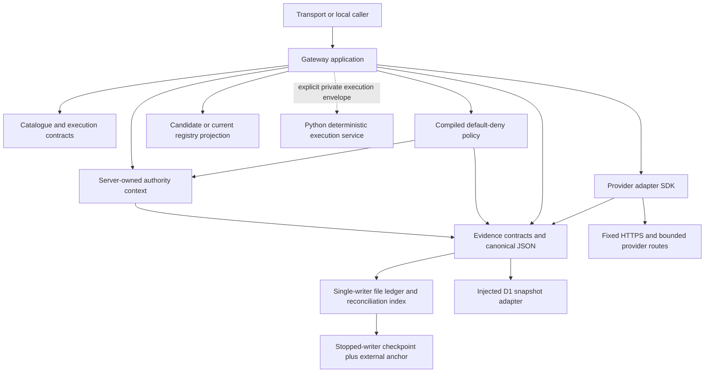
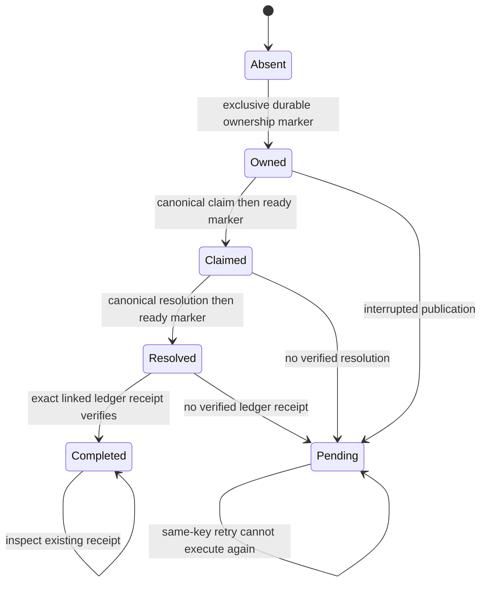
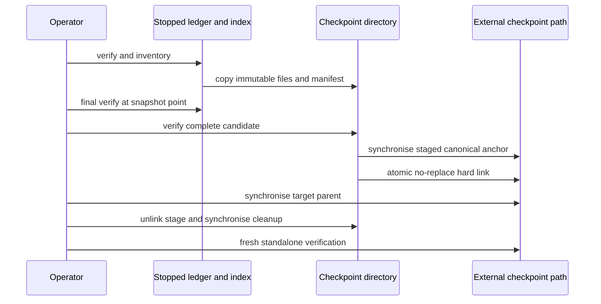

# Core libraries, evidence and deterministic execution

This is an implementation description at commit `97bc45635a91064cd78f06bf0848ad7636f05439`. Every Git link pins that revision so subsequent comments and refactoring cannot silently change the cited evidence. The formulae below specify observed behaviour and its preconditions; they are not machine-checked proofs. The accompanying [review](REVIEW.md) separates removal candidates, maintainability findings and intentional boundaries.

## Component responsibilities

| Component | Responsibility and trust boundary | Implementation evidence |
| --- | --- | --- |
| `contracts` | Catalogue parsing, public records, deterministic filtering/search/facets and execution-envelope TypeScript declarations. Runtime validation is still needed for external values. | [catalogue semantics](https://github.com/chris-page-gov/gis-ai-go/blob/97bc45635a91064cd78f06bf0848ad7636f05439/packages/contracts/src/catalogue/catalogue.ts#L1-L80); [execution declarations](https://github.com/chris-page-gov/gis-ai-go/blob/97bc45635a91064cd78f06bf0848ad7636f05439/packages/contracts/src/execution/types.ts#L1-L135) |
| `authority-context` | Constructs frozen anonymous-open contexts entirely from server constants. Three versions describe catalogue, bounded public read and current-call inspection. These are scope statements, not signed-in identities. | [catalogue authority](https://github.com/chris-page-gov/gis-ai-go/blob/97bc45635a91064cd78f06bf0848ad7636f05439/packages/authority-context/src/index.ts#L10-L53); [public-read authority](https://github.com/chris-page-gov/gis-ai-go/blob/97bc45635a91064cd78f06bf0848ad7636f05439/packages/authority-context/src/public-read-v2.ts#L10-L48); [inspection authority](https://github.com/chris-page-gov/gis-ai-go/blob/97bc45635a91064cd78f06bf0848ad7636f05439/packages/authority-context/src/evidence-inspect-v3.ts#L10-L51) |
| `policy-client` | Verifies checked-in compiled JSON against the expected policy and evaluates explicit default-deny rules. It does not call an external policy engine. | [catalogue policy](https://github.com/chris-page-gov/gis-ai-go/blob/97bc45635a91064cd78f06bf0848ad7636f05439/packages/policy-client/src/index.ts#L27-L73); [public-read policy](https://github.com/chris-page-gov/gis-ai-go/blob/97bc45635a91064cd78f06bf0848ad7636f05439/packages/policy-client/src/public-read-v2.ts#L34-L81); [inspection policy](https://github.com/chris-page-gov/gis-ai-go/blob/97bc45635a91064cd78f06bf0848ad7636f05439/packages/policy-client/src/evidence-inspect-v3.ts#L28-L68) |
| `evidence` | Canonical JSON, content hashes, receipts, file ledger, reconciliation, checkpoint/recovery and a separate CPIH snapshot model/D1 adapter. It verifies input material independently of TypeScript declarations. | [canonical JSON](https://github.com/chris-page-gov/gis-ai-go/blob/97bc45635a91064cd78f06bf0848ad7636f05439/packages/evidence/src/canonical-json.ts#L127-L254); [file ledger](https://github.com/chris-page-gov/gis-ai-go/blob/97bc45635a91064cd78f06bf0848ad7636f05439/packages/evidence/src/public-ledger.ts#L1109-L1213); [reconciliation engine](https://github.com/chris-page-gov/gis-ai-go/blob/97bc45635a91064cd78f06bf0848ad7636f05439/packages/evidence/src/reconciliation-index.ts#L1283-L1343); [checkpoint creation](https://github.com/chris-page-gov/gis-ai-go/blob/97bc45635a91064cd78f06bf0848ad7636f05439/packages/evidence/src/checkpoint.ts#L2110-L2251); [D1 snapshot adapter](https://github.com/chris-page-gov/gis-ai-go/blob/97bc45635a91064cd78f06bf0848ad7636f05439/packages/evidence/src/web216-transactional-d1.ts#L62-L174) |
| `provider-adapter-sdk` | Versioned provider descriptions, independent discovery/invocation lifecycle, source-native results, fixed HTTPS, ONS admission/retry handling, approved-cache reading and private Sites provider calls. | [adapter contracts](https://github.com/chris-page-gov/gis-ai-go/blob/97bc45635a91064cd78f06bf0848ad7636f05439/packages/provider-adapter-sdk/src/types.ts#L1-L225); [pinned HTTPS transport](https://github.com/chris-page-gov/gis-ai-go/blob/97bc45635a91064cd78f06bf0848ad7636f05439/packages/provider-adapter-sdk/src/fixed-https.ts#L334-L504); [ONS adapter](https://github.com/chris-page-gov/gis-ai-go/blob/97bc45635a91064cd78f06bf0848ad7636f05439/packages/provider-adapter-sdk/src/ons-data-api.ts#L840-L882); [approved-cache read](https://github.com/chris-page-gov/gis-ai-go/blob/97bc45635a91064cd78f06bf0848ad7636f05439/packages/provider-adapter-sdk/src/ons-approved-cache.ts#L400-L467); [Sites provider calls](https://github.com/chris-page-gov/gis-ai-go/blob/97bc45635a91064cd78f06bf0848ad7636f05439/packages/provider-adapter-sdk/src/sites-pilot-providers.ts#L150-L366) |
| `tool-registry` | Validates governance metadata and returns separate candidate and currently callable projections. Twelve profiles exist; five can enter the candidate assembly. Profile presence does not activate a public tool. | [registry projections](https://github.com/chris-page-gov/gis-ai-go/blob/97bc45635a91064cd78f06bf0848ad7636f05439/packages/tool-registry/src/registry.ts#L718-L759) |
| `geo-execution` | Python execution of one bounded synthetic point-in-polygon operation behind a loopback-only HTTP adapter; independent request checking and controlled errors. | [execution service](https://github.com/chris-page-gov/gis-ai-go/blob/97bc45635a91064cd78f06bf0848ad7636f05439/services/geo-execution/src/gis_ai_go_execution/service.py#L207-L253); [private HTTP server](https://github.com/chris-page-gov/gis-ai-go/blob/97bc45635a91064cd78f06bf0848ad7636f05439/services/geo-execution/src/gis_ai_go_execution/http.py#L241-L310) |



Arrows represent dependencies or explicit calls, not universal activation. In particular the Python service is not the ONS adapter's execution host. The private Sites subpath has its own bounded fetch contract and admission callback; it does not inherit the Node ONS adapter's DNS-pinning implementation. The evidence `web216-pure` subpath excludes file-ledger/checkpoint imports but still needs Node-compatible crypto/util ([pure subpath exports](https://github.com/chris-page-gov/gis-ai-go/blob/97bc45635a91064cd78f06bf0848ad7636f05439/packages/evidence/src/web216-pure.ts#L1-L13)). Public release activation remains the gateway's responsibility.

## A contract, explained through a real call

A contract is an agreement between two pieces of software: which inputs are accepted, which outputs can be returned, and what must remain true while work happens. A TypeScript interface helps a programmer prepare a value; it cannot make an arbitrary JSON request trustworthy after the program has started. Runtime validators enforce the agreement. A JSON Schema documents and checks the shape; a semantic validator also checks relationships, such as whether a dataset version is the reviewed version.

Consider the repository's weekly-deaths example. The SDK admits only dataset `weekly-deaths-region`, edition `time-series`, version `121`, with ordered selections `time=2026`, `geography=E92000001`, `week=week-24` and `causeofdeath=all-causes` ([fixed ONS identity and selections](https://github.com/chris-page-gov/gis-ai-go/blob/97bc45635a91064cd78f06bf0848ad7636f05439/packages/provider-adapter-sdk/src/ons-data-api.ts#L235-L271)). Requesting another week needs a separately reviewed resource; changing a string in an example does not extend the contract. The public-read policy compares the selected resource with its exact content-addressed constant before allowing the operation ([approved resource predicate](https://github.com/chris-page-gov/gis-ai-go/blob/97bc45635a91064cd78f06bf0848ad7636f05439/packages/policy-client/src/public-read-v2.ts#L142-L147)).

A successful response has several related agreements:

1. **Authority:** the server describes its anonymous, public, read-only scope; the caller supplies no authority claims ([public-read authority](https://github.com/chris-page-gov/gis-ai-go/blob/97bc45635a91064cd78f06bf0848ad7636f05439/packages/authority-context/src/public-read-v2.ts#L10-L48)).
2. **Policy:** the permitted operation and resource must match a rule, and required evidence obligations follow the allow decision ([public-read decision](https://github.com/chris-page-gov/gis-ai-go/blob/97bc45635a91064cd78f06bf0848ad7636f05439/packages/policy-client/src/public-read-v2.ts#L193-L247)).
3. **Provider:** the adapter validates the fixed query, controls transport bounds and preserves native identifiers and rights ([fixed query parser](https://github.com/chris-page-gov/gis-ai-go/blob/97bc45635a91064cd78f06bf0848ad7636f05439/packages/provider-adapter-sdk/src/ons-data-api.ts#L410-L442); [bounded ONS execution](https://github.com/chris-page-gov/gis-ai-go/blob/97bc45635a91064cd78f06bf0848ad7636f05439/packages/provider-adapter-sdk/src/ons-data-api.ts#L932-L1043)).
4. **Receipt:** the receipt binds normalised parameters, result, authority, policy, resource, software and call identifiers. Its body says `inline-only`, `not-persisted`, `not-attested` ([public-read receipt builder](https://github.com/chris-page-gov/gis-ai-go/blob/97bc45635a91064cd78f06bf0848ad7636f05439/packages/evidence/src/public-read-receipt.ts#L1802-L1890)).
5. **Durable storage, when configured:** the original receipt remains unchanged inside a new record. A separate storage reference is returned only after the record and linked event verify ([receipt persistence sequence](https://github.com/chris-page-gov/gis-ai-go/blob/97bc45635a91064cd78f06bf0848ad7636f05439/packages/evidence/src/public-ledger.ts#L1363-L1450)).
6. **Recovery:** the caller's idempotency key can locate the existing receipt when a response is lost. It does not cause the old result to be recomputed ([reconciliation lookup](https://github.com/chris-page-gov/gis-ai-go/blob/97bc45635a91064cd78f06bf0848ad7636f05439/packages/evidence/src/reconciliation-index.ts#L1623-L1659)).

A hash is a content fingerprint: equal canonical content produces an equal fingerprint under the same domain. It does not identify a person, prove permission, sign a result or prove a file was saved. The code therefore keeps content equality, authorisation, storage acknowledgement and external checkpoint evidence as separate contracts. For the repository-wide schema catalogue and other client contracts, see the [beginner contracts guide](CONTRACTS.md) and [complete contract register](CONTRACT_REGISTER.md).

### Evidence families in use

| Family | Permitted meaning | Evidence |
| --- | --- | --- |
| `evidence-receipt.v1` | Successful catalogue search/description; digest of normalised request and exact catalogue/result/licence bindings. | [catalogue receipt builder](https://github.com/chris-page-gov/gis-ai-go/blob/97bc45635a91064cd78f06bf0848ad7636f05439/packages/evidence/src/receipt.ts#L1524-L1601) |
| `evidence-receipt.v2` | Successful `selection.resolve` or exact approved `data.query`; binds reviewed resource, selections and live/cache provenance. | [public-read receipt builder](https://github.com/chris-page-gov/gis-ai-go/blob/97bc45635a91064cd78f06bf0848ad7636f05439/packages/evidence/src/public-read-receipt.ts#L1802-L1890) |
| `evidence-receipt.v3` | A new successful `evidence.inspect` call; binds the safe lookup digest and exact stored evidence projection. Inline only; creates no new ledger event. | [inspection receipt builder](https://github.com/chris-page-gov/gis-ai-go/blob/97bc45635a91064cd78f06bf0848ad7636f05439/packages/evidence/src/evidence-inspect-receipt.ts#L800-L860) |
| `web216-cpih-receipt.v1` | Read one of two pinned captured CPIH observations, January or July 2026, with no provider egress. Captured currency is explicit. | [captured CPIH scope and result](https://github.com/chris-page-gov/gis-ai-go/blob/97bc45635a91064cd78f06bf0848ad7636f05439/packages/evidence/src/web216-cpih-receipt.ts#L22-L169) |
| `public-evidence-record.v1 / v2 / v3` | Durable wrappers for catalogue v1, public-read v2 and CPIH receipts respectively. Record v3 does **not** mean inspection receipt v3. | [stored record families](https://github.com/chris-page-gov/gis-ai-go/blob/97bc45635a91064cd78f06bf0848ad7636f05439/packages/evidence/src/public-ledger.ts#L147-L216) |
| Ledger descriptor and event v1 | Fixed public storage scope and retention, append order, prior-event hash, receipt/record linkage and replay identity. | [ledger descriptor/event contracts](https://github.com/chris-page-gov/gis-ai-go/blob/97bc45635a91064cd78f06bf0848ad7636f05439/packages/evidence/src/public-ledger.ts#L115-L244) |
| Reconciliation descriptor, claim and resolution | Digest-only ownership of a semantic request and its eventual receipt; a separate CPIH family uses the same file engine behind a branded facade. | [claim and resolution contracts](https://github.com/chris-page-gov/gis-ai-go/blob/97bc45635a91064cd78f06bf0848ad7636f05439/packages/evidence/src/reconciliation-index.ts#L104-L243); [CPIH index facade](https://github.com/chris-page-gov/gis-ai-go/blob/97bc45635a91064cd78f06bf0848ad7636f05439/packages/evidence/src/reconciliation-index.ts#L1325-L1343) |
| Checkpoint manifest and external checkpoint | Exact inventory and logical state of the legacy public-read ledger/index pair captured with its writer stopped. | [checkpoint contracts](https://github.com/chris-page-gov/gis-ai-go/blob/97bc45635a91064cd78f06bf0848ad7636f05439/packages/evidence/src/checkpoint.ts#L120-L232); [legacy pair opener](https://github.com/chris-page-gov/gis-ai-go/blob/97bc45635a91064cd78f06bf0848ad7636f05439/packages/evidence/src/checkpoint.ts#L1820-L1838) |
| CPIH transactional descriptor, record, event, head, snapshot and append plan | Pure all-or-none state transition; an independent D1 adapter performs conditional publication/read-back. | [pure transactional model](https://github.com/chris-page-gov/gis-ai-go/blob/97bc45635a91064cd78f06bf0848ad7636f05439/packages/evidence/src/web216-transactional-contract.ts#L193-L284); [D1 snapshot adapter](https://github.com/chris-page-gov/gis-ai-go/blob/97bc45635a91064cd78f06bf0848ad7636f05439/packages/evidence/src/web216-transactional-d1.ts#L62-L174) |
| Execution request/result/problem/evidence v1 | Private synthetic execution envelope, bounded failure and content fingerprints of input/result. | [execution declarations](https://github.com/chris-page-gov/gis-ai-go/blob/97bc45635a91064cd78f06bf0848ad7636f05439/packages/contracts/src/execution/types.ts#L1-L135); [execution service](https://github.com/chris-page-gov/gis-ai-go/blob/97bc45635a91064cd78f06bf0848ad7636f05439/services/geo-execution/src/gis_ai_go_execution/service.py#L207-L253) |
| Provider description/query/result/error/rights/trace/egress contracts | What an adapter can do and the source-native evidence it must return, with closed transport bounds. | [adapter contracts](https://github.com/chris-page-gov/gis-ai-go/blob/97bc45635a91064cd78f06bf0848ad7636f05439/packages/provider-adapter-sdk/src/types.ts#L1-L225); [fixed egress contract](https://github.com/chris-page-gov/gis-ai-go/blob/97bc45635a91064cd78f06bf0848ad7636f05439/packages/provider-adapter-sdk/src/contract.ts#L72-L207) |

The legacy inspection policy refuses CPIH record v3; its dedicated application owns that inspection route ([legacy inspection family refusal](https://github.com/chris-page-gov/gis-ai-go/blob/97bc45635a91064cd78f06bf0848ad7636f05439/packages/policy-client/src/evidence-inspect-v3.ts#L89-L108)). Similar names and version numbers are not a licence to pass records between families.

## Canonical content and receipt specification

Let `J(x)` be the UTF-8 encoding of the accepted RFC 8785-style canonical JSON value, and `P = "GIS-AI-GO\0canonical-json\0sha256\0v1\0"`. For a valid versioned domain `d`:

```text
H(d, x) = hex(SHA256(UTF8(P) || UTF8(d) || 0x00 || J(x)))
ID(prefix, d, x) = prefix || ":sha256:" || H(d, x)
```

`J` accepts finite JSON numbers, strings with paired surrogates, plain objects and dense ordinary arrays. It rejects proxies, getters, cycles, sparse arrays, non-enumerable or symbol properties and values outside the JSON data model. Object key order is UTF-16 code-unit order, not locale order; array order is preserved. `canonicalJsonClone(x)` validates, detaches and recursively freezes the parsed canonical value ([canonical JSON](https://github.com/chris-page-gov/gis-ai-go/blob/97bc45635a91064cd78f06bf0848ad7636f05439/packages/evidence/src/canonical-json.ts#L127-L254); [domain-separated identities](https://github.com/chris-page-gov/gis-ai-go/blob/97bc45635a91064cd78f06bf0848ad7636f05439/packages/evidence/src/digest.ts#L74-L120)). Python independently implements the bounded execution subset and shares regression vectors with the gateway ([Python canonical subset](https://github.com/chris-page-gov/gis-ai-go/blob/97bc45635a91064cd78f06bf0848ad7636f05439/services/geo-execution/src/gis_ai_go_execution/canonical.py#L22-L111); [cross-language digest vectors](https://github.com/chris-page-gov/gis-ai-go/blob/97bc45635a91064cd78f06bf0848ad7636f05439/services/geo-execution/tests/test_service.py#L141-L167)).

For a receipt builder `B`, successful return `r = B(i)` implies the relationships below. `parameter_digest` and `result_digest` abbreviate the receipt's nested `operation.normalised_parameters.sha256` and `result.sha256`; `policy` and `result` denote the corresponding decision and receipt-free result core:

```text
ValidShape(r) and ValidIdentity(r)
r.parameter_digest = H(parameter_domain(operation), i.normalisedParameters)
r.result_digest = H(result_domain(operation), i.resultCore)
r.request_id = policy.request_id = result.request_id
r.trace_id = policy.trace_id = result.trace_id
policy.effect = allow-with-obligations
embedded authority/policy/resource/catalogue identities match the operation family
```

The exact predicates differ by family: catalogue receipts additionally cover each returned record's licence obligations; public-read receipts pin approved resource, selections and result shape; inspection receipts bind the inspected receipt, record, event and ledger tuple. Builders reject incompatible operation families and denied or malformed success material. Full verification recomputes these bindings with independently supplied material; structure-only verification cannot recreate original results that were not retained ([catalogue receipt builder](https://github.com/chris-page-gov/gis-ai-go/blob/97bc45635a91064cd78f06bf0848ad7636f05439/packages/evidence/src/receipt.ts#L1524-L1601); [public-read receipt builder](https://github.com/chris-page-gov/gis-ai-go/blob/97bc45635a91064cd78f06bf0848ad7636f05439/packages/evidence/src/public-read-receipt.ts#L1802-L1890); [inspection receipt builder](https://github.com/chris-page-gov/gis-ai-go/blob/97bc45635a91064cd78f06bf0848ad7636f05439/packages/evidence/src/evidence-inspect-receipt.ts#L800-L860); [full catalogue verification](https://github.com/chris-page-gov/gis-ai-go/blob/97bc45635a91064cd78f06bf0848ad7636f05439/packages/evidence/src/receipt.ts#L1648-L1746)).

## File ledger and reconciliation protocol

The file ledger root contains exactly `ledger.json`, `records/` and `events/`. Each file contains canonical JSON plus its required terminator; file identity, canonical encoding and content identity are checked. POSIX directories must be `0700`, files `0600`, with ordinary file/directory and identity checks. The descriptor fixes minimum retention; no expiry/deletion procedure exists ([safe file reads/writes](https://github.com/chris-page-gov/gis-ai-go/blob/97bc45635a91064cd78f06bf0848ad7636f05439/packages/evidence/src/public-ledger.ts#L394-L623); [complete ledger verification](https://github.com/chris-page-gov/gis-ai-go/blob/97bc45635a91064cd78f06bf0848ad7636f05439/packages/evidence/src/public-ledger.ts#L1227-L1345)).

For verified ledger `L = (descriptor, records, events)` of size `n`:

```text
0 <= n <= 1,000,000
|records| = |events| = n
for i in 1..n: events[i].sequence = i
for i > 1: events[i].previous_event_id = events[i-1].event_id
if n > 0: events[1].previous_event_id = null
all record IDs, receipt IDs and replay keys are unique
for every event e: exactly one referenced record exists and its receipt matches e
```

`persistReceipt(r,m)` requires a verified ledger, full-material-valid receipt `r`, privacy-safe content, absent replay binding and remaining capacity. It creates/synchronises a record, then its event, then verifies the complete ledger before returning a storage reference. These are two writes, not an atomic transaction. An interrupted record-only publication is an orphan and causes verification failure; restoration, rather than silent repair, is the supported recovery. A single writer must own the ledger. A hash chain alone cannot detect deletion of an otherwise self-consistent entire tail without an independent anchor ([receipt persistence sequence](https://github.com/chris-page-gov/gis-ai-go/blob/97bc45635a91064cd78f06bf0848ad7636f05439/packages/evidence/src/public-ledger.ts#L1363-L1450); [ledger corruption regressions](https://github.com/chris-page-gov/gis-ai-go/blob/97bc45635a91064cd78f06bf0848ad7636f05439/packages/evidence/test/public-ledger.test.ts#L348-L434)).



The diagram describes externally observable recovery states; `Pending` can be observed at any intermediate stage. There is no expiry transition back to `Absent`. The implementation does not promise progress from an interrupted ownership claim.

Let `k` be the operation-scoped digest of a valid, non-zero caller key, and `f` the digest of the semantic request (operation, reviewed resource and parameter digest). The index implements:

```text
claim(k, f):
  existing claim with different fingerprint -> conflict
  existing completed claim with same fingerprint -> completed(existing receipt)
  existing ownership without completed evidence -> pending
  absent key and owned_count < 4,096 -> publish owner; claim; claim-ready -> claimed
  absent key at capacity -> capacity error, no new ownership
```

Only `claimed` grants the application a first execution path. Resolution must be published before ledger persistence. Completion requires both stores to agree on claim, receipt, record, event and storage reference. The raw key, original result and query parameters are absent from the persisted index. Existing keys are checked before capacity, preserving recovery when the store is full ([claim admission/publication](https://github.com/chris-page-gov/gis-ai-go/blob/97bc45635a91064cd78f06bf0848ad7636f05439/packages/evidence/src/reconciliation-index.ts#L1513-L1547); [resolution before persistence](https://github.com/chris-page-gov/gis-ai-go/blob/97bc45635a91064cd78f06bf0848ad7636f05439/packages/evidence/src/reconciliation-index.ts#L1557-L1621); [reconciliation lookup](https://github.com/chris-page-gov/gis-ai-go/blob/97bc45635a91064cd78f06bf0848ad7636f05439/packages/evidence/src/reconciliation-index.ts#L1623-L1659); [reconciliation regression cases](https://github.com/chris-page-gov/gis-ai-go/blob/97bc45635a91064cd78f06bf0848ad7636f05439/packages/evidence/test/reconciliation-index.test.ts#L100-L177)). Same-key exclusion across processes sharing the index does not coordinate unrelated ledger writers.

## Checkpoint and restore specification

The checkpoint helpers apply to the **legacy public-read** file ledger/index pair: `openPairAtRoots` and restore use `PublicEvidenceReconciliationIndex.open`, not the CPIH facade. D1 snapshots have a separate contract and do not inherit these restore helpers ([legacy pair opener](https://github.com/chris-page-gov/gis-ai-go/blob/97bc45635a91064cd78f06bf0848ad7636f05439/packages/evidence/src/checkpoint.ts#L1820-L1838); [empty-root restore](https://github.com/chris-page-gov/gis-ai-go/blob/97bc45635a91064cd78f06bf0848ad7636f05439/packages/evidence/src/checkpoint.ts#L2444-L2530)).

Creation preconditions are: writer stopped; existing valid, private source roots; disjoint new backup/external paths; no pre-existing output. The caller's `stoppedSingleWriter: true` is an operational assertion, not a mechanism that stops processes. Before/after/final inventory checks detect visible concurrent changes around the declared snapshot point ([checkpoint creation](https://github.com/chris-page-gov/gis-ai-go/blob/97bc45635a91064cd78f06bf0848ad7636f05439/packages/evidence/src/checkpoint.ts#L2110-L2251)).



Success implies verified copied file inventories, matching logical ledger/index state, a matching external commit record and completed publication durability checks. Ambiguous interrupted publication returns an error and requires bounded reconciliation with an exclusive owner; it never becomes success merely because a filename exists. Restore requires already-existing empty private disjoint destination roots, verifies the backup before copying and verifies both restored stores against the external checkpoint afterwards ([checkpoint creation](https://github.com/chris-page-gov/gis-ai-go/blob/97bc45635a91064cd78f06bf0848ad7636f05439/packages/evidence/src/checkpoint.ts#L2110-L2251); [external publication state machine](https://github.com/chris-page-gov/gis-ai-go/blob/97bc45635a91064cd78f06bf0848ad7636f05439/packages/evidence/src/checkpoint.ts#L1561-L1718); [empty-root restore](https://github.com/chris-page-gov/gis-ai-go/blob/97bc45635a91064cd78f06bf0848ad7636f05439/packages/evidence/src/checkpoint.ts#L2444-L2530); [publication interruption regression](https://github.com/chris-page-gov/gis-ai-go/blob/97bc45635a91064cd78f06bf0848ad7636f05439/packages/evidence/test/checkpoint-recovery.test.ts#L483-L615)).

## CPIH snapshot model and D1 publication

CPIH's separate pure model caps a store at 128 records and 365 days minimum retention. It validates the independently supplied software, store ID and pinned projection. An optional independently retained checkpoint detects self-consistent rollback. Plans are module-branded in a `WeakSet`; copying a valid plan's JSON does not grant plan authority ([pure transactional model](https://github.com/chris-page-gov/gis-ai-go/blob/97bc45635a91064cd78f06bf0848ad7636f05439/packages/evidence/src/web216-transactional-contract.ts#L193-L284); [state/model regression cases](https://github.com/chris-page-gov/gis-ai-go/blob/97bc45635a91064cd78f06bf0848ad7636f05439/packages/evidence/test/web216-transactional-contract.test.ts#L86-L155)).

For current state `S` and generated plan `p`:

```text
Pre: verify(S, material); branded(p); p.expected_head = S.head; same store ID
Post: S'.records = S.records ++ [p.record]
      S'.events  = S.events  ++ [p.event]
      S'.head.sequence = S.head.sequence + 1
      S'.head.tail_event_id = p.event.event_id
      verify(S', material pinned to p.next_head)
```

The D1 adapter serialises the complete state into a single bounded row (at most 1 MiB). Its conditional `UPDATE` compares store ID, checkpoint ID and sequence. Zero changed rows mean `stale-head`; successful acknowledgement is followed by a verified read-back containing the exact record. A lost acknowledgement, aborted call after write issuance or failed read-back means `uncertain-write`. A timeout cannot be interpreted as proof the write did not occur ([conditional single-row SQL](https://github.com/chris-page-gov/gis-ai-go/blob/97bc45635a91064cd78f06bf0848ad7636f05439/packages/evidence/src/web216-transactional-d1.ts#L14-L33); [conditional write and verified read-back](https://github.com/chris-page-gov/gis-ai-go/blob/97bc45635a91064cd78f06bf0848ad7636f05439/packages/evidence/src/web216-transactional-d1.ts#L130-L170); [D1/SQLite failure regressions](https://github.com/chris-page-gov/gis-ai-go/blob/97bc45635a91064cd78f06bf0848ad7636f05439/packages/evidence/test/web216-transactional-d1.test.ts#L80-L192)). This adapter never provisions the table, creates plans, calls a provider or retries writes automatically.

## Provider and policy boundaries

`AdapterLifecycle.discovery` and `.invocation` are independent; defaults suspend both. A provider's appearance in metadata does not authorise execution. `estimate` distinguishes exact fixture observations/bytes from live upper bounds ([adapter contracts](https://github.com/chris-page-gov/gis-ai-go/blob/97bc45635a91064cd78f06bf0848ad7636f05439/packages/provider-adapter-sdk/src/types.ts#L1-L225); [default suspended lifecycle](https://github.com/chris-page-gov/gis-ai-go/blob/97bc45635a91064cd78f06bf0848ad7636f05439/packages/provider-adapter-sdk/src/ons-data-api.ts#L386-L408)).

The exact ONS adapter internally constructs one URL. The fixed-egress contract checks HTTPS origin/path, raw query spelling and ordered decoded pairs, method, no caller credentials and zero redirects. DNS answers must be public; the selected address is pinned through TLS hostname/certificate verification and checked against the connected remote address. The adapter owns one process-wide concurrent call, 30 actual attempt starts per minute, a 20-second total deadline, at most two attempts, bounded decompression/JSON and controlled errors ([fixed egress contract](https://github.com/chris-page-gov/gis-ai-go/blob/97bc45635a91064cd78f06bf0848ad7636f05439/packages/provider-adapter-sdk/src/contract.ts#L72-L207); [pinned HTTPS transport](https://github.com/chris-page-gov/gis-ai-go/blob/97bc45635a91064cd78f06bf0848ad7636f05439/packages/provider-adapter-sdk/src/fixed-https.ts#L334-L504); [process admission and attempt budget](https://github.com/chris-page-gov/gis-ai-go/blob/97bc45635a91064cd78f06bf0848ad7636f05439/packages/provider-adapter-sdk/src/ons-data-api.ts#L152-L233); [bounded ONS execution](https://github.com/chris-page-gov/gis-ai-go/blob/97bc45635a91064cd78f06bf0848ad7636f05439/packages/provider-adapter-sdk/src/ons-data-api.ts#L932-L1043)).

Approved-cache eligibility is a separate provenance contract. The gateway's pristine execution wrapper issues a one-use capability tied to the exact caught error and invocation; arbitrary errors or JSON lookalikes do not establish that provenance. The cache reader separately verifies the accepted record and checks matching policy/resource/query, eligible outage classification and `approved_at <= checked_at < stale_after` ([one-call outage capability](https://github.com/chris-page-gov/gis-ai-go/blob/97bc45635a91064cd78f06bf0848ad7636f05439/packages/provider-adapter-sdk/src/ons-data-api.ts#L1234-L1256); [approved-cache read](https://github.com/chris-page-gov/gis-ai-go/blob/97bc45635a91064cd78f06bf0848ad7636f05439/packages/provider-adapter-sdk/src/ons-approved-cache.ts#L400-L467)). The cache class is a deterministic reader, not an independent authorisation decision.

Private Sites providers use injected `fetch`, `admit`, clock and optional OS credential; bounded routes construct provider URLs internally, refuse redirects, cap time/body size and normalise results. The admission callback runs before each upstream request. No request query/credential is included in the endpoint used for admission. This is a distinct provider plane with its own result envelope ([Sites provider calls](https://github.com/chris-page-gov/gis-ai-go/blob/97bc45635a91064cd78f06bf0848ad7636f05439/packages/provider-adapter-sdk/src/sites-pilot-providers.ts#L150-L366)).

## Deterministic Python execution

The private service accepts only `fixture.features.query`. It validates a closed request, exact fixture/source/rights, `EPSG:4326`, longitude-latitude axis order, an explicit future deadline no more than 30 seconds away and bounded byte/feature/geometry/complexity limits. `gateway_authorisation` fields must be structurally valid and name the operation, but the service does not authenticate their sender or re-evaluate a policy decision ([independent execution validation](https://github.com/chris-page-gov/gis-ai-go/blob/97bc45635a91064cd78f06bf0848ad7636f05439/services/geo-execution/src/gis_ai_go_execution/service.py#L276-L382)).

For a simple, closed, single outer ring `R` and the five sorted fixture points `F`, define `inside` using the implementation's planar ray-casting and boundary tolerance. With accepted limit `l`:

```text
1 <= l <= max_features <= 100
4 <= |R| <= max_coordinates <= 128
complexity = (|R|-1)^2 + |F| <= max_complexity <= 20,000
selected = take(l, [p in sort_by_id(F) where inside_or_boundary(p, R)])
output.evidence.input_sha256 = H("gis-ai-go.execution-parameters.v1", request.parameters)
output.evidence.output_sha256 = H("gis-ai-go.execution-result-data.v1", output.data)
canonical_size(output) <= max_output_bytes <= 262,144
```

Geometry validation rejects non-finite/out-of-range coordinates, unclosed/degenerate rings and self-intersections. It performs no geometry repair, simplification, reprojection, geodesic calculation or provider fetch. Boundary membership uses a `1e-12` tolerance; this is the bounded fictional fixture algorithm, not a general GIS engine. Cancellation/deadline checks occur at bounded per-feature checkpoints, and active request IDs are removed in `finally` ([bounded polygon algorithm](https://github.com/chris-page-gov/gis-ai-go/blob/97bc45635a91064cd78f06bf0848ad7636f05439/services/geo-execution/src/gis_ai_go_execution/geometry.py#L13-L132); [deterministic fixture execution](https://github.com/chris-page-gov/gis-ai-go/blob/97bc45635a91064cd78f06bf0848ad7636f05439/services/geo-execution/src/gis_ai_go_execution/service.py#L384-L450); [geometry and execution limits tests](https://github.com/chris-page-gov/gis-ai-go/blob/97bc45635a91064cd78f06bf0848ad7636f05439/services/geo-execution/tests/test_service.py#L214-L316)).

The HTTP adapter binds `127.0.0.1`, checks loopback peer and Host, accepts strict bounded JSON, caps active connection handlers at eight and rejects the ninth before creating another handler thread. Problem responses use a closed safe vocabulary rather than raw exceptions ([private HTTP server](https://github.com/chris-page-gov/gis-ai-go/blob/97bc45635a91064cd78f06bf0848ad7636f05439/services/geo-execution/src/gis_ai_go_execution/http.py#L241-L310); [HTTP handler capacity](https://github.com/chris-page-gov/gis-ai-go/blob/97bc45635a91064cd78f06bf0848ad7636f05439/services/geo-execution/src/gis_ai_go_execution/http.py#L261-L303); [real loopback capacity test](https://github.com/chris-page-gov/gis-ai-go/blob/97bc45635a91064cd78f06bf0848ad7636f05439/services/geo-execution/tests/test_http.py#L184-L249)).

## Review coverage and limitations

Every source file below was inventoried and inspected for exports/imports, entry points and references. `boundary/state` means direct reading of implementation boundaries and state transitions; `indexed/targeted` means declaration/reference review plus targeted portions, not an exhaustive line-by-line proof. Tests and package manifests were inventoried, with test entry points and named regression cases used as evidence. The separate contracts review covers catalogue internals and schema/type consistency. No external provider was called and no infrastructure was changed by this review. Static reference absence cannot rule out external consumers of exported package APIs.

| Reviewed source file | Depth |
| --- | --- |
| [packages/authority-context/src/evidence-inspect-v3.ts](https://github.com/chris-page-gov/gis-ai-go/blob/97bc45635a91064cd78f06bf0848ad7636f05439/packages/authority-context/src/evidence-inspect-v3.ts#L1) | boundary/state |
| [packages/authority-context/src/index.ts](https://github.com/chris-page-gov/gis-ai-go/blob/97bc45635a91064cd78f06bf0848ad7636f05439/packages/authority-context/src/index.ts#L1) | boundary/state |
| [packages/authority-context/src/public-read-v2.ts](https://github.com/chris-page-gov/gis-ai-go/blob/97bc45635a91064cd78f06bf0848ad7636f05439/packages/authority-context/src/public-read-v2.ts#L1) | boundary/state |
| [packages/contracts/src/catalogue/catalogue.ts](https://github.com/chris-page-gov/gis-ai-go/blob/97bc45635a91064cd78f06bf0848ad7636f05439/packages/contracts/src/catalogue/catalogue.ts#L1) | indexed; catalogue/contract review delegated to contract catalogue reviewer |
| [packages/contracts/src/catalogue/index.ts](https://github.com/chris-page-gov/gis-ai-go/blob/97bc45635a91064cd78f06bf0848ad7636f05439/packages/contracts/src/catalogue/index.ts#L1) | indexed; catalogue/contract review delegated to contract catalogue reviewer |
| [packages/contracts/src/catalogue/links.ts](https://github.com/chris-page-gov/gis-ai-go/blob/97bc45635a91064cd78f06bf0848ad7636f05439/packages/contracts/src/catalogue/links.ts#L1) | indexed; catalogue/contract review delegated to contract catalogue reviewer |
| [packages/contracts/src/catalogue/types.ts](https://github.com/chris-page-gov/gis-ai-go/blob/97bc45635a91064cd78f06bf0848ad7636f05439/packages/contracts/src/catalogue/types.ts#L1) | indexed; catalogue/contract review delegated to contract catalogue reviewer |
| [packages/contracts/src/execution/index.ts](https://github.com/chris-page-gov/gis-ai-go/blob/97bc45635a91064cd78f06bf0848ad7636f05439/packages/contracts/src/execution/index.ts#L1) | indexed; catalogue/contract review delegated to contract catalogue reviewer |
| [packages/contracts/src/execution/types.ts](https://github.com/chris-page-gov/gis-ai-go/blob/97bc45635a91064cd78f06bf0848ad7636f05439/packages/contracts/src/execution/types.ts#L1) | indexed; catalogue/contract review delegated to contract catalogue reviewer |
| [packages/contracts/src/index.ts](https://github.com/chris-page-gov/gis-ai-go/blob/97bc45635a91064cd78f06bf0848ad7636f05439/packages/contracts/src/index.ts#L1) | indexed; catalogue/contract review delegated to contract catalogue reviewer |
| [packages/evidence/src/canonical-json.ts](https://github.com/chris-page-gov/gis-ai-go/blob/97bc45635a91064cd78f06bf0848ad7636f05439/packages/evidence/src/canonical-json.ts#L1) | boundary/state |
| [packages/evidence/src/checkpoint-publication-test-seam.ts](https://github.com/chris-page-gov/gis-ai-go/blob/97bc45635a91064cd78f06bf0848ad7636f05439/packages/evidence/src/checkpoint-publication-test-seam.ts#L1) | boundary/state |
| [packages/evidence/src/checkpoint.ts](https://github.com/chris-page-gov/gis-ai-go/blob/97bc45635a91064cd78f06bf0848ad7636f05439/packages/evidence/src/checkpoint.ts#L1) | boundary/state; supporting validators indexed/targeted |
| [packages/evidence/src/digest.ts](https://github.com/chris-page-gov/gis-ai-go/blob/97bc45635a91064cd78f06bf0848ad7636f05439/packages/evidence/src/digest.ts#L1) | boundary/state |
| [packages/evidence/src/evidence-inspect-receipt.ts](https://github.com/chris-page-gov/gis-ai-go/blob/97bc45635a91064cd78f06bf0848ad7636f05439/packages/evidence/src/evidence-inspect-receipt.ts#L1) | boundary/state; supporting validators indexed/targeted |
| [packages/evidence/src/idempotency-constants.ts](https://github.com/chris-page-gov/gis-ai-go/blob/97bc45635a91064cd78f06bf0848ad7636f05439/packages/evidence/src/idempotency-constants.ts#L1) | boundary/state |
| [packages/evidence/src/index.ts](https://github.com/chris-page-gov/gis-ai-go/blob/97bc45635a91064cd78f06bf0848ad7636f05439/packages/evidence/src/index.ts#L1) | boundary/state |
| [packages/evidence/src/public-ledger-capacity.ts](https://github.com/chris-page-gov/gis-ai-go/blob/97bc45635a91064cd78f06bf0848ad7636f05439/packages/evidence/src/public-ledger-capacity.ts#L1) | boundary/state |
| [packages/evidence/src/public-ledger.ts](https://github.com/chris-page-gov/gis-ai-go/blob/97bc45635a91064cd78f06bf0848ad7636f05439/packages/evidence/src/public-ledger.ts#L1) | boundary/state |
| [packages/evidence/src/public-read-receipt.ts](https://github.com/chris-page-gov/gis-ai-go/blob/97bc45635a91064cd78f06bf0848ad7636f05439/packages/evidence/src/public-read-receipt.ts#L1) | boundary/state; supporting validators indexed/targeted |
| [packages/evidence/src/receipt.ts](https://github.com/chris-page-gov/gis-ai-go/blob/97bc45635a91064cd78f06bf0848ad7636f05439/packages/evidence/src/receipt.ts#L1) | boundary/state; supporting validators indexed/targeted |
| [packages/evidence/src/reconciliation-index-capacity.ts](https://github.com/chris-page-gov/gis-ai-go/blob/97bc45635a91064cd78f06bf0848ad7636f05439/packages/evidence/src/reconciliation-index-capacity.ts#L1) | boundary/state |
| [packages/evidence/src/reconciliation-index.ts](https://github.com/chris-page-gov/gis-ai-go/blob/97bc45635a91064cd78f06bf0848ad7636f05439/packages/evidence/src/reconciliation-index.ts#L1) | boundary/state |
| [packages/evidence/src/web216-cpih-receipt.ts](https://github.com/chris-page-gov/gis-ai-go/blob/97bc45635a91064cd78f06bf0848ad7636f05439/packages/evidence/src/web216-cpih-receipt.ts#L1) | boundary/state |
| [packages/evidence/src/web216-pure.ts](https://github.com/chris-page-gov/gis-ai-go/blob/97bc45635a91064cd78f06bf0848ad7636f05439/packages/evidence/src/web216-pure.ts#L1) | boundary/state |
| [packages/evidence/src/web216-transactional-contract.ts](https://github.com/chris-page-gov/gis-ai-go/blob/97bc45635a91064cd78f06bf0848ad7636f05439/packages/evidence/src/web216-transactional-contract.ts#L1) | boundary/state |
| [packages/evidence/src/web216-transactional-d1.ts](https://github.com/chris-page-gov/gis-ai-go/blob/97bc45635a91064cd78f06bf0848ad7636f05439/packages/evidence/src/web216-transactional-d1.ts#L1) | boundary/state |
| [packages/policy-client/src/evidence-inspect-v3.ts](https://github.com/chris-page-gov/gis-ai-go/blob/97bc45635a91064cd78f06bf0848ad7636f05439/packages/policy-client/src/evidence-inspect-v3.ts#L1) | boundary/state |
| [packages/policy-client/src/index.ts](https://github.com/chris-page-gov/gis-ai-go/blob/97bc45635a91064cd78f06bf0848ad7636f05439/packages/policy-client/src/index.ts#L1) | boundary/state |
| [packages/policy-client/src/public-catalogue-v1.json](https://github.com/chris-page-gov/gis-ai-go/blob/97bc45635a91064cd78f06bf0848ad7636f05439/packages/policy-client/src/public-catalogue-v1.json#L1) | boundary/state |
| [packages/policy-client/src/public-evidence-inspect-v3.json](https://github.com/chris-page-gov/gis-ai-go/blob/97bc45635a91064cd78f06bf0848ad7636f05439/packages/policy-client/src/public-evidence-inspect-v3.json#L1) | boundary/state |
| [packages/policy-client/src/public-read-v2.json](https://github.com/chris-page-gov/gis-ai-go/blob/97bc45635a91064cd78f06bf0848ad7636f05439/packages/policy-client/src/public-read-v2.json#L1) | boundary/state |
| [packages/policy-client/src/public-read-v2.ts](https://github.com/chris-page-gov/gis-ai-go/blob/97bc45635a91064cd78f06bf0848ad7636f05439/packages/policy-client/src/public-read-v2.ts#L1) | boundary/state |
| [packages/provider-adapter-sdk/src/contract.ts](https://github.com/chris-page-gov/gis-ai-go/blob/97bc45635a91064cd78f06bf0848ad7636f05439/packages/provider-adapter-sdk/src/contract.ts#L1) | boundary/state |
| [packages/provider-adapter-sdk/src/fixed-https.ts](https://github.com/chris-page-gov/gis-ai-go/blob/97bc45635a91064cd78f06bf0848ad7636f05439/packages/provider-adapter-sdk/src/fixed-https.ts#L1) | boundary/state |
| [packages/provider-adapter-sdk/src/index.ts](https://github.com/chris-page-gov/gis-ai-go/blob/97bc45635a91064cd78f06bf0848ad7636f05439/packages/provider-adapter-sdk/src/index.ts#L1) | boundary/state |
| [packages/provider-adapter-sdk/src/ons-approved-cache.ts](https://github.com/chris-page-gov/gis-ai-go/blob/97bc45635a91064cd78f06bf0848ad7636f05439/packages/provider-adapter-sdk/src/ons-approved-cache.ts#L1) | boundary/state |
| [packages/provider-adapter-sdk/src/ons-data-api.ts](https://github.com/chris-page-gov/gis-ai-go/blob/97bc45635a91064cd78f06bf0848ad7636f05439/packages/provider-adapter-sdk/src/ons-data-api.ts#L1) | boundary/state |
| [packages/provider-adapter-sdk/src/ons-live-probe-record.ts](https://github.com/chris-page-gov/gis-ai-go/blob/97bc45635a91064cd78f06bf0848ad7636f05439/packages/provider-adapter-sdk/src/ons-live-probe-record.ts#L1) | indexed/targeted |
| [packages/provider-adapter-sdk/src/ons-live-probe.ts](https://github.com/chris-page-gov/gis-ai-go/blob/97bc45635a91064cd78f06bf0848ad7636f05439/packages/provider-adapter-sdk/src/ons-live-probe.ts#L1) | boundary/state |
| [packages/provider-adapter-sdk/src/sites-pilot-providers.ts](https://github.com/chris-page-gov/gis-ai-go/blob/97bc45635a91064cd78f06bf0848ad7636f05439/packages/provider-adapter-sdk/src/sites-pilot-providers.ts#L1) | boundary/state |
| [packages/provider-adapter-sdk/src/strict-json.ts](https://github.com/chris-page-gov/gis-ai-go/blob/97bc45635a91064cd78f06bf0848ad7636f05439/packages/provider-adapter-sdk/src/strict-json.ts#L1) | indexed/targeted |
| [packages/provider-adapter-sdk/src/synthetic-fixture.ts](https://github.com/chris-page-gov/gis-ai-go/blob/97bc45635a91064cd78f06bf0848ad7636f05439/packages/provider-adapter-sdk/src/synthetic-fixture.ts#L1) | indexed/targeted |
| [packages/provider-adapter-sdk/src/trace-context.ts](https://github.com/chris-page-gov/gis-ai-go/blob/97bc45635a91064cd78f06bf0848ad7636f05439/packages/provider-adapter-sdk/src/trace-context.ts#L1) | boundary/state |
| [packages/provider-adapter-sdk/src/types.ts](https://github.com/chris-page-gov/gis-ai-go/blob/97bc45635a91064cd78f06bf0848ad7636f05439/packages/provider-adapter-sdk/src/types.ts#L1) | indexed/targeted |
| [packages/tool-registry/src/index.ts](https://github.com/chris-page-gov/gis-ai-go/blob/97bc45635a91064cd78f06bf0848ad7636f05439/packages/tool-registry/src/index.ts#L1) | boundary/state; closed validators indexed/targeted |
| [packages/tool-registry/src/registry.ts](https://github.com/chris-page-gov/gis-ai-go/blob/97bc45635a91064cd78f06bf0848ad7636f05439/packages/tool-registry/src/registry.ts#L1) | boundary/state; closed validators indexed/targeted |
| [packages/tool-registry/src/types.ts](https://github.com/chris-page-gov/gis-ai-go/blob/97bc45635a91064cd78f06bf0848ad7636f05439/packages/tool-registry/src/types.ts#L1) | boundary/state; closed validators indexed/targeted |
| [services/geo-execution/src/gis_ai_go_execution/__init__.py](https://github.com/chris-page-gov/gis-ai-go/blob/97bc45635a91064cd78f06bf0848ad7636f05439/services/geo-execution/src/gis_ai_go_execution/__init__.py#L1) | boundary/state |
| [services/geo-execution/src/gis_ai_go_execution/__main__.py](https://github.com/chris-page-gov/gis-ai-go/blob/97bc45635a91064cd78f06bf0848ad7636f05439/services/geo-execution/src/gis_ai_go_execution/__main__.py#L1) | boundary/state |
| [services/geo-execution/src/gis_ai_go_execution/boundary.py](https://github.com/chris-page-gov/gis-ai-go/blob/97bc45635a91064cd78f06bf0848ad7636f05439/services/geo-execution/src/gis_ai_go_execution/boundary.py#L1) | boundary/state |
| [services/geo-execution/src/gis_ai_go_execution/canonical.py](https://github.com/chris-page-gov/gis-ai-go/blob/97bc45635a91064cd78f06bf0848ad7636f05439/services/geo-execution/src/gis_ai_go_execution/canonical.py#L1) | boundary/state |
| [services/geo-execution/src/gis_ai_go_execution/errors.py](https://github.com/chris-page-gov/gis-ai-go/blob/97bc45635a91064cd78f06bf0848ad7636f05439/services/geo-execution/src/gis_ai_go_execution/errors.py#L1) | boundary/state |
| [services/geo-execution/src/gis_ai_go_execution/fixtures.py](https://github.com/chris-page-gov/gis-ai-go/blob/97bc45635a91064cd78f06bf0848ad7636f05439/services/geo-execution/src/gis_ai_go_execution/fixtures.py#L1) | boundary/state |
| [services/geo-execution/src/gis_ai_go_execution/geometry.py](https://github.com/chris-page-gov/gis-ai-go/blob/97bc45635a91064cd78f06bf0848ad7636f05439/services/geo-execution/src/gis_ai_go_execution/geometry.py#L1) | boundary/state |
| [services/geo-execution/src/gis_ai_go_execution/http.py](https://github.com/chris-page-gov/gis-ai-go/blob/97bc45635a91064cd78f06bf0848ad7636f05439/services/geo-execution/src/gis_ai_go_execution/http.py#L1) | boundary/state |
| [services/geo-execution/src/gis_ai_go_execution/service.py](https://github.com/chris-page-gov/gis-ai-go/blob/97bc45635a91064cd78f06bf0848ad7636f05439/services/geo-execution/src/gis_ai_go_execution/service.py#L1) | boundary/state |
