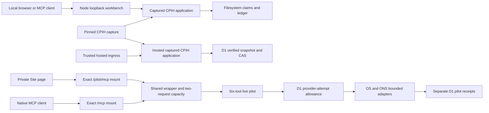
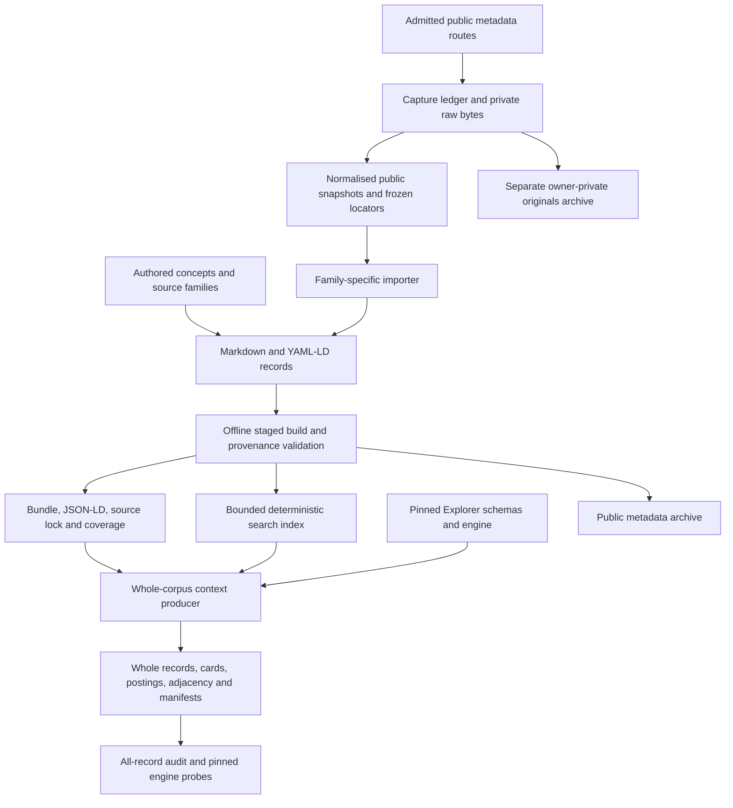
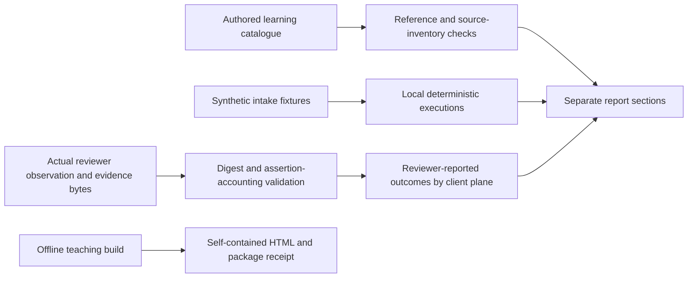

# Experimental execution, metadata and evaluation architecture

This chapter describes the checked-in baseline `97bc45635a91064cd78f06bf0848ad7636f05439`. Every source reference below is an immutable Git line link. It documents implemented contracts and tests; it does not certify a current deployment, a complete source catalogue or independent client acceptance. The review is accompanied by explanatory inline comments without behavioural changes.

## Execution surfaces and ownership

| Surface | Entry and owner | Data and durable state | Boundary |
| --- | --- | --- | --- |
| Local captured CPIH workbench | Explicit [CLI][local-main], loopback Node [server][local-ingress] at `127.0.0.1:8788` | Pinned January/July 2026 capture; private filesystem ledger, reconciliation index and [identity marker][local-state] | Three CPIH tools; no provider egress. State survives normal shutdown. |
| Hosted captured CPIH assembly | Separate [Fetch constructor][hosted-http] and async application | The same capture; branded D1 snapshot store, atomic compare-and-swap | No listener or migration is created by this constructor. Mounting infrastructure owns identity, route/origin checks, concurrency and timeouts. |
| Private live Sites pilot | `/pilot/mcp` and native `/mcp`, assembled by [trusted wrapper][pilot-wrapper] | Live OS/ONS responses; separate allowance and receipt tables | Six tools. Native mount uses platform identity; the private test token is confined to `/pilot/mcp`. PSGA remains disabled. |
| Manual private Site page | [`/pilot` client][pilot-page] | Same MCP route, provider admission and receipts as tool callers | Browser never receives a provider key. Initialise, notify initialised, call one tool. |
| Supported public OKF publication | Separate [36-record reviewed publication][okf-readme] | Locked reviewed source/profile/vendor inputs, generated static artefacts | Describes discovery metadata; it does not activate providers. |
| OKF+ metadata tools | Offline builder/search/verification plus explicitly bounded capture CLIs | 30,833 retained Markdown records at this baseline, 27 source JSON files and pinned consumer code | Capturing metadata, building metadata, retrieving observations and deploying a service are distinct operations. |
| Learning and evaluation | Authored catalogue, offline package, deterministic tests and optional observation aggregator | Developer-authored cases; separately bound actual evidence | Coverage, deterministic execution, reviewer judgements and participant/voice acceptance have separate denominators. |

The two D1 models deliberately differ. Captured CPIH verifies a bounded snapshot and returns the selected record/event/head subset; its [storage observation][hosted-observation] explicitly limits freshness and independent rollback claims. The live pilot stores individual hashed results and charges upstream attempts. Sharing a database binding does not merge their tables, evidence formats or admission rules.

## Contracts in plain language

A contract is a precise agreement between a caller and a component: what it accepts, what it promises on success, and what happens on failure. A TypeScript type helps the compiler; a runtime validator checks actual values. A JSON Schema tells a client the accepted shape. A hash binds content. A policy rule establishes permission. None of these substitutes for all the others.

For example, the captured CPIH [selection input][input] accepts `{"period":"2026-07"}`. It returns a [selection plan][selection] declaring `grants_execution: false`. To query, the caller supplies the matching plan ID and a non-zero idempotency key. The [proposal validator][proposal] checks that they agree. The application still checks capture material and durable storage. Copying a plan or changing a period cannot create permission.

An idempotency key labels one intended operation. Retrying a captured query with the same key and period returns the original receipt; changing the period with that key is a conflict. It is not a password. The [local test][local-tests] and [hosted test][hosted-tests] demonstrate lost-response recovery. Live Sites queries have a different contract: they consume provider allowance and are **not** advertised as idempotent. Cancelling after a request starts cannot guarantee that no upstream work or write happened.

An OKF+ record is another example. The [record factory][model] fixes `rights.executionAdmitted` to `false`. The [build validator][build-record] rejects records that assert execution authority, fabricated unknown dates or mismatched provenance. A dataset appearing in metadata therefore does not mean that the program can legally or technically retrieve it. The [negative tests][model-test] make that distinction executable.

### Contract register for this subsystem

| Contract | Producer / consumer and enforcement | Concrete example / guarantee |
| --- | --- | --- |
| Captured CPIH closed inputs | Shared [input schemas][input], selection normaliser and branded local/hosted applications | Exactly January or July 2026; exact field sets; matching content-addressed plan; one receipt ID **or** one key for inspection. |
| Local CPIH outputs | [MCP schemas][local-schema], receipt verification and stored-evidence projection verification | Result, receipt, storage reference, record and ledger event agree. Select is non-mutating; query persists; inspection reads existing evidence. |
| Hosted CPIH outputs | [MCP schemas][hosted-schema] and [subset verifier][hosted-verifier] | Receipt, record, event and head IDs bind their contents and cross-references. Returned subset does not independently prove the whole store. |
| Pilot inputs | Six closed [tool schemas][pilot-input], SDK validation and provider-specific validation | Place query length and count bounds, finite open-product names, one or two distinct CPIH months and a receipt identifier pattern. |
| Pilot outputs and receipts | [TypeScript result/evidence builder and runtime verifier][pilot-receipt] | Canonical data and parameter digests, software revision and date feed a content-addressed receipt; 65,536-byte result maximum. No separate `outputSchema` is registered by the [factory][pilot-factory]. |
| Pilot ingress and lifetime | [HTTP handler][pilot-ingress] and [cleanup][pilot-cleanup] | Exact URL, trusted identity, origin/Host/fetch-site, finite methods, request/response bounds, deadline and shared capacity. |
| Pilot allowance and persistence | [Atomic SQL][pilot-sql], [store][pilot-store], immutable migration | Per-provider lifetime/minute allowance; at most 128 receipts; success requires verified read-back. |
| Pilot assembly source identity | [Packager][pilot-package], [manifest][pilot-package-manifest], trusted wrapper | Clean committed source, pinned compiler, captured dependency bytes and manifest revision equality. Declared source identity is not independent attestation. |
| Normalised metadata source | [Snapshot schema][snapshot-schema], frozen locators, importer and [record validator][build-record] | Source URL, retrieval time, response digest, native identifier, normalised digest and pointer agree; failed or browser-observed metadata has separately labelled evidence. |
| OKF+ record / search formats | [Record schema][record-schema], [search schema][search-schema], local context/profile | Known semantic prefixes, explicit rights/status, source-native fields, separate temporal and update evidence. |
| Build / export identity | [Source inventory][build-source], staged builder, output checksums and [public export filter][export] | Source revision plus ordered input digests; failed rebuild preserves previous generated output; raw capture directories are excluded from public export. |
| Explorer context compatibility | [Pinned vendor closure][context-vendor], local schema validation and all-record audit | Whole evidence units, separately bounded discovery cards, compressed record/posting/adjacency shards, exact hashes and a full v3 inventory. |
| Evaluation case contracts | [Experience validator][experience] and OKF+ question corpus | Explicit source and assertion references; authored cases cannot claim execution; context-required questions are unassessed. |
| Actual observation contract | [Observation validator][observations] | Exact catalogue digest and runtime revision; every expected assertion; bound evidence bytes; reviewer-reported outcome and separate client plane. |
| Governance registries | [Profiles][profiles], [policy boundary][policy], [provider metadata][providers] | Checked-in governance describes candidates; it does not register tools. `workflows/` is a [placeholder boundary][workflow], not dead runtime code. |

The CPIH SDK input adapter looks unusual: [`validate` returns the supplied value][input-shim] because the branded application performs the strict runtime validation. The JSON Schema remains the discovery description. This delegation must be preserved when changing the adapter; an arbitrary callback cannot safely replace the application.

## Formal behaviour specifications

These are source-derived preconditions, postconditions and invariants, expressed as contracts rather than proof claims. `H` means the relevant canonical SHA-256 function; `S` is durable state before an operation; `S'` is its state afterwards. Error responses never establish a successful operation merely because a previous external side effect may have happened.

### EX-C1 — captured selection and local query

**Preconditions:** `period ∈ {2026-01, 2026-07}`; query fields are exactly `period`, `selection_plan_id`, `idempotency_key`; the plan ID equals the server's deterministic plan for that period; the key is a non-zero 64-hex digest in the admitted namespace. Capture, software/time identity and linked ledger/index integrity must validate.

**Postconditions:** select leaves `S'=S`. A completed query returns the fixed captured result with a verified durable receipt. Same-key/same-period replay returns the previous stored receipt. Full capacity blocks new keys while allowing replay and inspection. A published resolution without its receipt stays pending rather than being silently reclaimed.

**Invariant:** `provider_egress=false`; the selection plan grants no authority; receipt result period agrees with requested period. The [query implementation][local-query], [replay tests][local-tests] and [pending-state test][local-pending-test] are the executable reference.

```mermaid
stateDiagram-v2
  [*] --> Unclaimed
  Unclaimed --> Claimed: validated key, capture and capacity
  Claimed --> ResolutionPublished: resolve proposed receipt
  ResolutionPublished --> Completed: persist and verify ledger record
  Claimed --> Pending: interrupted before completion
  ResolutionPublished --> Pending: receipt absent
  Completed --> Completed: same key and period replay
  Completed --> Conflict: same key, different period
  Pending --> Pending: inspect or retry; no silent reclaim
```

### EX-C2 — hosted captured query and uncertain writes

**Preconditions:** EX-C1 proposal plus a branded snapshot adapter and independently configured expected store ID; server-generated request/trace IDs pass validation. The returned snapshot must match expected software/store identity.

**Postconditions:** an existing same-key/same-period record replays; a changed period conflicts. A fresh append is a pure plan until `publish`. Publishing against a changed head returns `retryable-conflict`, without automatic retry. Cancellation after write issuance returns `uncertain-write`, not a claim of absence. Inspection or a later same-key retry can recover the committed record.

**Invariant:** successful response is derived from a verified adapter snapshot; `records ≤ maximum_records`; full storage is read-only with inspection available. See [query][hosted-query], [readiness][hosted-readiness], [concurrent/recovery tests][hosted-tests] and [cancellation test][hosted-cancel-test].

### EX-C3 — live pilot admission and receipt persistence

Let `u` be lifetime attempts for one provider, `m` its configured maximum, `w` attempts in the active 60-second window, and `r` stored receipts.

**Admission condition:** provider enabled, `u<m`, `r<128`, and either the window is expired or `w<20`. A successful atomic SQL update increments `u` and resets/increments `w` before egress. `m∈[1,200]`; initial migration rows set `m=120`. Failed attempts are not refunded. Reapplying the [migration][pilot-migration] neither refills usage nor re-enables a provider.

**Receipt condition:** `data_sha256=H(data)` and `receipt_id="sites-pilot:sha256:"+H({tool,...evidence_without_receipt_id})`; the result has exact envelope/evidence fields and is at most 65,536 bytes. The original parameters are not stored; only their digest is retained. A success is returned only after insertion and verified read-back. Duplicate insertion currently yields `store-full`, so append is not an idempotent success API.

**Concurrency invariant:** `0≤inFlight≤2` for the wrapper's shared capacity. Both mounts draw from the same pool and store. HTTP cancellation can finish before non-cancellable D1 work; [cleanup retains capacity][pilot-cleanup] until application promises settle. A permanently stuck operation keeps its lease, making later admission fail closed. See [atomic storage tests][pilot-tests], [write-failure/cancellation tests][pilot-write-test] and [shared-capacity test][pilot-capacity-test].

### EX-C4 — bounded metadata capture

**Preconditions:** HTTPS, no credentials, one admitted host/route/query shape, a non-ambiguous path, and remaining persisted request/byte budget. [URL admission][capture-allow] occurs before capture. Cache reuse requires exact saved-response hash agreement.

**Postconditions:** an issued attempt is recorded before network work; redirects require separate admission and are refused; fresh response is bounded by 16 MiB and remaining 256 MiB cumulative capacity. The [capture operation][capture] uses a [30-second POSIX wall deadline][capture-deadline], a 25-second transport timeout and no automatic retry. HTTP 429 stops the run. Normalised public snapshots omit private raw-file paths.

**Invariant:** metadata routes do not retrieve statistical observations or licensed feature payloads. Raw acquisition bytes remain separate from public metadata. Acquisition is an explicit CLI execution surface, never a side effect of offline search/build.

### EX-C5 — metadata build, context projection and export

**Preconditions:** full 40-hex revision; sources remain inside the checkout without symlink traversal; required record fields, semantic prefixes, native identity and provenance validate. Existing outputs must carry the generated marker. Current builder schema files are optional for small synthetic fixtures; production callers should preserve the checked-in schemas.

**Postconditions:** the [staged builder][build] publishes validated output only after staging succeeds. `source-lock.sha256=H(ordered input inventory)` binds actual inputs as well as the declared revision. The [context producer][context] preserves every bound semantic record in a whole evidence unit; cards are navigation summaries. The [independent corpus audit][context-audit] checks exact text, shard and passage hashes, identity sets, record counts and card bindings.

**Hash invariant:** source-model canonical JSON includes a final newline; the Explorer context convention excludes it. These are deliberately distinct [source][hash] and [context][context-hash] contracts. Substituting one common helper would change identities.

**Export invariant:** [public metadata export][export] excludes raw captures, credentials and unrelated directories. [Original-document export][private-export] has a distinct owner-private manifest and byte/count bounds. Vocabulary [usage counts][vocabulary] are not general JSON-LD/RDF conformance or legal entitlement. See [failed-rebuild test][build-test] and [whole-record test][context-test].

### EX-C6 — evaluations and claims

**Preconditions:** authored feature/story/persona/source/assertion IDs are unique and consistent; current operation inventories agree with source declarations. An actual observation binds an exact catalogue SHA-256, runtime revision, known question/variant, evidence hash and one of `typed-client`, `ai-text`, `ai-voice`, `participant`.

**Postconditions:** authored coverage never increments executed results. Deterministic fixture runs remain distinct from natural-language outcomes. A blocked observation has no assertion verdicts. Completed observation verdicts are explicitly reviewer-reported. [OKF+ retrieval][search-eval] skips context-required cases; the [verification gate][verify-gate] fixes 40 cases as 36 retrieval checks plus four unassessed interpretation cases. See [evaluation tests][eval-test] and [client-plane tests][experience-test].

**Invariant:** integrity of an evidence file does not establish truth, participant understanding or reviewer independence. The [experience report][experience-report] states zero provider/model calls. The [Sites live evaluator][sites-eval] is separately bounded and requires explicit live admission when no injected test transport is supplied.

## Metadata dataflow and execution boundaries

Capture/enrichment modules divide by source family: `harvest.py` establishes transport and common captures; `ons_catalogues.py` paginates discovery/release/code-list families; `ons_enrichment.py` binds latest-version, native-time and Nomis metadata; `os_enrichment.py` captures OS product/schema/guide projections; `documentation.py` extracts bounded document structure; `freeze_locators.py` freezes original-byte locators; `import_sources.py` maps families into records. The [importer][import] owns only generated family directories and deliberately removes stale files there; it does not own authored concept directories. This is intentional generated-data maintenance, not dead-code deletion.

Offline stages are `build.py`, `search.py`, `context_projection.py`, `vocabulary_usage.py`, `verify.py` and the two exporters. The [outputs][build-output] retain source locks, coverage gaps, declared rights and lifecycle status. A successful build does not establish installed Ask OKF admission or availability of candidate publication URLs.

The [offline teaching packager][offline] inlines the built entry/CSS, rejects remaining module imports, hashes assets and writes one local HTML file. Its no-network claim applies to activities; source/reference links can still be followed intentionally. Browser journey checks use synthetic page-tool bridges and are not actual hosted voice/client acceptance.

## Review findings and refactor boundaries

The review found one definite dead module-local value and several maintainability issues. No public export or experimental entrypoint is classified as dead merely because the default production gateway does not mount it. Test-only injection seams and pinned vendored consumers also have real uses.

| Finding | Evidence and impact | Recommended bounded change / validation |
| --- | --- | --- |
| EX-01 — unused local CPIH `key` constant; high confidence, low impact | [Declaration][unused-key] is never read; the actual input key schema now lives in the [shared inputs][input]. | Remove the stale local constant; run compiler unused-symbol checks and existing local CPIH MCP tests. No runtime feature is removed. |
| EX-02 — duplicated local/hosted output schema construction; high confidence, maintenance risk | [Local][local-schema] and [hosted][hosted-schema] duplicate receipt, identifier, time and fixed-value schema fragments. Their storage/result envelopes differ legitimately. | Extract only shared schema vocabulary and receipt shape. Preserve separate envelopes, Workers mutable-validator copies, error codes and storage validators. Snapshot both tool contracts and run both wire suites. |
| EX-03 — mutable build root hides a dependency; high confidence, conditional risk | [Build][build] mutates module `ROOT`; [record validation][build-record] reads it implicitly. The current CLI is sequential, but interleaved library calls for different roots would share it. | Pass root explicitly through validation or use a per-build context. Prove existing relocated builds remain byte-identical and add a two-root interleaving check if a concurrent API is introduced. |
| EX-04 — coverage extractor depends on source formatting; high confidence, maintenance risk | [Regex inventory extraction][source-extractor] recognises particular declaration spelling, object formatting and quoted strings. Harmless refactors can break the coverage gate. | Derive inert operation manifests from shared declarations or parse syntax; keep independent source-to-catalogue equality checks. Validate actual additions/removals plus formatting-only changes. |
| EX-05 — dense metadata pipeline code obscures stage boundaries; high confidence, readability | [Record construction][model], [build validation][build-record] and [import loop][import] mix multi-field mapping, evidence checks, filesystem mutation and reporting in compressed statements. | Expand control flow and extract named pure family mappings first. Preserve exact normalised bytes, frozen locators and deterministic fixture outputs before any performance redesign. |
| EX-06 — pilot return contracts are harder for clients to discover; high confidence, API clarity | [Tool registration][pilot-factory] declares input schemas but no output schema; receipt integrity is enforced separately by [runtime verification][pilot-receipt]. | Add shared, versioned result/problem/capability output schemas only as a reviewed compatibility change. Verify SDK output validation and schema/fixture parity; do not imply that schema validity proves source accuracy. |
| EX-07 — missing-schema fallback is implicit fixture mode; high confidence, bounded assurance risk | [Schema loader][build-validator] returns `None` when a file is absent, so the same code path can silently omit that JSON Schema pass in a damaged checkout. Manual provenance checks still run. | Make fixture mode explicit or require complete schemas for the normal CLI. Exercise missing-schema failures alongside intentionally minimal fixtures. |

Additional unused-import candidates are `urlparse` and `canonical` in `build.py`, `BASE`/`CONTEXT` in `import_sources.py`, and `Path` in `model.py`/`ons_enrichment.py`. AST load analysis found no module use and repository search found no qualified consumer. They remain candidates because Python import/re-export behaviour needs checking before removal; they are not equivalent to a proven removable public API.

## Review coverage and limits

Implementation review traced entrypoints, control flow, validation, state and evidence at the boundaries above. Tests were reviewed for contract intent and relevant assertions; this is not a claim of independent line-by-line semantic review of every test. The generated/data inventory records filenames and contract roles; it does not claim to have read the contents of all 30,833 metadata records or to certify the truth of their source facts.

The exact implementation-file inventory for this chapter is below. **Flow** means control flow and relevant contract implementation were traced; **structure** means the entrypoint, dependency/contract surface and verification role were inspected, with detailed branch review outside this pass.

- [apps/mcp-gateway/src/sites-pilot-http.ts](https://github.com/chris-page-gov/gis-ai-go/blob/97bc45635a91064cd78f06bf0848ad7636f05439/apps/mcp-gateway/src/sites-pilot-http.ts#L1-L269) — flow
- [apps/mcp-gateway/src/sites-pilot-store.ts](https://github.com/chris-page-gov/gis-ai-go/blob/97bc45635a91064cd78f06bf0848ad7636f05439/apps/mcp-gateway/src/sites-pilot-store.ts#L1-L134) — flow
- [apps/mcp-gateway/src/web216-cpih-application.ts](https://github.com/chris-page-gov/gis-ai-go/blob/97bc45635a91064cd78f06bf0848ad7636f05439/apps/mcp-gateway/src/web216-cpih-application.ts#L1-L173) — flow
- [apps/mcp-gateway/src/web216-cpih-input-schemas.ts](https://github.com/chris-page-gov/gis-ai-go/blob/97bc45635a91064cd78f06bf0848ad7636f05439/apps/mcp-gateway/src/web216-cpih-input-schemas.ts#L1-L21) — flow
- [apps/mcp-gateway/src/web216-cpih-mcp.ts](https://github.com/chris-page-gov/gis-ai-go/blob/97bc45635a91064cd78f06bf0848ad7636f05439/apps/mcp-gateway/src/web216-cpih-mcp.ts#L1-L194) — flow
- [apps/mcp-gateway/src/web216-cpih-selection.ts](https://github.com/chris-page-gov/gis-ai-go/blob/97bc45635a91064cd78f06bf0848ad7636f05439/apps/mcp-gateway/src/web216-cpih-selection.ts#L1-L101) — flow
- [apps/mcp-gateway/src/web216-hosted-cpih-application.ts](https://github.com/chris-page-gov/gis-ai-go/blob/97bc45635a91064cd78f06bf0848ad7636f05439/apps/mcp-gateway/src/web216-hosted-cpih-application.ts#L1-L206) — flow
- [apps/mcp-gateway/src/web216-hosted-cpih-http.ts](https://github.com/chris-page-gov/gis-ai-go/blob/97bc45635a91064cd78f06bf0848ad7636f05439/apps/mcp-gateway/src/web216-hosted-cpih-http.ts#L1-L18) — flow
- [apps/mcp-gateway/src/web216-hosted-cpih-mcp.ts](https://github.com/chris-page-gov/gis-ai-go/blob/97bc45635a91064cd78f06bf0848ad7636f05439/apps/mcp-gateway/src/web216-hosted-cpih-mcp.ts#L1-L196) — flow
- [apps/mcp-gateway/src/web216-workbench-main.ts](https://github.com/chris-page-gov/gis-ai-go/blob/97bc45635a91064cd78f06bf0848ad7636f05439/apps/mcp-gateway/src/web216-workbench-main.ts#L1-L144) — flow
- [apps/mcp-gateway/src/web216-workbench-server.ts](https://github.com/chris-page-gov/gis-ai-go/blob/97bc45635a91064cd78f06bf0848ad7636f05439/apps/mcp-gateway/src/web216-workbench-server.ts#L1-L189) — flow
- [scripts/check_experience_browser.mjs](https://github.com/chris-page-gov/gis-ai-go/blob/97bc45635a91064cd78f06bf0848ad7636f05439/scripts/check_experience_browser.mjs#L1-L290) — structure
- [scripts/experience_evaluate.mjs](https://github.com/chris-page-gov/gis-ai-go/blob/97bc45635a91064cd78f06bf0848ad7636f05439/scripts/experience_evaluate.mjs#L1-L301) — flow
- [scripts/okf_plus/build.py](https://github.com/chris-page-gov/gis-ai-go/blob/97bc45635a91064cd78f06bf0848ad7636f05439/scripts/okf_plus/build.py#L1-L205) — flow
- [scripts/okf_plus/context_projection.py](https://github.com/chris-page-gov/gis-ai-go/blob/97bc45635a91064cd78f06bf0848ad7636f05439/scripts/okf_plus/context_projection.py#L1-L471) — flow
- [scripts/okf_plus/documentation.py](https://github.com/chris-page-gov/gis-ai-go/blob/97bc45635a91064cd78f06bf0848ad7636f05439/scripts/okf_plus/documentation.py#L1-L443) — structure
- [scripts/okf_plus/export.py](https://github.com/chris-page-gov/gis-ai-go/blob/97bc45635a91064cd78f06bf0848ad7636f05439/scripts/okf_plus/export.py#L1-L320) — flow
- [scripts/okf_plus/export_documents.py](https://github.com/chris-page-gov/gis-ai-go/blob/97bc45635a91064cd78f06bf0848ad7636f05439/scripts/okf_plus/export_documents.py#L1-L208) — structure
- [scripts/okf_plus/freeze_locators.py](https://github.com/chris-page-gov/gis-ai-go/blob/97bc45635a91064cd78f06bf0848ad7636f05439/scripts/okf_plus/freeze_locators.py#L1-L64) — structure
- [scripts/okf_plus/harvest.py](https://github.com/chris-page-gov/gis-ai-go/blob/97bc45635a91064cd78f06bf0848ad7636f05439/scripts/okf_plus/harvest.py#L1-L261) — flow
- [scripts/okf_plus/import_sources.py](https://github.com/chris-page-gov/gis-ai-go/blob/97bc45635a91064cd78f06bf0848ad7636f05439/scripts/okf_plus/import_sources.py#L1-L318) — flow
- [scripts/okf_plus/model.py](https://github.com/chris-page-gov/gis-ai-go/blob/97bc45635a91064cd78f06bf0848ad7636f05439/scripts/okf_plus/model.py#L1-L146) — flow
- [scripts/okf_plus/ons_catalogues.py](https://github.com/chris-page-gov/gis-ai-go/blob/97bc45635a91064cd78f06bf0848ad7636f05439/scripts/okf_plus/ons_catalogues.py#L1-L336) — structure
- [scripts/okf_plus/ons_enrichment.py](https://github.com/chris-page-gov/gis-ai-go/blob/97bc45635a91064cd78f06bf0848ad7636f05439/scripts/okf_plus/ons_enrichment.py#L1-L490) — structure
- [scripts/okf_plus/os_enrichment.py](https://github.com/chris-page-gov/gis-ai-go/blob/97bc45635a91064cd78f06bf0848ad7636f05439/scripts/okf_plus/os_enrichment.py#L1-L384) — structure
- [scripts/okf_plus/search.py](https://github.com/chris-page-gov/gis-ai-go/blob/97bc45635a91064cd78f06bf0848ad7636f05439/scripts/okf_plus/search.py#L1-L402) — flow
- [scripts/okf_plus/verify.py](https://github.com/chris-page-gov/gis-ai-go/blob/97bc45635a91064cd78f06bf0848ad7636f05439/scripts/okf_plus/verify.py#L1-L361) — flow
- [scripts/okf_plus/vocabulary_usage.py](https://github.com/chris-page-gov/gis-ai-go/blob/97bc45635a91064cd78f06bf0848ad7636f05439/scripts/okf_plus/vocabulary_usage.py#L1-L146) — flow
- [scripts/package_experience_offline.mjs](https://github.com/chris-page-gov/gis-ai-go/blob/97bc45635a91064cd78f06bf0848ad7636f05439/scripts/package_experience_offline.mjs#L1-L29) — flow
- [scripts/package_sites_pilot_runtime.mjs](https://github.com/chris-page-gov/gis-ai-go/blob/97bc45635a91064cd78f06bf0848ad7636f05439/scripts/package_sites_pilot_runtime.mjs#L1-L88) — flow
- [scripts/sites_mcp_evaluate.mjs](https://github.com/chris-page-gov/gis-ai-go/blob/97bc45635a91064cd78f06bf0848ad7636f05439/scripts/sites_mcp_evaluate.mjs#L1-L298) — flow
- [scripts/sites_pilot_bundle_entry.ts](https://github.com/chris-page-gov/gis-ai-go/blob/97bc45635a91064cd78f06bf0848ad7636f05439/scripts/sites_pilot_bundle_entry.ts#L1-L2) — flow
- [scripts/test_sites_pilot_built_worker.mjs](https://github.com/chris-page-gov/gis-ai-go/blob/97bc45635a91064cd78f06bf0848ad7636f05439/scripts/test_sites_pilot_built_worker.mjs#L1-L326) — structure
- [scripts/test_sites_pilot_page.mjs](https://github.com/chris-page-gov/gis-ai-go/blob/97bc45635a91064cd78f06bf0848ad7636f05439/scripts/test_sites_pilot_page.mjs#L1-L35) — structure
- [sites/private-pilot/app/mcp/route.ts](https://github.com/chris-page-gov/gis-ai-go/blob/97bc45635a91064cd78f06bf0848ad7636f05439/sites/private-pilot/app/mcp/route.ts#L1-L10) — flow
- [sites/private-pilot/app/pilot/learning.ts](https://github.com/chris-page-gov/gis-ai-go/blob/97bc45635a91064cd78f06bf0848ad7636f05439/sites/private-pilot/app/pilot/learning.ts#L1-L8) — flow
- [sites/private-pilot/app/pilot/mcp/route.ts](https://github.com/chris-page-gov/gis-ai-go/blob/97bc45635a91064cd78f06bf0848ad7636f05439/sites/private-pilot/app/pilot/mcp/route.ts#L1-L9) — flow
- [sites/private-pilot/app/pilot/page.tsx](https://github.com/chris-page-gov/gis-ai-go/blob/97bc45635a91064cd78f06bf0848ad7636f05439/sites/private-pilot/app/pilot/page.tsx#L1-L187) — flow
- [sites/private-pilot/db/sites-pilot-schema.ts](https://github.com/chris-page-gov/gis-ai-go/blob/97bc45635a91064cd78f06bf0848ad7636f05439/sites/private-pilot/db/sites-pilot-schema.ts#L1-L28) — flow
- [sites/private-pilot/server/sites-pilot-runtime.mjs](https://github.com/chris-page-gov/gis-ai-go/blob/97bc45635a91064cd78f06bf0848ad7636f05439/sites/private-pilot/server/sites-pilot-runtime.mjs#L1-L73) — flow

The exact test-contract inventory inspected for this chapter is:

- [apps/mcp-gateway/test/sites-pilot.test.ts](https://github.com/chris-page-gov/gis-ai-go/blob/97bc45635a91064cd78f06bf0848ad7636f05439/apps/mcp-gateway/test/sites-pilot.test.ts#L1-L543)
- [apps/mcp-gateway/test/web216-cpih-application.test.ts](https://github.com/chris-page-gov/gis-ai-go/blob/97bc45635a91064cd78f06bf0848ad7636f05439/apps/mcp-gateway/test/web216-cpih-application.test.ts#L1-L169)
- [apps/mcp-gateway/test/web216-cpih-legacy-inspection.test.ts](https://github.com/chris-page-gov/gis-ai-go/blob/97bc45635a91064cd78f06bf0848ad7636f05439/apps/mcp-gateway/test/web216-cpih-legacy-inspection.test.ts#L1-L57)
- [apps/mcp-gateway/test/web216-cpih-mcp.test.ts](https://github.com/chris-page-gov/gis-ai-go/blob/97bc45635a91064cd78f06bf0848ad7636f05439/apps/mcp-gateway/test/web216-cpih-mcp.test.ts#L1-L287)
- [apps/mcp-gateway/test/web216-cpih-selection.test.ts](https://github.com/chris-page-gov/gis-ai-go/blob/97bc45635a91064cd78f06bf0848ad7636f05439/apps/mcp-gateway/test/web216-cpih-selection.test.ts#L1-L72)
- [apps/mcp-gateway/test/web216-hosted-cpih-application.test.ts](https://github.com/chris-page-gov/gis-ai-go/blob/97bc45635a91064cd78f06bf0848ad7636f05439/apps/mcp-gateway/test/web216-hosted-cpih-application.test.ts#L1-L199)
- [apps/mcp-gateway/test/web216-hosted-cpih-mcp.test.ts](https://github.com/chris-page-gov/gis-ai-go/blob/97bc45635a91064cd78f06bf0848ad7636f05439/apps/mcp-gateway/test/web216-hosted-cpih-mcp.test.ts#L1-L278)
- [apps/mcp-gateway/test/web216-workbench-main.test.ts](https://github.com/chris-page-gov/gis-ai-go/blob/97bc45635a91064cd78f06bf0848ad7636f05439/apps/mcp-gateway/test/web216-workbench-main.test.ts#L1-L55)
- [apps/mcp-gateway/test/web216-workbench-server.test.ts](https://github.com/chris-page-gov/gis-ai-go/blob/97bc45635a91064cd78f06bf0848ad7636f05439/apps/mcp-gateway/test/web216-workbench-server.test.ts#L1-L159)
- [tests/contract/test_ci_okf_plus_evidence_privacy.py](https://github.com/chris-page-gov/gis-ai-go/blob/97bc45635a91064cd78f06bf0848ad7636f05439/tests/contract/test_ci_okf_plus_evidence_privacy.py#L1-L31)
- [tests/contract/test_okf_plus_build.py](https://github.com/chris-page-gov/gis-ai-go/blob/97bc45635a91064cd78f06bf0848ad7636f05439/tests/contract/test_okf_plus_build.py#L1-L486)
- [tests/contract/test_okf_plus_context.py](https://github.com/chris-page-gov/gis-ai-go/blob/97bc45635a91064cd78f06bf0848ad7636f05439/tests/contract/test_okf_plus_context.py#L1-L155)
- [tests/contract/test_okf_plus_export.py](https://github.com/chris-page-gov/gis-ai-go/blob/97bc45635a91064cd78f06bf0848ad7636f05439/tests/contract/test_okf_plus_export.py#L1-L221)
- [tests/contract/test_okf_plus_export_documents.py](https://github.com/chris-page-gov/gis-ai-go/blob/97bc45635a91064cd78f06bf0848ad7636f05439/tests/contract/test_okf_plus_export_documents.py#L1-L106)
- [tests/contract/test_okf_plus_model.py](https://github.com/chris-page-gov/gis-ai-go/blob/97bc45635a91064cd78f06bf0848ad7636f05439/tests/contract/test_okf_plus_model.py#L1-L55)
- [tests/contract/test_okf_plus_search.py](https://github.com/chris-page-gov/gis-ai-go/blob/97bc45635a91064cd78f06bf0848ad7636f05439/tests/contract/test_okf_plus_search.py#L1-L253)
- [tests/contract/test_okf_plus_time_table.py](https://github.com/chris-page-gov/gis-ai-go/blob/97bc45635a91064cd78f06bf0848ad7636f05439/tests/contract/test_okf_plus_time_table.py#L1-L25)
- [tests/contract/test_okf_plus_verify.py](https://github.com/chris-page-gov/gis-ai-go/blob/97bc45635a91064cd78f06bf0848ad7636f05439/tests/contract/test_okf_plus_verify.py#L1-L172)
- [tests/interoperability/test_sites_mcp_evaluate.mjs](https://github.com/chris-page-gov/gis-ai-go/blob/97bc45635a91064cd78f06bf0848ad7636f05439/tests/interoperability/test_sites_mcp_evaluate.mjs#L1-L183)
- [tests/interoperability/test_sites_native_mount.mjs](https://github.com/chris-page-gov/gis-ai-go/blob/97bc45635a91064cd78f06bf0848ad7636f05439/tests/interoperability/test_sites_native_mount.mjs#L1-L153)
- [tests/test_experience_evaluate.mjs](https://github.com/chris-page-gov/gis-ai-go/blob/97bc45635a91064cd78f06bf0848ad7636f05439/tests/test_experience_evaluate.mjs#L1-L149)
- [tests/test_okf_plus_documentation.py](https://github.com/chris-page-gov/gis-ai-go/blob/97bc45635a91064cd78f06bf0848ad7636f05439/tests/test_okf_plus_documentation.py#L1-L277)
- [tests/test_okf_plus_harvest.py](https://github.com/chris-page-gov/gis-ai-go/blob/97bc45635a91064cd78f06bf0848ad7636f05439/tests/test_okf_plus_harvest.py#L1-L132)
- [tests/test_okf_plus_ons_catalogues.py](https://github.com/chris-page-gov/gis-ai-go/blob/97bc45635a91064cd78f06bf0848ad7636f05439/tests/test_okf_plus_ons_catalogues.py#L1-L185)
- [tests/test_okf_plus_ons_enrichment.py](https://github.com/chris-page-gov/gis-ai-go/blob/97bc45635a91064cd78f06bf0848ad7636f05439/tests/test_okf_plus_ons_enrichment.py#L1-L313)
- [tests/test_okf_plus_os_enrichment.py](https://github.com/chris-page-gov/gis-ai-go/blob/97bc45635a91064cd78f06bf0848ad7636f05439/tests/test_okf_plus_os_enrichment.py#L1-L251)
- [tests/test_okf_plus_vocabulary_usage.py](https://github.com/chris-page-gov/gis-ai-go/blob/97bc45635a91064cd78f06bf0848ad7636f05439/tests/test_okf_plus_vocabulary_usage.py#L1-L146)

The metadata inventory comprises `okf-plus/records/` (30,833 Markdown files), `okf-plus/source/` (27 JSON files), `okf-plus/vendor/` (16 pinned files), `okf/vendor/` (10 pinned files), and the profiles, schemas, evaluation manifests, provider fixtures and README boundaries. Vendor contents were inspected as pinned dependency closure and contract consumers; they are not proposed for local refactoring. Whole-corpus provenance/schema verification is a separate executable assurance lane, not a substitute for individual semantic review.

[local-main]: https://github.com/chris-page-gov/gis-ai-go/blob/97bc45635a91064cd78f06bf0848ad7636f05439/apps/mcp-gateway/src/web216-workbench-main.ts#L111-L139
[local-state]: https://github.com/chris-page-gov/gis-ai-go/blob/97bc45635a91064cd78f06bf0848ad7636f05439/apps/mcp-gateway/src/web216-workbench-main.ts#L68-L96
[local-ingress]: https://github.com/chris-page-gov/gis-ai-go/blob/97bc45635a91064cd78f06bf0848ad7636f05439/apps/mcp-gateway/src/web216-workbench-server.ts#L98-L165
[selection]: https://github.com/chris-page-gov/gis-ai-go/blob/97bc45635a91064cd78f06bf0848ad7636f05439/apps/mcp-gateway/src/web216-cpih-selection.ts#L36-L78
[proposal]: https://github.com/chris-page-gov/gis-ai-go/blob/97bc45635a91064cd78f06bf0848ad7636f05439/apps/mcp-gateway/src/web216-cpih-selection.ts#L88-L101
[input]: https://github.com/chris-page-gov/gis-ai-go/blob/97bc45635a91064cd78f06bf0848ad7636f05439/apps/mcp-gateway/src/web216-cpih-input-schemas.ts#L12-L21
[local-query]: https://github.com/chris-page-gov/gis-ai-go/blob/97bc45635a91064cd78f06bf0848ad7636f05439/apps/mcp-gateway/src/web216-cpih-application.ts#L103-L135
[local-mcp]: https://github.com/chris-page-gov/gis-ai-go/blob/97bc45635a91064cd78f06bf0848ad7636f05439/apps/mcp-gateway/src/web216-cpih-mcp.ts#L148-L194
[local-schema]: https://github.com/chris-page-gov/gis-ai-go/blob/97bc45635a91064cd78f06bf0848ad7636f05439/apps/mcp-gateway/src/web216-cpih-mcp.ts#L47-L104
[input-shim]: https://github.com/chris-page-gov/gis-ai-go/blob/97bc45635a91064cd78f06bf0848ad7636f05439/apps/mcp-gateway/src/web216-cpih-mcp.ts#L113-L119
[unused-key]: https://github.com/chris-page-gov/gis-ai-go/blob/97bc45635a91064cd78f06bf0848ad7636f05439/apps/mcp-gateway/src/web216-cpih-mcp.ts#L44-L44
[hosted-query]: https://github.com/chris-page-gov/gis-ai-go/blob/97bc45635a91064cd78f06bf0848ad7636f05439/apps/mcp-gateway/src/web216-hosted-cpih-application.ts#L160-L186
[hosted-readiness]: https://github.com/chris-page-gov/gis-ai-go/blob/97bc45635a91064cd78f06bf0848ad7636f05439/apps/mcp-gateway/src/web216-hosted-cpih-application.ts#L149-L160
[hosted-observation]: https://github.com/chris-page-gov/gis-ai-go/blob/97bc45635a91064cd78f06bf0848ad7636f05439/apps/mcp-gateway/src/web216-hosted-cpih-application.ts#L71-L94
[hosted-schema]: https://github.com/chris-page-gov/gis-ai-go/blob/97bc45635a91064cd78f06bf0848ad7636f05439/apps/mcp-gateway/src/web216-hosted-cpih-mcp.ts#L46-L109
[hosted-verifier]: https://github.com/chris-page-gov/gis-ai-go/blob/97bc45635a91064cd78f06bf0848ad7636f05439/apps/mcp-gateway/src/web216-hosted-cpih-mcp.ts#L119-L146
[hosted-http]: https://github.com/chris-page-gov/gis-ai-go/blob/97bc45635a91064cd78f06bf0848ad7636f05439/apps/mcp-gateway/src/web216-hosted-cpih-http.ts#L8-L18
[pilot-input]: https://github.com/chris-page-gov/gis-ai-go/blob/97bc45635a91064cd78f06bf0848ad7636f05439/apps/mcp-gateway/src/sites-pilot-http.ts#L11-L22
[pilot-factory]: https://github.com/chris-page-gov/gis-ai-go/blob/97bc45635a91064cd78f06bf0848ad7636f05439/apps/mcp-gateway/src/sites-pilot-http.ts#L65-L127
[pilot-ingress]: https://github.com/chris-page-gov/gis-ai-go/blob/97bc45635a91064cd78f06bf0848ad7636f05439/apps/mcp-gateway/src/sites-pilot-http.ts#L143-L208
[pilot-cleanup]: https://github.com/chris-page-gov/gis-ai-go/blob/97bc45635a91064cd78f06bf0848ad7636f05439/apps/mcp-gateway/src/sites-pilot-http.ts#L250-L269
[pilot-sql]: https://github.com/chris-page-gov/gis-ai-go/blob/97bc45635a91064cd78f06bf0848ad7636f05439/apps/mcp-gateway/src/sites-pilot-store.ts#L11-L32
[pilot-receipt]: https://github.com/chris-page-gov/gis-ai-go/blob/97bc45635a91064cd78f06bf0848ad7636f05439/apps/mcp-gateway/src/sites-pilot-store.ts#L61-L94
[pilot-store]: https://github.com/chris-page-gov/gis-ai-go/blob/97bc45635a91064cd78f06bf0848ad7636f05439/apps/mcp-gateway/src/sites-pilot-store.ts#L93-L132
[pilot-wrapper]: https://github.com/chris-page-gov/gis-ai-go/blob/97bc45635a91064cd78f06bf0848ad7636f05439/sites/private-pilot/server/sites-pilot-runtime.mjs#L29-L62
[pilot-native]: https://github.com/chris-page-gov/gis-ai-go/blob/97bc45635a91064cd78f06bf0848ad7636f05439/sites/private-pilot/app/mcp/route.ts#L1-L10
[pilot-migration]: https://github.com/chris-page-gov/gis-ai-go/blob/97bc45635a91064cd78f06bf0848ad7636f05439/sites/private-pilot/drizzle/0001_sites_pilot.sql#L17-L23
[pilot-page]: https://github.com/chris-page-gov/gis-ai-go/blob/97bc45635a91064cd78f06bf0848ad7636f05439/sites/private-pilot/app/pilot/page.tsx#L57-L74
[pilot-package]: https://github.com/chris-page-gov/gis-ai-go/blob/97bc45635a91064cd78f06bf0848ad7636f05439/scripts/package_sites_pilot_runtime.mjs#L18-L37
[pilot-package-manifest]: https://github.com/chris-page-gov/gis-ai-go/blob/97bc45635a91064cd78f06bf0848ad7636f05439/scripts/package_sites_pilot_runtime.mjs#L72-L88
[pilot-tests]: https://github.com/chris-page-gov/gis-ai-go/blob/97bc45635a91064cd78f06bf0848ad7636f05439/apps/mcp-gateway/test/sites-pilot.test.ts#L135-L185
[pilot-write-test]: https://github.com/chris-page-gov/gis-ai-go/blob/97bc45635a91064cd78f06bf0848ad7636f05439/apps/mcp-gateway/test/sites-pilot.test.ts#L286-L308
[pilot-capacity-test]: https://github.com/chris-page-gov/gis-ai-go/blob/97bc45635a91064cd78f06bf0848ad7636f05439/apps/mcp-gateway/test/sites-pilot.test.ts#L419-L433
[local-tests]: https://github.com/chris-page-gov/gis-ai-go/blob/97bc45635a91064cd78f06bf0848ad7636f05439/apps/mcp-gateway/test/web216-cpih-application.test.ts#L76-L102
[local-pending-test]: https://github.com/chris-page-gov/gis-ai-go/blob/97bc45635a91064cd78f06bf0848ad7636f05439/apps/mcp-gateway/test/web216-cpih-application.test.ts#L116-L130
[hosted-tests]: https://github.com/chris-page-gov/gis-ai-go/blob/97bc45635a91064cd78f06bf0848ad7636f05439/apps/mcp-gateway/test/web216-hosted-cpih-application.test.ts#L112-L137
[hosted-cancel-test]: https://github.com/chris-page-gov/gis-ai-go/blob/97bc45635a91064cd78f06bf0848ad7636f05439/apps/mcp-gateway/test/web216-hosted-cpih-application.test.ts#L173-L182
[okf-readme]: https://github.com/chris-page-gov/gis-ai-go/blob/97bc45635a91064cd78f06bf0848ad7636f05439/okf/README.md#L1-L28
[capture]: https://github.com/chris-page-gov/gis-ai-go/blob/97bc45635a91064cd78f06bf0848ad7636f05439/scripts/okf_plus/harvest.py#L131-L169
[capture-allow]: https://github.com/chris-page-gov/gis-ai-go/blob/97bc45635a91064cd78f06bf0848ad7636f05439/scripts/okf_plus/harvest.py#L42-L108
[capture-deadline]: https://github.com/chris-page-gov/gis-ai-go/blob/97bc45635a91064cd78f06bf0848ad7636f05439/scripts/okf_plus/harvest.py#L99-L110
[import]: https://github.com/chris-page-gov/gis-ai-go/blob/97bc45635a91064cd78f06bf0848ad7636f05439/scripts/okf_plus/import_sources.py#L274-L318
[model]: https://github.com/chris-page-gov/gis-ai-go/blob/97bc45635a91064cd78f06bf0848ad7636f05439/scripts/okf_plus/model.py#L74-L85
[hash]: https://github.com/chris-page-gov/gis-ai-go/blob/97bc45635a91064cd78f06bf0848ad7636f05439/scripts/okf_plus/model.py#L38-L39
[context-hash]: https://github.com/chris-page-gov/gis-ai-go/blob/97bc45635a91064cd78f06bf0848ad7636f05439/scripts/okf_plus/context_projection.py#L54-L56
[build-validator]: https://github.com/chris-page-gov/gis-ai-go/blob/97bc45635a91064cd78f06bf0848ad7636f05439/scripts/okf_plus/build.py#L44-L50
[build-record]: https://github.com/chris-page-gov/gis-ai-go/blob/97bc45635a91064cd78f06bf0848ad7636f05439/scripts/okf_plus/build.py#L52-L108
[build]: https://github.com/chris-page-gov/gis-ai-go/blob/97bc45635a91064cd78f06bf0848ad7636f05439/scripts/okf_plus/build.py#L118-L140
[build-source]: https://github.com/chris-page-gov/gis-ai-go/blob/97bc45635a91064cd78f06bf0848ad7636f05439/scripts/okf_plus/build.py#L27-L38
[build-output]: https://github.com/chris-page-gov/gis-ai-go/blob/97bc45635a91064cd78f06bf0848ad7636f05439/scripts/okf_plus/build.py#L180-L190
[context]: https://github.com/chris-page-gov/gis-ai-go/blob/97bc45635a91064cd78f06bf0848ad7636f05439/scripts/okf_plus/context_projection.py#L210-L240
[context-manifest]: https://github.com/chris-page-gov/gis-ai-go/blob/97bc45635a91064cd78f06bf0848ad7636f05439/scripts/okf_plus/context_projection.py#L308-L331
[context-vendor]: https://github.com/chris-page-gov/gis-ai-go/blob/97bc45635a91064cd78f06bf0848ad7636f05439/scripts/okf_plus/context_projection.py#L88-L118
[context-audit]: https://github.com/chris-page-gov/gis-ai-go/blob/97bc45635a91064cd78f06bf0848ad7636f05439/scripts/okf_plus/verify.py#L183-L238
[search]: https://github.com/chris-page-gov/gis-ai-go/blob/97bc45635a91064cd78f06bf0848ad7636f05439/scripts/okf_plus/search.py#L215-L224
[search-eval]: https://github.com/chris-page-gov/gis-ai-go/blob/97bc45635a91064cd78f06bf0848ad7636f05439/scripts/okf_plus/search.py#L316-L342
[verify-gate]: https://github.com/chris-page-gov/gis-ai-go/blob/97bc45635a91064cd78f06bf0848ad7636f05439/scripts/okf_plus/verify.py#L138-L148
[export]: https://github.com/chris-page-gov/gis-ai-go/blob/97bc45635a91064cd78f06bf0848ad7636f05439/scripts/okf_plus/export.py#L60-L84
[private-export]: https://github.com/chris-page-gov/gis-ai-go/blob/97bc45635a91064cd78f06bf0848ad7636f05439/scripts/okf_plus/export_documents.py#L144-L165
[vocabulary]: https://github.com/chris-page-gov/gis-ai-go/blob/97bc45635a91064cd78f06bf0848ad7636f05439/scripts/okf_plus/vocabulary_usage.py#L34-L91
[model-test]: https://github.com/chris-page-gov/gis-ai-go/blob/97bc45635a91064cd78f06bf0848ad7636f05439/tests/contract/test_okf_plus_build.py#L332-L344
[build-test]: https://github.com/chris-page-gov/gis-ai-go/blob/97bc45635a91064cd78f06bf0848ad7636f05439/tests/contract/test_okf_plus_build.py#L394-L407
[context-test]: https://github.com/chris-page-gov/gis-ai-go/blob/97bc45635a91064cd78f06bf0848ad7636f05439/tests/contract/test_okf_plus_context.py#L51-L70
[eval-test]: https://github.com/chris-page-gov/gis-ai-go/blob/97bc45635a91064cd78f06bf0848ad7636f05439/tests/contract/test_okf_plus_verify.py#L26-L35
[experience]: https://github.com/chris-page-gov/gis-ai-go/blob/97bc45635a91064cd78f06bf0848ad7636f05439/scripts/experience_evaluate.mjs#L28-L95
[source-extractor]: https://github.com/chris-page-gov/gis-ai-go/blob/97bc45635a91064cd78f06bf0848ad7636f05439/scripts/experience_evaluate.mjs#L122-L146
[observations]: https://github.com/chris-page-gov/gis-ai-go/blob/97bc45635a91064cd78f06bf0848ad7636f05439/scripts/experience_evaluate.mjs#L214-L272
[experience-report]: https://github.com/chris-page-gov/gis-ai-go/blob/97bc45635a91064cd78f06bf0848ad7636f05439/scripts/experience_evaluate.mjs#L261-L280
[experience-test]: https://github.com/chris-page-gov/gis-ai-go/blob/97bc45635a91064cd78f06bf0848ad7636f05439/tests/test_experience_evaluate.mjs#L87-L111
[offline]: https://github.com/chris-page-gov/gis-ai-go/blob/97bc45635a91064cd78f06bf0848ad7636f05439/scripts/package_experience_offline.mjs#L15-L29
[sites-eval]: https://github.com/chris-page-gov/gis-ai-go/blob/97bc45635a91064cd78f06bf0848ad7636f05439/scripts/sites_mcp_evaluate.mjs#L167-L190
[profiles]: https://github.com/chris-page-gov/gis-ai-go/blob/97bc45635a91064cd78f06bf0848ad7636f05439/profiles/README.md#L1-L23
[policy]: https://github.com/chris-page-gov/gis-ai-go/blob/97bc45635a91064cd78f06bf0848ad7636f05439/policies/README.md#L1-L9
[workflow]: https://github.com/chris-page-gov/gis-ai-go/blob/97bc45635a91064cd78f06bf0848ad7636f05439/workflows/README.md#L1-L5
[providers]: https://github.com/chris-page-gov/gis-ai-go/blob/97bc45635a91064cd78f06bf0848ad7636f05439/providers/README.md#L1-L14
[record-schema]: https://github.com/chris-page-gov/gis-ai-go/blob/97bc45635a91064cd78f06bf0848ad7636f05439/okf-plus/schemas/record.schema.json#L2-L17
[snapshot-schema]: https://github.com/chris-page-gov/gis-ai-go/blob/97bc45635a91064cd78f06bf0848ad7636f05439/okf-plus/schemas/source-snapshot.schema.json#L2-L17
[search-schema]: https://github.com/chris-page-gov/gis-ai-go/blob/97bc45635a91064cd78f06bf0848ad7636f05439/okf-plus/schemas/search-index.schema.json#L2-L17
