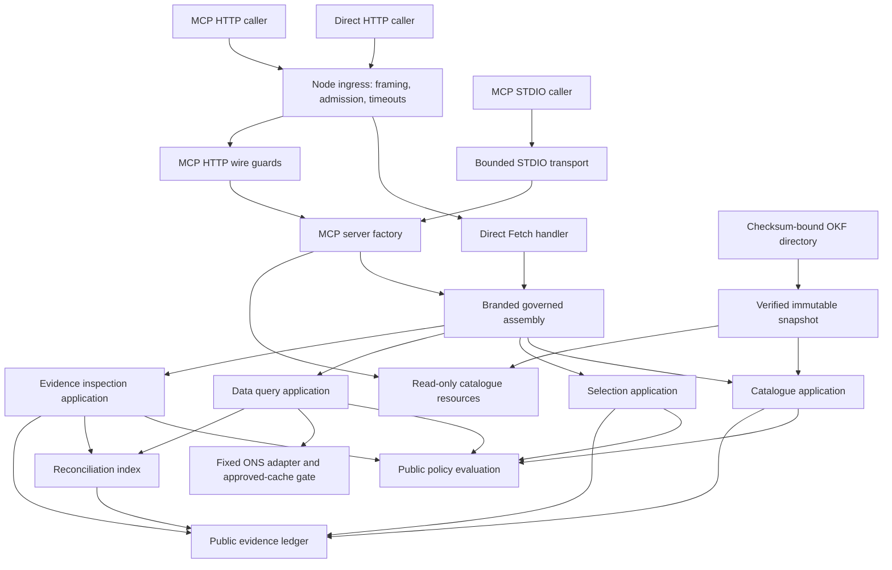
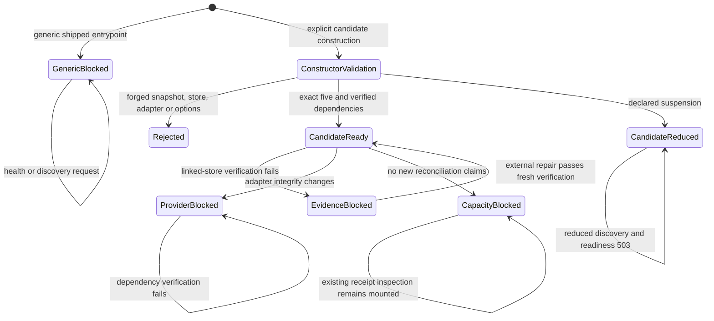
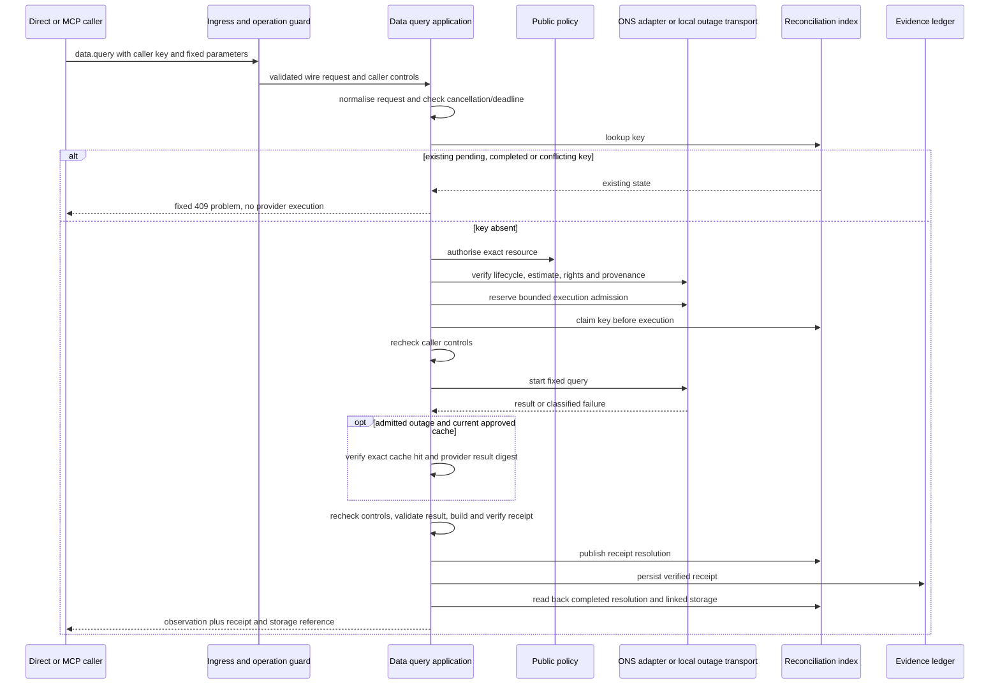
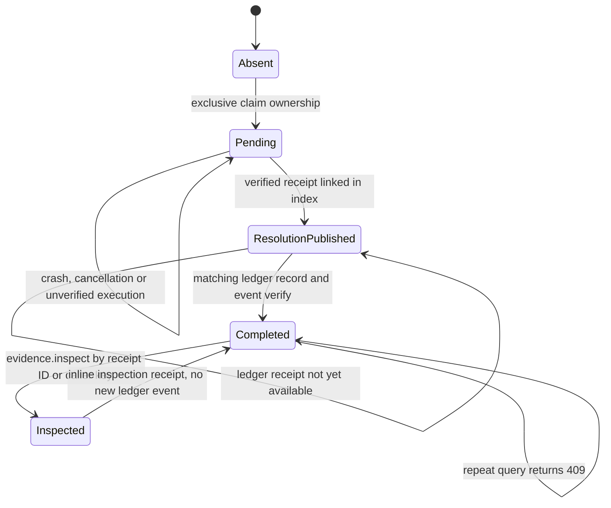

# Gateway architecture and behavioural specification

This chapter describes the core gateway at commit `97bc45635a91064cd78f06bf0848ad7636f05439`.
All Git links below name that immutable commit. Facts describe the implementation;
proposed refactors appear in the review section. Formal statements are reviewable
behavioural specifications, not a claim of machine-checked proof.

The gateway gives direct HTTP and MCP clients the same four application objects:
catalogue search/description, deterministic selection, one fixed ONS query, and
receipt inspection. An explicit assembly can expose five operations and three
resource kinds. Generic entrypoints expose no operations. The local evaluation
launcher supplies a deterministic provider outage and an approved cache; the
container constructs the normal ONS adapter. These are different execution profiles.
The Python synthetic geometry envelope is an exported contract with tests, but
there is no Python dispatch in the five-operation assembly.

## Components and ownership

The [assembly constructor](https://github.com/chris-page-gov/gis-ai-go/blob/97bc45635a91064cd78f06bf0848ad7636f05439/apps/mcp-gateway/src/governed-assembly.ts#L374-L498) is the
composition root for these application objects. Its public value contains immutable
capability descriptions; a module-private `WeakMap` contains the actual application
bindings. The [binding lookup](https://github.com/chris-page-gov/gis-ai-go/blob/97bc45635a91064cd78f06bf0848ad7636f05439/apps/mcp-gateway/src/governed-assembly.ts#L500-L516)
rejects objects that merely copy the visible fields. JSON can describe an assembly,
but cannot manufacture the identity required to mount one.

The direct and MCP faces share the same applications and schema projections.
[Direct dispatch](https://github.com/chris-page-gov/gis-ai-go/blob/97bc45635a91064cd78f06bf0848ad7636f05439/apps/mcp-gateway/src/http-app.ts#L732-L765) maps application outcomes
to HTTP status and JSON. [MCP result projection](https://github.com/chris-page-gov/gis-ai-go/blob/97bc45635a91064cd78f06bf0848ad7636f05439/apps/mcp-gateway/src/mcp-server.ts#L319-L374)
returns both `structuredContent` and complete JSON text, validates successful output,
and bounds the combined representation. Resource reads have their own URI and byte
limits. Catalogue resources serve precomputed snapshot JSON; evidence resources run
the evidence application and its readiness guard.

The gateway does not ask an LLM to select a provider, perform geometry, decide rights,
or validate evidence. A client may formulate a request, but the
[selection algorithm](https://github.com/chris-page-gov/gis-ai-go/blob/97bc45635a91064cd78f06bf0848ad7636f05439/apps/mcp-gateway/src/selection-application.ts#L386-L500) compares
explicit constraints against one reviewed candidate. Its `question` field is bounded
untrusted text and does not participate in ranking.

## Entrypoints and activation boundaries

| Entry or constructor | Callable surface and lifecycle | Provider and state behaviour |
| --- | --- | --- |
| [Generic HTTP main](https://github.com/chris-page-gov/gis-ai-go/blob/97bc45635a91064cd78f06bf0848ad7636f05439/apps/mcp-gateway/src/http-main.ts#L1-L31) | Loopback `127.0.0.1:8787`; health/OpenAPI available, readiness blocked, default operations empty | Loads catalogue; does not construct a query application |
| [Generic STDIO main](https://github.com/chris-page-gov/gis-ai-go/blob/97bc45635a91064cd78f06bf0848ad7636f05439/apps/mcp-gateway/src/mcp-stdio-main.ts#L15-L42) | Modern protocol, zero tools/resources by default | Catalogue application exists but is not advertised |
| [Governed assembly constructor](https://github.com/chris-page-gov/gis-ai-go/blob/97bc45635a91064cd78f06bf0848ad7636f05439/apps/mcp-gateway/src/governed-assembly.ts#L374-L498) | Candidate-unregistered; five operations minus explicit/policy/provider suspensions | Requires a verified snapshot, exact linked stores and a pristine ONS adapter; opens no listener |
| [Container main](https://github.com/chris-page-gov/gis-ai-go/blob/97bc45635a91064cd78f06bf0848ad7636f05439/apps/mcp-gateway/src/container-main.ts#L170-L223) | Fixed `0.0.0.0:8787`; exact five; no CLI overrides | Fixed persistent ledger/index paths and byte-verified approved cache; normal ONS adapter is constructed by [candidate activation](https://github.com/chris-page-gov/gis-ai-go/blob/97bc45635a91064cd78f06bf0848ad7636f05439/apps/mcp-gateway/src/candidate-activation.ts#L38-L62) |
| [Local evaluation main](https://github.com/chris-page-gov/gis-ai-go/blob/97bc45635a91064cd78f06bf0848ad7636f05439/apps/mcp-gateway/src/local-candidate-main.ts#L335-L432) | Fixed `127.0.0.1:8787`; exact five; no CLI overrides | Deterministic in-memory HTTP 503, approved cache, session-only private state removed on orderly stop |
| [Legacy conformance constructor](https://github.com/chris-page-gov/gis-ai-go/blob/97bc45635a91064cd78f06bf0848ad7636f05439/apps/mcp-gateway/src/mcp-stdio.ts#L351-L377) | Explicit symbol authority; catalogue operations/resources only | Test/embedding seam; no shipped production activation flag |

The public HTTPS origin setting changes only ingress allowlists and the advertised
OpenAPI server origin. It does not enable tools. In public mode both HTTP faces
require the same authority; forwarded headers cannot substitute for the actual Host
and Origin. See [allowlist derivation](https://github.com/chris-page-gov/gis-ai-go/blob/97bc45635a91064cd78f06bf0848ad7636f05439/apps/mcp-gateway/src/container-ingress.ts#L32-L60),
[canonical-origin validation](https://github.com/chris-page-gov/gis-ai-go/blob/97bc45635a91064cd78f06bf0848ad7636f05439/apps/mcp-gateway/src/public-origin.ts#L23-L52), and the
[real-socket public-authority tests](https://github.com/chris-page-gov/gis-ai-go/blob/97bc45635a91064cd78f06bf0848ad7636f05439/apps/mcp-gateway/test/governed-assembly.test.ts#L1511-L1604).
TLS termination remains outside this HTTP listener.

These are observed readiness outcomes, not a mutable activation switch. The assembly
operation list is fixed at construction. Provider and evidence integrity are checked
again on calls; readiness cannot grant production registration. If an inspector is
suspended, `data.query` is removed too, so a query cannot be advertised without its
recovery operation. The rules are in
[suspension projection](https://github.com/chris-page-gov/gis-ai-go/blob/97bc45635a91064cd78f06bf0848ad7636f05439/apps/mcp-gateway/src/governed-assembly.ts#L338-L366) and
[readiness evaluation](https://github.com/chris-page-gov/gis-ai-go/blob/97bc45635a91064cd78f06bf0848ad7636f05439/apps/mcp-gateway/src/governed-assembly.ts#L534-L603).

Local cache health is a separate observation. At cache expiry `/readyz` can remain
HTTP 200 while `local_capability_health.data_query` becomes `expired` and a fresh
query fails. Existing evidence remains inspectable. This is intentional and tested
at the exact expiry boundary in
[local capability tests](https://github.com/chris-page-gov/gis-ai-go/blob/97bc45635a91064cd78f06bf0848ad7636f05439/apps/mcp-gateway/test/local-candidate-main.test.ts#L272-L399).
Consumers must read capability health when they need to know whether the cached
observation is still admissible.

## Catalogue loading and read operations

The snapshot loader scans a canonical absolute directory, rejects symbolic links and
unexpected entries, bounds the inventory, and opens files without following links.
It compares file metadata before and after bounded reads, verifies every checksum,
and cross-checks the bundle, manifest and build receipt. Only then does it freeze the
bundle and issue an object identity recognised by `requireExactCatalogueSnapshot`.
A checksum detects changed bytes; it is not a signature or proof that the publisher
is trustworthy. See [filesystem boundary](https://github.com/chris-page-gov/gis-ai-go/blob/97bc45635a91064cd78f06bf0848ad7636f05439/apps/mcp-gateway/src/catalogue-snapshot.ts#L248-L406)
and [verification and branding](https://github.com/chris-page-gov/gis-ai-go/blob/97bc45635a91064cd78f06bf0848ad7636f05439/apps/mcp-gateway/src/catalogue-snapshot.ts#L701-L838).

Search normalises bounded terms and facet values, filters the immutable catalogue,
then creates a cursor tied to the content-root digest and semantic criteria, including
page size. Describe uses exact, case-sensitive record IDs and deterministic source
expansion. Both operations evaluate policy, construct a receipt, verify it, and, when
a ledger is configured, persist before returning a storage reference. The catalogue
snapshot's staleness flag is calculated when it is loaded; it is not recalculated on
every search. See [search](https://github.com/chris-page-gov/gis-ai-go/blob/97bc45635a91064cd78f06bf0848ad7636f05439/apps/mcp-gateway/src/catalogue-application.ts#L1023-L1098),
[describe](https://github.com/chris-page-gov/gis-ai-go/blob/97bc45635a91064cd78f06bf0848ad7636f05439/apps/mcp-gateway/src/catalogue-application.ts#L1140-L1205),
[receipt construction](https://github.com/chris-page-gov/gis-ai-go/blob/97bc45635a91064cd78f06bf0848ad7636f05439/apps/mcp-gateway/src/catalogue-application.ts#L860-L931), and
[load-time freshness](https://github.com/chris-page-gov/gis-ai-go/blob/97bc45635a91064cd78f06bf0848ad7636f05439/apps/mcp-gateway/src/catalogue-snapshot.ts#L795-L819).

The cursor is `base64url(canonical payload) + "." + sha256(payload)`. Its fields are
version, catalogue content digest, criteria digest and offset. It has no secret or
signature and confers no authority. Decoding checks canonical encoding, digest,
criteria and catalogue equality, then page alignment; the application also rejects
an offset beyond the results. See [cursor codec](https://github.com/chris-page-gov/gis-ai-go/blob/97bc45635a91064cd78f06bf0848ad7636f05439/apps/mcp-gateway/src/cursor.ts#L106-L212).

## Query, evidence publication and recovery

The order is part of the contract. The
[first half of query](https://github.com/chris-page-gov/gis-ai-go/blob/97bc45635a91064cd78f06bf0848ad7636f05439/apps/mcp-gateway/src/data-query-application.ts#L985-L1135) performs
early reconciliation, policy and provider admission before claiming execution. The
[second half](https://github.com/chris-page-gov/gis-ai-go/blob/97bc45635a91064cd78f06bf0848ad7636f05439/apps/mcp-gateway/src/data-query-application.ts#L1136-L1275) verifies the
result, publishes resolution, persists the receipt and checks the completed chain.
Do not move the ledger write ahead of resolution publication during extraction.

Externally, `ResolutionPublished` without a verified ledger receipt is still pending.
There is no automatic transition from an uncertain claim back to absent. This avoids
re-execution after a lost response or crash, but can leave a key permanently pending.
A new caller key is a new operation; the mechanism does not promise global exactly-once
execution. The application returns a receipt-free 409 for retries, never a replayed
observation. See [restart and pending-key tests](https://github.com/chris-page-gov/gis-ai-go/blob/97bc45635a91064cd78f06bf0848ad7636f05439/apps/mcp-gateway/test/data-query-application.test.ts#L1518-L1605)
and [same-key concurrency test](https://github.com/chris-page-gov/gis-ai-go/blob/97bc45635a91064cd78f06bf0848ad7636f05439/apps/mcp-gateway/test/data-query-application.test.ts#L1694-L1761).

Evidence inspection first verifies the stored evidence, then evaluates the inspection
policy. Receipt lookup v1 and caller-key lookup v2 produce the current v3 inspection
result. The stored target receipt remains unchanged; a separate inline receipt binds
the inspection call. Inspection does not persist that new receipt and does not retain
or replay the original observation. See
[lookup paths](https://github.com/chris-page-gov/gis-ai-go/blob/97bc45635a91064cd78f06bf0848ad7636f05439/apps/mcp-gateway/src/evidence-application.ts#L169-L217) and
[inspection result and receipt](https://github.com/chris-page-gov/gis-ai-go/blob/97bc45635a91064cd78f06bf0848ad7636f05439/apps/mcp-gateway/src/evidence-application.ts#L307-L372).

## Formal behavioural contracts

Let `T = {catalogue.search, catalogue.describe, evidence.inspect, selection.resolve,
data.query}`, `A` be a genuine assembly, `ops(A)` its advertised operations,
`I` the linked reconciliation index, `L` the ledger, `K` a caller key, and `P` the exact
reviewed query parameters. `success` means an application result, not just HTTP 200:
an MCP error can be carried inside a successful HTTP exchange.

| ID | Preconditions, invariant and postcondition | Implementation and executable evidence |
| --- | --- | --- |
| G-01 | `ops(A) ⊆ T`; `A.apiOperations = A.mcpOperations = A.operations` by object identity; `productionRegistration = false`. No constructor option may add a planned operation. | [construction](https://github.com/chris-page-gov/gis-ai-go/blob/97bc45635a91064cd78f06bf0848ad7636f05439/apps/mcp-gateway/src/governed-assembly.ts#L438-L497); [cross-face discovery](https://github.com/chris-page-gov/gis-ai-go/blob/97bc45635a91064cd78f06bf0848ad7636f05439/apps/mcp-gateway/test/governed-assembly.test.ts#L423-L517) |
| G-02 | Generic activation has `activeTools = activeApiOperations = []`. Constructing an application does not mount it. | [activation value](https://github.com/chris-page-gov/gis-ai-go/blob/97bc45635a91064cd78f06bf0848ad7636f05439/apps/mcp-gateway/src/activation.ts#L1-L25); [default identity test](https://github.com/chris-page-gov/gis-ai-go/blob/97bc45635a91064cd78f06bf0848ad7636f05439/apps/mcp-gateway/test/index.test.ts#L7-L27) |
| G-03 | A governed mount accepts only an assembly present in the private bindings map, a loader-branded snapshot and exact linked evidence instances. A copied shape is insufficient. | [dependency admission](https://github.com/chris-page-gov/gis-ai-go/blob/97bc45635a91064cd78f06bf0848ad7636f05439/apps/mcp-gateway/src/governed-assembly.ts#L374-L408); [brand check](https://github.com/chris-page-gov/gis-ai-go/blob/97bc45635a91064cd78f06bf0848ad7636f05439/apps/mcp-gateway/src/governed-assembly.ts#L500-L516); [forged-authority tests](https://github.com/chris-page-gov/gis-ai-go/blob/97bc45635a91064cd78f06bf0848ad7636f05439/apps/mcp-gateway/test/governed-assembly.test.ts#L1030-L1160) |
| G-04 | `data.query ∈ ops(A) ⇒ evidence.inspect ∈ ops(A)` and both application brands bind the same `I`, where `I.ledger === L`. | [identity binding](https://github.com/chris-page-gov/gis-ai-go/blob/97bc45635a91064cd78f06bf0848ad7636f05439/apps/mcp-gateway/src/reconciliation-applications.ts#L1-L37); [mount requirements](https://github.com/chris-page-gov/gis-ai-go/blob/97bc45635a91064cd78f06bf0848ad7636f05439/apps/mcp-gateway/src/http-app.ts#L335-L400); [mount rejection cases](https://github.com/chris-page-gov/gis-ai-go/blob/97bc45635a91064cd78f06bf0848ad7636f05439/apps/mcp-gateway/test/public-read-transport.test.ts#L458-L612) |
| G-05 | `loadCatalogueSnapshot(root)` returns only if directory inventory, checksums, manifest, build receipt and bundle identities agree. The returned graph is immutable and complete. | [loader](https://github.com/chris-page-gov/gis-ai-go/blob/97bc45635a91064cd78f06bf0848ad7636f05439/apps/mcp-gateway/src/catalogue-snapshot.ts#L701-L838); [immutability/corruption/race tests](https://github.com/chris-page-gov/gis-ai-go/blob/97bc45635a91064cd78f06bf0848ad7636f05439/apps/mcp-gateway/test/catalogue-snapshot.test.ts#L54-L215) |
| G-06 | A search cursor is usable only for the same content root and normalised query/facets/page size; `offset > 0 ∧ offset mod limit = 0 ∧ offset < matched`. | [decode](https://github.com/chris-page-gov/gis-ai-go/blob/97bc45635a91064cd78f06bf0848ad7636f05439/apps/mcp-gateway/src/cursor.ts#L161-L212); [binding and result extent](https://github.com/chris-page-gov/gis-ai-go/blob/97bc45635a91064cd78f06bf0848ad7636f05439/apps/mcp-gateway/src/catalogue-application.ts#L1033-L1057); [replay/alignment tests](https://github.com/chris-page-gov/gis-ai-go/blob/97bc45635a91064cd78f06bf0848ad7636f05439/apps/mcp-gateway/test/cursor.test.ts#L39-L109) |
| G-07 | Selection success requires at least one matching anchor, all required dimensions, no conflict and no ambiguity. It yields the fixed non-executing plan. Changing only question text cannot change the selection. | [decision precedence](https://github.com/chris-page-gov/gis-ai-go/blob/97bc45635a91064cd78f06bf0848ad7636f05439/apps/mcp-gateway/src/selection-application.ts#L456-L500); [selection examples](https://github.com/chris-page-gov/gis-ai-go/blob/97bc45635a91064cd78f06bf0848ad7636f05439/apps/mcp-gateway/test/selection-application.test.ts#L101-L204) |
| G-08 | A reconciled query requires exact wrapper keys, a non-zero 256-bit lowercase caller key and parameters canonically equal to `P`. Unknown fields, altered datasets and arbitrary URLs fail before provider execution. | [request admission](https://github.com/chris-page-gov/gis-ai-go/blob/97bc45635a91064cd78f06bf0848ad7636f05439/apps/mcp-gateway/src/data-query-application.ts#L538-L571); [parameter deviation tests](https://github.com/chris-page-gov/gis-ai-go/blob/97bc45635a91064cd78f06bf0848ad7636f05439/apps/mcp-gateway/test/data-query-application.test.ts#L1083-L1110) |
| G-09 | Existing `K` with a conflicting fingerprint, pending ownership or completed evidence returns the corresponding fixed 409 and performs no provider preflight/execution. A claim race is rechecked before starting the reserved execution. | [lookup and claim](https://github.com/chris-page-gov/gis-ai-go/blob/97bc45635a91064cd78f06bf0848ad7636f05439/apps/mcp-gateway/src/data-query-application.ts#L1009-L1135); [restart](https://github.com/chris-page-gov/gis-ai-go/blob/97bc45635a91064cd78f06bf0848ad7636f05439/apps/mcp-gateway/test/data-query-application.test.ts#L1518-L1574); [concurrency and conflict](https://github.com/chris-page-gov/gis-ai-go/blob/97bc45635a91064cd78f06bf0848ad7636f05439/apps/mcp-gateway/test/data-query-application.test.ts#L1694-L1803) |
| G-10 | Reconciled candidate query success requires verified result and receipt, published resolution, durable ledger persistence and a matching completed read-back. A persistence failure cannot return a success receipt. | [publication](https://github.com/chris-page-gov/gis-ai-go/blob/97bc45635a91064cd78f06bf0848ad7636f05439/apps/mcp-gateway/src/data-query-application.ts#L1217-L1275); [storage failure tests](https://github.com/chris-page-gov/gis-ai-go/blob/97bc45635a91064cd78f06bf0848ad7636f05439/apps/mcp-gateway/test/data-query-application.test.ts#L1467-L1516) |
| G-11 | Cache fallback requires a genuine classified outage and an exact, currently approved cache match. Suspended, rate-limited, stale or contract-invalid states do not authorise fallback. | [fallback gate](https://github.com/chris-page-gov/gis-ai-go/blob/97bc45635a91064cd78f06bf0848ad7636f05439/apps/mcp-gateway/src/data-query-application.ts#L1144-L1177); [cache acceptance/refusal](https://github.com/chris-page-gov/gis-ai-go/blob/97bc45635a91064cd78f06bf0848ad7636f05439/apps/mcp-gateway/test/data-query-application.test.ts#L628-L807) |
| G-12 | Cancellation or deadline expiry checked before execution and after its asynchronous result prevents result/receipt publication; it yields caller-control 408, distinct from provider timeout 504. A prior claim may remain pending. | [control check](https://github.com/chris-page-gov/gis-ai-go/blob/97bc45635a91064cd78f06bf0848ad7636f05439/apps/mcp-gateway/src/data-query-application.ts#L681-L695); [ordering tests](https://github.com/chris-page-gov/gis-ai-go/blob/97bc45635a91064cd78f06bf0848ad7636f05439/apps/mcp-gateway/test/data-query-application.test.ts#L1305-L1465); [transport mapping](https://github.com/chris-page-gov/gis-ai-go/blob/97bc45635a91064cd78f06bf0848ad7636f05439/apps/mcp-gateway/test/public-read-transport.test.ts#L1442-L1551) |
| G-13 | `inspect(K)` returns 404 when absent, 503 while pending/unverifiable, and verified evidence when complete. It adds no ledger event and makes no query replay. | [key lookup](https://github.com/chris-page-gov/gis-ai-go/blob/97bc45635a91064cd78f06bf0848ad7636f05439/apps/mcp-gateway/src/evidence-application.ts#L187-L217); [inspection without ledger growth](https://github.com/chris-page-gov/gis-ai-go/blob/97bc45635a91064cd78f06bf0848ad7636f05439/apps/mcp-gateway/test/evidence-application.test.ts#L67-L162) |
| G-14 | Direct results and MCP structured/plain-text results represent the same application outcome under the same injected identities. Full encoded byte limits apply before output. | [MCP projection](https://github.com/chris-page-gov/gis-ai-go/blob/97bc45635a91064cd78f06bf0848ad7636f05439/apps/mcp-gateway/src/mcp-server.ts#L319-L374); [parity tests](https://github.com/chris-page-gov/gis-ai-go/blob/97bc45635a91064cd78f06bf0848ad7636f05439/apps/mcp-gateway/test/public-read-transport.test.ts#L957-L1101) |

The unmounted legacy application seam may omit the ledger and return an inline-only
query receipt; G-10 applies to the reconciled candidate mount, which requires the
linked stores. See [both publication branches](https://github.com/chris-page-gov/gis-ai-go/blob/97bc45635a91064cd78f06bf0848ad7636f05439/apps/mcp-gateway/src/data-query-application.ts#L1237-L1275).

These contracts intentionally have different failure vocabularies. Catalogue problems
use the central RFC 9457-compatible factory; selection problems are returned values;
query failures throw `DataQueryApplicationError`; inspection throws
`EvidenceInspectError`. Transport adapters translate these forms. Treating every
failure as an exception or every problem as a normal result without checking the
operation would change current semantics.

## Contracts explained for a beginner

A contract is a precise agreement between two pieces of software. It says what the
caller must supply, what a successful response means, and what happens when the
agreement cannot be met. A TypeScript interface helps programmers while compiling;
it cannot validate JSON that arrives over a network. A JSON Schema documents and
checks the message shape. Runtime checks also enforce facts that a schema cannot
establish alone, such as whether a receipt exists on disk or whether two objects
share the exact same ledger.

For example, [the query request schema](https://github.com/chris-page-gov/gis-ai-go/blob/97bc45635a91064cd78f06bf0848ad7636f05439/schemas/data-query-request.schema.json#L1-L20)
requires only `schema`, `idempotency_key`, and `parameters`. The
[parameters schema](https://github.com/chris-page-gov/gis-ai-go/blob/97bc45635a91064cd78f06bf0848ad7636f05439/schemas/data-query-parameters.schema.json#L1-L31) fixes dataset
`weekly-deaths-region`, edition `time-series`, version `121`, four dimension values
and `limit: 1`. The gateway's [runtime normaliser](https://github.com/chris-page-gov/gis-ai-go/blob/97bc45635a91064cd78f06bf0848ad7636f05439/apps/mcp-gateway/src/data-query-application.ts#L538-L571)
also checks canonical equality with this reviewed selection. Adding an arbitrary
`url` does not widen the operation: it makes the request invalid.

A caller key is a correlation identifier created before the query. If the connection
fails after the work completed, the caller can use it in
[an inspection request](https://github.com/chris-page-gov/gis-ai-go/blob/97bc45635a91064cd78f06bf0848ad7636f05439/schemas/evidence-inspect-request-v2.schema.json#L1-L18). This
recovers evidence of the operation. Reusing the key for `data.query` produces a 409;
it does not return the observation again. The key is not a password and must contain
no personal or secret material.

A receipt is an evidence contract. It binds identities and digests of the request,
result, policy and source. It does not make the original source infallible, and a
checksum is not an external signature. The gateway
[verifies the receipt before success](https://github.com/chris-page-gov/gis-ai-go/blob/97bc45635a91064cd78f06bf0848ad7636f05439/apps/mcp-gateway/src/data-query-application.ts#L1220-L1275).
Later inspection proves the stored receipt/record/event binding; its explicit
[verification fields](https://github.com/chris-page-gov/gis-ai-go/blob/97bc45635a91064cd78f06bf0848ad7636f05439/apps/mcp-gateway/src/evidence-application.ts#L59-L75) say that the
original result material was verified at ingest and was not retained.

The following is the gateway's contract map. The repository-wide contract inventory
covers the wider providers, deployment, browser and assurance families.

| Contract family in this gateway | What it agrees | Concrete source and use |
| --- | --- | --- |
| Catalogue publication bundle, manifest, build receipt and checksum inventory | Which exact public metadata files and record identities form a snapshot | [control-file parsers](https://github.com/chris-page-gov/gis-ai-go/blob/97bc45635a91064cd78f06bf0848ad7636f05439/apps/mcp-gateway/src/catalogue-snapshot.ts#L416-L682) and [bundle schema](https://github.com/chris-page-gov/gis-ai-go/blob/97bc45635a91064cd78f06bf0848ad7636f05439/schemas/okf-publication-bundle.schema.json#L1-L25) |
| Catalogue search/describe requests; catalogue result and problem | Closed query/facet/ID inputs, complete governed fields, pagination and errors | [search normalisation](https://github.com/chris-page-gov/gis-ai-go/blob/97bc45635a91064cd78f06bf0848ad7636f05439/apps/mcp-gateway/src/catalogue-application.ts#L731-L811), [describe normalisation](https://github.com/chris-page-gov/gis-ai-go/blob/97bc45635a91064cd78f06bf0848ad7636f05439/apps/mcp-gateway/src/catalogue-application.ts#L1100-L1131), [problem factory](https://github.com/chris-page-gov/gis-ai-go/blob/97bc45635a91064cd78f06bf0848ad7636f05439/apps/mcp-gateway/src/problem.ts#L266-L309) |
| Cursor payload v1 | Continuation belongs to the same catalogue and criteria | [payload/binding types](https://github.com/chris-page-gov/gis-ai-go/blob/97bc45635a91064cd78f06bf0848ad7636f05439/apps/mcp-gateway/src/cursor.ts#L8-L19) and [worked tests](https://github.com/chris-page-gov/gis-ai-go/blob/97bc45635a91064cd78f06bf0848ad7636f05439/apps/mcp-gateway/test/cursor.test.ts#L22-L109) |
| Selection request, selection profile, selection parameters, selection plan, result and problem v1 | Explicit constraints resolve to one reviewed non-executing plan | [message types](https://github.com/chris-page-gov/gis-ai-go/blob/97bc45635a91064cd78f06bf0848ad7636f05439/apps/mcp-gateway/src/selection-application.ts#L53-L160), [application flow](https://github.com/chris-page-gov/gis-ai-go/blob/97bc45635a91064cd78f06bf0848ad7636f05439/apps/mcp-gateway/src/selection-application.ts#L585-L682) |
| Data query request/parameters/result/problem v1 and reconciliation problem v1 | One fixed observation, caller controls, 409 recovery states, optional approved-cache disclosure | [message types](https://github.com/chris-page-gov/gis-ai-go/blob/97bc45635a91064cd78f06bf0848ad7636f05439/apps/mcp-gateway/src/data-query-application.ts#L168-L269), [request/problem dispatch schemas](https://github.com/chris-page-gov/gis-ai-go/blob/97bc45635a91064cd78f06bf0848ad7636f05439/apps/mcp-gateway/src/openapi.ts#L454-L494) |
| Provider preflight, result, rights, provenance and approved cache | The adapter's estimate, source, licence and returned observation match the reviewed resource | [expected evidence](https://github.com/chris-page-gov/gis-ai-go/blob/97bc45635a91064cd78f06bf0848ad7636f05439/apps/mcp-gateway/src/data-query-application.ts#L705-L756), [preflight/result checks](https://github.com/chris-page-gov/gis-ai-go/blob/97bc45635a91064cd78f06bf0848ad7636f05439/apps/mcp-gateway/src/data-query-application.ts#L856-L979) |
| Public policy and authority context v1/v2/v3 | Catalogue reads, fixed public reads and inspection have the appropriate public authority and policy decision | [schema imports](https://github.com/chris-page-gov/gis-ai-go/blob/97bc45635a91064cd78f06bf0848ad7636f05439/apps/mcp-gateway/src/openapi.ts#L110-L133), [catalogue policy](https://github.com/chris-page-gov/gis-ai-go/blob/97bc45635a91064cd78f06bf0848ad7636f05439/apps/mcp-gateway/src/catalogue-application.ts#L869-L882), [inspection policy](https://github.com/chris-page-gov/gis-ai-go/blob/97bc45635a91064cd78f06bf0848ad7636f05439/apps/mcp-gateway/src/evidence-application.ts#L314-L324) |
| Evidence receipt v1/v2/v3; public evidence record v1/v2; event and storage reference | Catalogue receipts, selection/query receipts and current-call inspection receipts have different, preserved identities | [self-contained inspection schema graph](https://github.com/chris-page-gov/gis-ai-go/blob/97bc45635a91064cd78f06bf0848ad7636f05439/apps/mcp-gateway/src/openapi.ts#L289-L426), [current output shape](https://github.com/chris-page-gov/gis-ai-go/blob/97bc45635a91064cd78f06bf0848ad7636f05439/apps/mcp-gateway/src/evidence-application.ts#L45-L77) |
| Evidence inspection request v1/v2 and operation request dispatcher; current result v3 | Receipt-ID and caller-key lookup converge on verified stored evidence and a new inline inspection receipt | [request alternatives](https://github.com/chris-page-gov/gis-ai-go/blob/97bc45635a91064cd78f06bf0848ad7636f05439/apps/mcp-gateway/src/evidence-application.ts#L109-L141), [request schema composition](https://github.com/chris-page-gov/gis-ai-go/blob/97bc45635a91064cd78f06bf0848ad7636f05439/apps/mcp-gateway/src/openapi.ts#L428-L452) |
| Reconciliation claim/resolution/index and exact linked-application identity | A caller key owns one semantic request; query and inspection refer to the same index and ledger | [claim use](https://github.com/chris-page-gov/gis-ai-go/blob/97bc45635a91064cd78f06bf0848ad7636f05439/apps/mcp-gateway/src/data-query-application.ts#L1088-L1135), [object identity contract](https://github.com/chris-page-gov/gis-ai-go/blob/97bc45635a91064cd78f06bf0848ad7636f05439/apps/mcp-gateway/src/reconciliation-applications.ts#L1-L37) |
| MCP JSON-RPC wire contract and OpenAPI route projection | Protocol revision, complete fallback content, bounded messages, and advertised operations match the mounted profile | [HTTP adaptation](https://github.com/chris-page-gov/gis-ai-go/blob/97bc45635a91064cd78f06bf0848ad7636f05439/apps/mcp-gateway/src/mcp-http-core.ts#L343-L389), [STDIO framing](https://github.com/chris-page-gov/gis-ai-go/blob/97bc45635a91064cd78f06bf0848ad7636f05439/apps/mcp-gateway/src/mcp-stdio.ts#L215-L296), [OpenAPI projection](https://github.com/chris-page-gov/gis-ai-go/blob/97bc45635a91064cd78f06bf0848ad7636f05439/apps/mcp-gateway/src/openapi.ts#L689-L850) |
| Assembly/readiness brands and local lifecycle/capability-health v1 | Genuine constructor identity, candidate-only status, cache vintage, expiry and session retention | [assembly/readiness types](https://github.com/chris-page-gov/gis-ai-go/blob/97bc45635a91064cd78f06bf0848ad7636f05439/apps/mcp-gateway/src/governed-assembly.ts#L114-L165), [capability fields](https://github.com/chris-page-gov/gis-ai-go/blob/97bc45635a91064cd78f06bf0848ad7636f05439/apps/mcp-gateway/src/local-candidate-capability.ts#L5-L24), [lifecycle record](https://github.com/chris-page-gov/gis-ai-go/blob/97bc45635a91064cd78f06bf0848ad7636f05439/apps/mcp-gateway/src/local-candidate-main.ts#L97-L117) |
| Synthetic execution request, gateway authorisation, result and evidence v1 | Bounded EPSG:4326 fixture geometry and a verified Python hand-off; no public route is mounted | [builder](https://github.com/chris-page-gov/gis-ai-go/blob/97bc45635a91064cd78f06bf0848ad7636f05439/apps/mcp-gateway/src/execution-envelope.ts#L157-L221), [result parser](https://github.com/chris-page-gov/gis-ai-go/blob/97bc45635a91064cd78f06bf0848ad7636f05439/apps/mcp-gateway/src/execution-envelope.ts#L270-L407) |

The MCP input-schema adapter deliberately lets the application do request validation,
so direct HTTP and MCP return the same structured problem. It still advertises the
complete schema and validates successful outputs. This is an explicit compatibility
choice documented in [the schema adapter](https://github.com/chris-page-gov/gis-ai-go/blob/97bc45635a91064cd78f06bf0848ad7636f05439/apps/mcp-gateway/src/mcp-server.ts#L204-L225),
with [invalid-input parity evidence](https://github.com/chris-page-gov/gis-ai-go/blob/97bc45635a91064cd78f06bf0848ad7636f05439/apps/mcp-gateway/test/mcp-transport.test.ts#L455-L486).
Old exported inspection schemas and the legacy constructor remain useful versioned
contracts; their absence from normal discovery is not evidence of dead code.

## Transport bounds and cancellation

| Boundary | Enforced limit or rule | Source |
| --- | --- | --- |
| Node listener | 32 concurrent requests by default; configured range 1–128; 64 header pairs; 16,384 header bytes; 5-second header/body timeout; 25-second socket timeout | [constants](https://github.com/chris-page-gov/gis-ai-go/blob/97bc45635a91064cd78f06bf0848ad7636f05439/apps/mcp-gateway/src/http-server.ts#L47-L54), [admission configuration](https://github.com/chris-page-gov/gis-ai-go/blob/97bc45635a91064cd78f06bf0848ad7636f05439/apps/mcp-gateway/src/http-server.ts#L549-L557), [listener options](https://github.com/chris-page-gov/gis-ai-go/blob/97bc45635a91064cd78f06bf0848ad7636f05439/apps/mcp-gateway/src/http-server.ts#L719-L738), [socket bounds](https://github.com/chris-page-gov/gis-ai-go/blob/97bc45635a91064cd78f06bf0848ad7636f05439/apps/mcp-gateway/src/http-server.ts#L870-L873) |
| Direct HTTP | 32,768 request bytes; 4,194,304 serialised response bytes; exact admitted Host/Origin; no query strings | [limits](https://github.com/chris-page-gov/gis-ai-go/blob/97bc45635a91064cd78f06bf0848ad7636f05439/apps/mcp-gateway/src/http-app.ts#L58-L65), [authority checks](https://github.com/chris-page-gov/gis-ai-go/blob/97bc45635a91064cd78f06bf0848ad7636f05439/apps/mcp-gateway/src/http-app.ts#L572-L613) |
| MCP HTTP | 65,536 standalone request bytes; both JSON and event-stream Accept types; strict modern revision | [limits](https://github.com/chris-page-gov/gis-ai-go/blob/97bc45635a91064cd78f06bf0848ad7636f05439/apps/mcp-gateway/src/mcp-http-core.ts#L8-L18), [Accept gate](https://github.com/chris-page-gov/gis-ai-go/blob/97bc45635a91064cd78f06bf0848ad7636f05439/apps/mcp-gateway/src/mcp-http-core.ts#L116-L132), [dispatch gates](https://github.com/chris-page-gov/gis-ai-go/blob/97bc45635a91064cd78f06bf0848ad7636f05439/apps/mcp-gateway/src/mcp-http-core.ts#L343-L367) |
| JSON bytes | Finite numbers, valid UTF-8/scalars, unique object keys, nesting at most 16 | [strict parser](https://github.com/chris-page-gov/gis-ai-go/blob/97bc45635a91064cd78f06bf0848ad7636f05439/apps/mcp-gateway/src/bounded-json.ts#L1-L223) |
| MCP identity | Request ID at most 128 Unicode code points; resource URI at most 2,048; raw/encoded caller keys rejected in protocol control fields | [wire guards](https://github.com/chris-page-gov/gis-ai-go/blob/97bc45635a91064cd78f06bf0848ad7636f05439/apps/mcp-gateway/src/mcp-wire-guards.ts#L1-L65) |
| MCP output | Tool result and resource wire envelope at most 1 MiB; catalogue resource text and inspection result at most 262,144 bytes; STDIO frame/buffer at most 1 MiB | [resource bounds](https://github.com/chris-page-gov/gis-ai-go/blob/97bc45635a91064cd78f06bf0848ad7636f05439/apps/mcp-gateway/src/mcp-server.ts#L112-L119), [tool bound](https://github.com/chris-page-gov/gis-ai-go/blob/97bc45635a91064cd78f06bf0848ad7636f05439/apps/mcp-gateway/src/mcp-constants.ts#L1-L4), [STDIO bound](https://github.com/chris-page-gov/gis-ai-go/blob/97bc45635a91064cd78f06bf0848ad7636f05439/apps/mcp-gateway/src/mcp-stdio.ts#L33-L38) |

The Node adapter translates disconnects to cancellation signals. The MCP HTTP core
keeps the original caller signal in `AsyncLocalStorage`, then combines it with SDK
cancellation for a query. A narrowly scoped response-signal replacement compensates
for SDK 2.0.0 turning an already produced `query_cancelled` problem into HTTP 499.
Listeners are removed after the call. See
[direct disconnect bridge](https://github.com/chris-page-gov/gis-ai-go/blob/97bc45635a91064cd78f06bf0848ad7636f05439/apps/mcp-gateway/src/http-server.ts#L172-L204),
[signal combination](https://github.com/chris-page-gov/gis-ai-go/blob/97bc45635a91064cd78f06bf0848ad7636f05439/apps/mcp-gateway/src/mcp-request-signal.ts#L11-L53), and
[SDK compatibility boundary](https://github.com/chris-page-gov/gis-ai-go/blob/97bc45635a91064cd78f06bf0848ad7636f05439/apps/mcp-gateway/src/mcp-http-core.ts#L369-L387).
The [overlapping-signal tests](https://github.com/chris-page-gov/gis-ai-go/blob/97bc45635a91064cd78f06bf0848ad7636f05439/apps/mcp-gateway/test/public-read-transport.test.ts#L1699-L1738)
check isolation between concurrent calls.

## Review findings and refactor boundaries

The review found small confirmed dead fragments, not a removable core subsystem.
The five-tool path, blocked generic launchers, explicit legacy conformance path,
fixture geometry contracts and historical schema exports have different purposes.
Do not infer inactivity from a symbol search alone.

| ID | Finding and confidence | Impact and proposed change | Verification needed |
| --- | --- | --- | --- |
| GW-01 | **Confirmed unused declarations.** `ONS_ADAPTER_VERSION` import, private `publicPolicyOperations(ledger)` parameter, and unused `TestContext`, `DataQueryProblemCode`, `directTrace` test declarations. `Inventory.totalBytes` is returned but never consumed; the local accumulator still enforces the byte cap. | Remove only the unused binding/parameter/returned field. Keep the inventory byte-limit calculation. Reduces misleading dependencies and makes unused-symbol checks usable. Evidence: [import](https://github.com/chris-page-gov/gis-ai-go/blob/97bc45635a91064cd78f06bf0848ad7636f05439/apps/mcp-gateway/src/data-query-application.ts#L26-L32), [unused parameter](https://github.com/chris-page-gov/gis-ai-go/blob/97bc45635a91064cd78f06bf0848ad7636f05439/apps/mcp-gateway/src/governed-assembly.ts#L315-L321), [inventory type](https://github.com/chris-page-gov/gis-ai-go/blob/97bc45635a91064cd78f06bf0848ad7636f05439/apps/mcp-gateway/src/catalogue-snapshot.ts#L46-L50), [accumulator and return](https://github.com/chris-page-gov/gis-ai-go/blob/97bc45635a91064cd78f06bf0848ad7636f05439/apps/mcp-gateway/src/catalogue-snapshot.ts#L329-L341), [test imports](https://github.com/chris-page-gov/gis-ai-go/blob/97bc45635a91064cd78f06bf0848ad7636f05439/apps/mcp-gateway/test/public-read-transport.test.ts#L1-L40), [unused local](https://github.com/chris-page-gov/gis-ai-go/blob/97bc45635a91064cd78f06bf0848ad7636f05439/apps/mcp-gateway/test/public-read-transport.test.ts#L623-L633). | Typecheck with unused diagnostics; preserve inventory oversize test and policy/discovery suites. |
| GW-02 | **Confirmed unreachable conditional arm.** The resource-size check chooses between JSON and SSE by comparing their byte lengths, but SSE is exactly the same JSON plus a fixed ASCII prefix/suffix. | Assert the SSE bound directly and explain why it also bounds JSON; remove two redundant UTF-8 encodings. Evidence: [resource envelope](https://github.com/chris-page-gov/gis-ai-go/blob/97bc45635a91064cd78f06bf0848ad7636f05439/apps/mcp-gateway/src/mcp-server.ts#L577-L599). | Preserve Unicode/escaped content, long request-ID and resource-size boundary cases in transport suites. |
| GW-03 | **High-confidence duplication/refactor candidate.** Exact-five candidate predicates repeat in activation and container authority; linked query/inspector mount checks repeat in direct and MCP constructors. | Extract pure predicates or a closed typed descriptor, preserving caller-specific authority checks, diagnostic messages, operation order and object-identity checks. Avoid a configurable registry that could expand activation. Evidence: [activation check](https://github.com/chris-page-gov/gis-ai-go/blob/97bc45635a91064cd78f06bf0848ad7636f05439/apps/mcp-gateway/src/candidate-activation.ts#L64-L89), [container check](https://github.com/chris-page-gov/gis-ai-go/blob/97bc45635a91064cd78f06bf0848ad7636f05439/apps/mcp-gateway/src/container-main.ts#L81-L126), [direct linkage](https://github.com/chris-page-gov/gis-ai-go/blob/97bc45635a91064cd78f06bf0848ad7636f05439/apps/mcp-gateway/src/http-app.ts#L335-L400), [MCP linkage](https://github.com/chris-page-gov/gis-ai-go/blob/97bc45635a91064cd78f06bf0848ad7636f05439/apps/mcp-gateway/src/mcp-server.ts#L816-L887). | Run forged-brand/proxy/accessor, suspension, exact-five discovery and direct/MCP parity tests. |
| GW-04 | **Confirmed repeated work.** Manifest/input path order checks call `toSorted()` inside `some()`, repeatedly sorting the same bounded array. | Sort once or compare adjacent entries while retaining the uniqueness check. This improves worst-case validation cost without widening the inventory. No runtime bottleneck is claimed without measurement. Evidence: [manifest paths](https://github.com/chris-page-gov/gis-ai-go/blob/97bc45635a91064cd78f06bf0848ad7636f05439/apps/mcp-gateway/src/catalogue-snapshot.ts#L524-L532), [input paths](https://github.com/chris-page-gov/gis-ai-go/blob/97bc45635a91064cd78f06bf0848ad7636f05439/apps/mcp-gateway/src/catalogue-snapshot.ts#L601-L609). | Preserve sorted/unsorted/duplicate and maximum-inventory cases; check identical rejection behaviour. |
| GW-05 | **High-confidence clarity/refactor candidate.** A Node body-read error fabricates a zero-length or oversized body and sometimes changes the method, then re-enters the direct Fetch handler to obtain a problem. | Extract an explicit shared body-failure-to-problem function. The current redispatch obscures precedence among route, media, identity and parsing errors and repeats body work. Evidence: [failure redispatch](https://github.com/chris-page-gov/gis-ai-go/blob/97bc45635a91064cd78f06bf0848ad7636f05439/apps/mcp-gateway/src/http-server.ts#L820-L856), [problem mapping](https://github.com/chris-page-gov/gis-ai-go/blob/97bc45635a91064cd78f06bf0848ad7636f05439/apps/mcp-gateway/src/http-app.ts#L311-L318). | First characterise current malformed length, oversized body, invalid route/media and GET/HEAD combinations; preserve status, problem body and disconnect semantics. |
| GW-06 | **High-confidence maintainability candidate.** `data-query-application.ts` combines parsing, control validation, provider evidence, cache adaptation, reconciliation and receipt publication; `openapi.ts` combines schema loading/embedding and route/health projection. | Extract bounded internal modules along these responsibilities. Keep the query state transition order visible in one orchestration function, and keep schema `$id`/`$ref` and byte output stable. Evidence: [query orchestration](https://github.com/chris-page-gov/gis-ai-go/blob/97bc45635a91064cd78f06bf0848ad7636f05439/apps/mcp-gateway/src/data-query-application.ts#L985-L1275), [schema embedding](https://github.com/chris-page-gov/gis-ai-go/blob/97bc45635a91064cd78f06bf0848ad7636f05439/apps/mcp-gateway/src/openapi.ts#L182-L426), [route projection](https://github.com/chris-page-gov/gis-ai-go/blob/97bc45635a91064cd78f06bf0848ad7636f05439/apps/mcp-gateway/src/openapi.ts#L689-L850). | Use existing schema equality, receipt fixtures, cancellation, cache-classification and same-key concurrency suites as acceptance gates; do not replace independent verification with shared builders. |

No refactor or deletion is implemented by this documentation change. Inline comments
explain the query recovery/publication ordering, separation of question text from
selection parameters, and the unmounted synthetic execution boundary.

## Reviewed inventory and validation scope

Every core source module below was read. Repository-wide symbol/consumer searches
were used for dead-code candidates; exported versioned schemas and test seams were
retained as such. Tests were indexed across the full core suite, with implementation
and assertions inspected for the cited invariants and findings. This is not a claim
that every test branch was manually proved.

| Source module | Responsibility |
| --- | --- |
| [activation.ts](https://github.com/chris-page-gov/gis-ai-go/blob/97bc45635a91064cd78f06bf0848ad7636f05439/apps/mcp-gateway/src/activation.ts#L1-L25) | Frozen empty production activation |
| [bounded-json.ts](https://github.com/chris-page-gov/gis-ai-go/blob/97bc45635a91064cd78f06bf0848ad7636f05439/apps/mcp-gateway/src/bounded-json.ts#L1-L223) | Strict bounded UTF-8 JSON parser |
| [candidate-activation.ts](https://github.com/chris-page-gov/gis-ai-go/blob/97bc45635a91064cd78f06bf0848ad7636f05439/apps/mcp-gateway/src/candidate-activation.ts#L1-L94) | Fixed exact-five container activation builder |
| [catalogue-application.ts](https://github.com/chris-page-gov/gis-ai-go/blob/97bc45635a91064cd78f06bf0848ad7636f05439/apps/mcp-gateway/src/catalogue-application.ts#L1-L1224) | Search, describe, bounds, policy and inline/persisted receipts |
| [catalogue-snapshot.ts](https://github.com/chris-page-gov/gis-ai-go/blob/97bc45635a91064cd78f06bf0848ad7636f05439/apps/mcp-gateway/src/catalogue-snapshot.ts#L1-L838) | Filesystem/checksum validation and immutable snapshot brand |
| [container-healthcheck.ts](https://github.com/chris-page-gov/gis-ai-go/blob/97bc45635a91064cd78f06bf0848ad7636f05439/apps/mcp-gateway/src/container-healthcheck.ts#L1-L165) | Bounded local container health/readiness probe |
| [container-ingress.ts](https://github.com/chris-page-gov/gis-ai-go/blob/97bc45635a91064cd78f06bf0848ad7636f05439/apps/mcp-gateway/src/container-ingress.ts#L1-L73) | One public-origin or loopback authority projection |
| [container-main.ts](https://github.com/chris-page-gov/gis-ai-go/blob/97bc45635a91064cd78f06bf0848ad7636f05439/apps/mcp-gateway/src/container-main.ts#L1-L223) | Fixed container paths, stores, startup and shutdown |
| [cursor.ts](https://github.com/chris-page-gov/gis-ai-go/blob/97bc45635a91064cd78f06bf0848ad7636f05439/apps/mcp-gateway/src/cursor.ts#L1-L212) | Canonical criteria hashing and cursor codec |
| [data-query-application.ts](https://github.com/chris-page-gov/gis-ai-go/blob/97bc45635a91064cd78f06bf0848ad7636f05439/apps/mcp-gateway/src/data-query-application.ts#L1-L1307) | Fixed ONS query, cache admission, controls and reconciliation |
| [evidence-application.ts](https://github.com/chris-page-gov/gis-ai-go/blob/97bc45635a91064cd78f06bf0848ad7636f05439/apps/mcp-gateway/src/evidence-application.ts#L1-L426) | Receipt/key lookup, policy and current-call inspection receipt |
| [execution-envelope.ts](https://github.com/chris-page-gov/gis-ai-go/blob/97bc45635a91064cd78f06bf0848ad7636f05439/apps/mcp-gateway/src/execution-envelope.ts#L1-L407) | Synthetic gateway/Python request and result contract |
| [governed-assembly.ts](https://github.com/chris-page-gov/gis-ai-go/blob/97bc45635a91064cd78f06bf0848ad7636f05439/apps/mcp-gateway/src/governed-assembly.ts#L1-L603) | Composition, brand, capabilities, suspension and readiness |
| [http-app.ts](https://github.com/chris-page-gov/gis-ai-go/blob/97bc45635a91064cd78f06bf0848ad7636f05439/apps/mcp-gateway/src/http-app.ts#L1-L808) | Transport-neutral direct HTTP request/response handling |
| [http-main.ts](https://github.com/chris-page-gov/gis-ai-go/blob/97bc45635a91064cd78f06bf0848ad7636f05439/apps/mcp-gateway/src/http-main.ts#L1-L31) | Blocked generic loopback launcher |
| [http-server.ts](https://github.com/chris-page-gov/gis-ai-go/blob/97bc45635a91064cd78f06bf0848ad7636f05439/apps/mcp-gateway/src/http-server.ts#L1-L957) | Node HTTP ingress, admission, framing, disconnects and transport adaptation |
| [index.ts](https://github.com/chris-page-gov/gis-ai-go/blob/97bc45635a91064cd78f06bf0848ad7636f05439/apps/mcp-gateway/src/index.ts#L1-L18) | Public package exports |
| [local-candidate-capability.ts](https://github.com/chris-page-gov/gis-ai-go/blob/97bc45635a91064cd78f06bf0848ad7636f05439/apps/mcp-gateway/src/local-candidate-capability.ts#L1-L88) | Private local cache/vintage health registration |
| [local-candidate-main.ts](https://github.com/chris-page-gov/gis-ai-go/blob/97bc45635a91064cd78f06bf0848ad7636f05439/apps/mcp-gateway/src/local-candidate-main.ts#L1-L432) | Provider-free local launcher and cleanup |
| [mcp-constants.ts](https://github.com/chris-page-gov/gis-ai-go/blob/97bc45635a91064cd78f06bf0848ad7636f05439/apps/mcp-gateway/src/mcp-constants.ts#L1-L4) | Side-effect-free protocol and result limits |
| [mcp-http-core.ts](https://github.com/chris-page-gov/gis-ai-go/blob/97bc45635a91064cd78f06bf0848ad7636f05439/apps/mcp-gateway/src/mcp-http-core.ts#L1-L389) | Shared modern HTTP wire parsing, privacy guards and SDK adaptation |
| [mcp-http.ts](https://github.com/chris-page-gov/gis-ai-go/blob/97bc45635a91064cd78f06bf0848ad7636f05439/apps/mcp-gateway/src/mcp-http.ts#L1-L67) | Catalogue/governed/CPIH HTTP wrappers |
| [mcp-request-signal.ts](https://github.com/chris-page-gov/gis-ai-go/blob/97bc45635a91064cd78f06bf0848ad7636f05439/apps/mcp-gateway/src/mcp-request-signal.ts#L1-L53) | Per-request HTTP/SDK abort-signal composition |
| [mcp-server.ts](https://github.com/chris-page-gov/gis-ai-go/blob/97bc45635a91064cd78f06bf0848ad7636f05439/apps/mcp-gateway/src/mcp-server.ts#L1-L1005) | MCP operation/resource registration and complete result mapping |
| [mcp-stdio-main.ts](https://github.com/chris-page-gov/gis-ai-go/blob/97bc45635a91064cd78f06bf0848ad7636f05439/apps/mcp-gateway/src/mcp-stdio-main.ts#L1-L42) | Blocked generic STDIO launcher |
| [mcp-stdio.ts](https://github.com/chris-page-gov/gis-ai-go/blob/97bc45635a91064cd78f06bf0848ad7636f05439/apps/mcp-gateway/src/mcp-stdio.ts#L1-L377) | Bounded modern/explicit legacy STDIO transport |
| [mcp-wire-guards.ts](https://github.com/chris-page-gov/gis-ai-go/blob/97bc45635a91064cd78f06bf0848ad7636f05439/apps/mcp-gateway/src/mcp-wire-guards.ts#L1-L65) | Identity and caller-key reflection guards |
| [metadata.ts](https://github.com/chris-page-gov/gis-ai-go/blob/97bc45635a91064cd78f06bf0848ad7636f05439/apps/mcp-gateway/src/metadata.ts#L1-L13) | Inactive gateway product metadata |
| [openapi.ts](https://github.com/chris-page-gov/gis-ai-go/blob/97bc45635a91064cd78f06bf0848ad7636f05439/apps/mcp-gateway/src/openapi.ts#L1-L850) | Schema embedding, operation projection and readiness contract |
| [problem.ts](https://github.com/chris-page-gov/gis-ai-go/blob/97bc45635a91064cd78f06bf0848ad7636f05439/apps/mcp-gateway/src/problem.ts#L1-L309) | Shared catalogue problem/context construction |
| [public-origin.ts](https://github.com/chris-page-gov/gis-ai-go/blob/97bc45635a91064cd78f06bf0848ad7636f05439/apps/mcp-gateway/src/public-origin.ts#L1-L52) | Canonical public HTTPS-origin grammar |
| [readiness-integrity.ts](https://github.com/chris-page-gov/gis-ai-go/blob/97bc45635a91064cd78f06bf0848ad7636f05439/apps/mcp-gateway/src/readiness-integrity.ts#L1-L225) | Exact evidence-store dispatch verification and branding |
| [reconciliation-applications.ts](https://github.com/chris-page-gov/gis-ai-go/blob/97bc45635a91064cd78f06bf0848ad7636f05439/apps/mcp-gateway/src/reconciliation-applications.ts#L1-L37) | Private exact query/inspector-to-index bindings |
| [selection-application.ts](https://github.com/chris-page-gov/gis-ai-go/blob/97bc45635a91064cd78f06bf0848ad7636f05439/apps/mcp-gateway/src/selection-application.ts#L1-L682) | Closed deterministic selection and evidence |

Core test inventory (including the launcher acceptance and HTTP fixture):

- [candidate-activation.test.ts](https://github.com/chris-page-gov/gis-ai-go/blob/97bc45635a91064cd78f06bf0848ad7636f05439/apps/mcp-gateway/test/candidate-activation.test.ts#L1-L196)
- [catalogue-application.test.ts](https://github.com/chris-page-gov/gis-ai-go/blob/97bc45635a91064cd78f06bf0848ad7636f05439/apps/mcp-gateway/test/catalogue-application.test.ts#L1-L814)
- [catalogue-snapshot.test.ts](https://github.com/chris-page-gov/gis-ai-go/blob/97bc45635a91064cd78f06bf0848ad7636f05439/apps/mcp-gateway/test/catalogue-snapshot.test.ts#L1-L215)
- [container-main.test.ts](https://github.com/chris-page-gov/gis-ai-go/blob/97bc45635a91064cd78f06bf0848ad7636f05439/apps/mcp-gateway/test/container-main.test.ts#L1-L248)
- [cursor.test.ts](https://github.com/chris-page-gov/gis-ai-go/blob/97bc45635a91064cd78f06bf0848ad7636f05439/apps/mcp-gateway/test/cursor.test.ts#L1-L119)
- [data-query-application.test.ts](https://github.com/chris-page-gov/gis-ai-go/blob/97bc45635a91064cd78f06bf0848ad7636f05439/apps/mcp-gateway/test/data-query-application.test.ts#L1-L1821)
- [evidence-application.test.ts](https://github.com/chris-page-gov/gis-ai-go/blob/97bc45635a91064cd78f06bf0848ad7636f05439/apps/mcp-gateway/test/evidence-application.test.ts#L1-L431)
- [evidence-transport.test.ts](https://github.com/chris-page-gov/gis-ai-go/blob/97bc45635a91064cd78f06bf0848ad7636f05439/apps/mcp-gateway/test/evidence-transport.test.ts#L1-L873)
- [execution-envelope.test.ts](https://github.com/chris-page-gov/gis-ai-go/blob/97bc45635a91064cd78f06bf0848ad7636f05439/apps/mcp-gateway/test/execution-envelope.test.ts#L1-L259)
- [fixtures/qual-206-exact-five-http-server.mjs](https://github.com/chris-page-gov/gis-ai-go/blob/97bc45635a91064cd78f06bf0848ad7636f05439/apps/mcp-gateway/test/fixtures/qual-206-exact-five-http-server.mjs#L1-L472)
- [governed-assembly.test.ts](https://github.com/chris-page-gov/gis-ai-go/blob/97bc45635a91064cd78f06bf0848ad7636f05439/apps/mcp-gateway/test/governed-assembly.test.ts#L1-L1815)
- [http-app.test.ts](https://github.com/chris-page-gov/gis-ai-go/blob/97bc45635a91064cd78f06bf0848ad7636f05439/apps/mcp-gateway/test/http-app.test.ts#L1-L691)
- [http-server-transport.test.ts](https://github.com/chris-page-gov/gis-ai-go/blob/97bc45635a91064cd78f06bf0848ad7636f05439/apps/mcp-gateway/test/http-server-transport.test.ts#L1-L739)
- [http-server.test.ts](https://github.com/chris-page-gov/gis-ai-go/blob/97bc45635a91064cd78f06bf0848ad7636f05439/apps/mcp-gateway/test/http-server.test.ts#L1-L96)
- [index.test.ts](https://github.com/chris-page-gov/gis-ai-go/blob/97bc45635a91064cd78f06bf0848ad7636f05439/apps/mcp-gateway/test/index.test.ts#L1-L27)
- [local-candidate-acceptance.test.ts](https://github.com/chris-page-gov/gis-ai-go/blob/97bc45635a91064cd78f06bf0848ad7636f05439/apps/mcp-gateway/test/local-candidate-acceptance.test.ts#L1-L733)
- [local-candidate-launcher.acceptance.ts](https://github.com/chris-page-gov/gis-ai-go/blob/97bc45635a91064cd78f06bf0848ad7636f05439/apps/mcp-gateway/test/local-candidate-launcher.acceptance.ts#L1-L267)
- [local-candidate-main.test.ts](https://github.com/chris-page-gov/gis-ai-go/blob/97bc45635a91064cd78f06bf0848ad7636f05439/apps/mcp-gateway/test/local-candidate-main.test.ts#L1-L522)
- [mcp-http-core.test.ts](https://github.com/chris-page-gov/gis-ai-go/blob/97bc45635a91064cd78f06bf0848ad7636f05439/apps/mcp-gateway/test/mcp-http-core.test.ts#L1-L196)
- [mcp-stdio.test.ts](https://github.com/chris-page-gov/gis-ai-go/blob/97bc45635a91064cd78f06bf0848ad7636f05439/apps/mcp-gateway/test/mcp-stdio.test.ts#L1-L1321)
- [mcp-transport.test.ts](https://github.com/chris-page-gov/gis-ai-go/blob/97bc45635a91064cd78f06bf0848ad7636f05439/apps/mcp-gateway/test/mcp-transport.test.ts#L1-L1206)
- [public-read-transport.test.ts](https://github.com/chris-page-gov/gis-ai-go/blob/97bc45635a91064cd78f06bf0848ad7636f05439/apps/mcp-gateway/test/public-read-transport.test.ts#L1-L2027)
- [qual-206-exact-five-http.test.ts](https://github.com/chris-page-gov/gis-ai-go/blob/97bc45635a91064cd78f06bf0848ad7636f05439/apps/mcp-gateway/test/qual-206-exact-five-http.test.ts#L1-L1104)
- [qual-206-host-015.test.ts](https://github.com/chris-page-gov/gis-ai-go/blob/97bc45635a91064cd78f06bf0848ad7636f05439/apps/mcp-gateway/test/qual-206-host-015.test.ts#L1-L267)
- [qual-206-local-protocol-matrix.test.ts](https://github.com/chris-page-gov/gis-ai-go/blob/97bc45635a91064cd78f06bf0848ad7636f05439/apps/mcp-gateway/test/qual-206-local-protocol-matrix.test.ts#L1-L355)
- [readiness-integrity.test.ts](https://github.com/chris-page-gov/gis-ai-go/blob/97bc45635a91064cd78f06bf0848ad7636f05439/apps/mcp-gateway/test/readiness-integrity.test.ts#L1-L155)
- [selection-application.test.ts](https://github.com/chris-page-gov/gis-ai-go/blob/97bc45635a91064cd78f06bf0848ad7636f05439/apps/mcp-gateway/test/selection-application.test.ts#L1-L344)

Files named `sites-pilot*` and `web216*` are reviewed in the separate workbench/pilot
chapter. Shared `mcp-http.ts`, `mcp-http-core.ts` and `readiness-integrity.ts` contain
small CPIH integration points; this chapter covers their shared transport/brand
behaviour and defers the CPIH application semantics to that chapter. Other packages,
scripts, schemas and service files are cross-referenced dependencies rather than
files owned by this gateway review.

Validation performed for this chapter:

- Read baseline source/test lines through `git show` and verified every generated
  immutable Git line link against that baseline.
- Ran the compiler with `--noEmit --noUnusedLocals --noUnusedParameters` as a diagnostic.
  It reported GW-01 and unused declarations in other component scopes; those are
  findings rather than failures introduced by comments.
- Standard gateway `tsc --project apps/mcp-gateway/tsconfig.json --noEmit` and
  `git diff --check` passed. Three pre-existing compiled test-file suites (cursor,
  execution envelope and selection application) also passed as supplementary checks;
  they do not replace a source rebuild and the coordinating test run.
- Confirmed the edited TypeScript files differ only by comments. The coordinating
  repository review records standard typecheck, tests and documentation checks.
