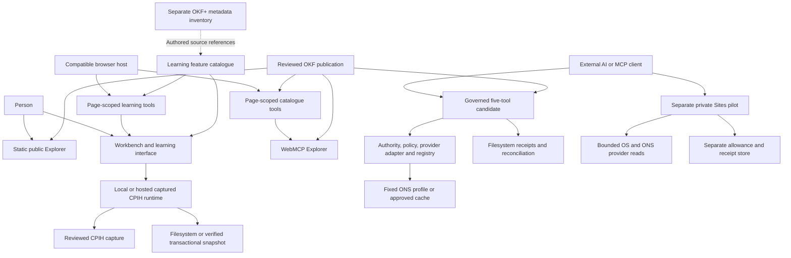
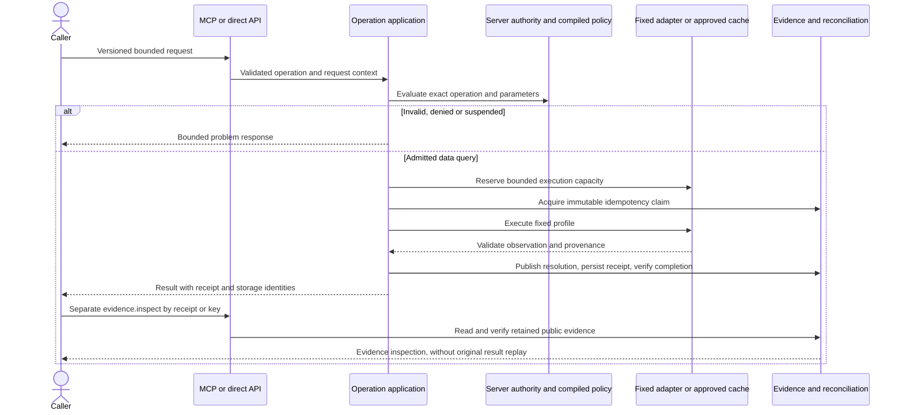

# GIS AI GO architecture and code review

This is the implemented architecture at Git commit
[`97bc45635a91064cd78f06bf0848ad7636f05439`](https://github.com/chris-page-gov/gis-ai-go/tree/97bc45635a91064cd78f06bf0848ad7636f05439).
It accompanies a repository-wide review of unused code, clarity and refactoring.
All implementation references use that immutable revision and exact GitHub line
anchors. Later comments and documentation do not move the referenced source.
Deployment statements describe the source and recorded acceptance at this baseline;
they are not a fresh observation of a hosted service.

## Reading routes

| Reader | Start here | Then read |
| --- | --- | --- |
| New to the project | The system map below, then [contracts explained](CONTRACTS.md) | One worked request in [the gateway](GATEWAY.md) |
| Implementing or maintaining a feature | The relevant component chapter | [Complete contract register](CONTRACT_REGISTER.md), implementation and tests |
| Reviewing correctness | [Formal model](FORMAL_MODEL.md) | Component invariants and their test references |
| Planning maintenance | [Prioritised code review](REVIEW.md) | [Source coverage register](SOURCE_REGISTER.md) and the affected component |
| Running or releasing the project | [Build and operations](BUILD_AND_OPERATIONS.md) | The linked maintained operator runbooks |

The component chapters are [core gateway](GATEWAY.md),
[shared packages, evidence and execution](CORE_AND_EVIDENCE.md),
[user interfaces and intake](USER_INTERFACES.md),
[experimental runtimes and knowledge](EXPERIMENTAL_AND_KNOWLEDGE.md), and
[build and operations](BUILD_AND_OPERATIONS.md). The
[contract inventory](contracts.json) and [source inventory](source-inventory.json)
provide machine-readable counterparts to the registers.

## Purpose and separation of responsibilities

GIS AI GO connects a person's or agent's question to governed discovery, bounded
operations and inspectable evidence. Its name means “give us AI governed output”.
The code implements deterministic selection and computation; it does not embed a
general-purpose model that may invent queries, grant authority or replace provider
facts. See the [product identity](https://github.com/chris-page-gov/gis-ai-go/blob/97bc45635a91064cd78f06bf0848ad7636f05439/README.md#L1-L6)
and [five-tool registry bindings](https://github.com/chris-page-gov/gis-ai-go/blob/97bc45635a91064cd78f06bf0848ad7636f05439/packages/tool-registry/src/registry.ts#L45-L110).

Arrows show dependencies or calls, not automatic authority transfer. In particular,
the learning catalogue contains authored references to OKF+; the workbench does
not directly ingest the whole OKF+ corpus. Finding a dataset in OKF+ does not admit
it to the five-tool query path. The pilot's
live-provider operations do not make the captured-CPIH path live. The Python
execution service is a separately tested synthetic boundary, described in
[core and evidence](CORE_AND_EVIDENCE.md); it is not an inferred dependency of the
fixed ONS query. The chapters trace each of these edges to implementation.

## The execution surfaces

| Surface | Inputs and outputs | Authority and storage boundary | Status at this source baseline |
| --- | --- | --- | --- |
| Public Explorer | Reviewed catalogue; cards, graph, timeline and coverage schematic | Static files, no provider execution or durable service receipts | Supported discovery product |
| WebMCP Explorer | Two page-scoped catalogue operations plus manual controls | Browser page lifetime; no persistent gateway ledger | Experimental browser integration |
| Five-tool gateway candidate | Search, describe, resolve, query and inspect | Server-built public authority, compiled policy, filesystem ledger and reconciliation | Explicit candidate entrypoints only |
| Local candidate launcher | Same five tools; approved historical ONS cache | Loopback bind, provider-free process, disposable session evidence | Local evaluation |
| Workbench CPIH | Reviewed period selection, captured observation and evidence | Local filesystem or hosted transactional snapshot implementation | Separate experimental profile |
| Private Sites pilot | Six bounded capability/provider/evidence tools | Host admission, per-provider allowance, dedicated receipt storage | Separate experimental live-data profile |
| Learning and intake | Local files, feature inventory and guided questions | Bounded parsing, provenance and explicit unsupported cases | Authored/offline experience and separately observed client facilities |
| Python execution | Fixed synthetic point/polygon request and typed result | Bounded deterministic service; envelope linkage is not authentication | Independently tested execution boundary |

The generic production activation object has empty tool and API arrays and no
environment-variable override: [activation](https://github.com/chris-page-gov/gis-ai-go/blob/97bc45635a91064cd78f06bf0848ad7636f05439/apps/mcp-gateway/src/activation.ts#L1-L25).
The candidate checks its registry projection and binds three resources:
[assembly](https://github.com/chris-page-gov/gis-ai-go/blob/97bc45635a91064cd78f06bf0848ad7636f05439/apps/mcp-gateway/src/governed-assembly.ts#L57-L87).
The pilot advertises a different bounded capability set:
[tool descriptions and limits](https://github.com/chris-page-gov/gis-ai-go/blob/97bc45635a91064cd78f06bf0848ad7636f05439/apps/mcp-gateway/src/sites-pilot-http.ts#L45-L63).
These surfaces must not be collapsed into one deployment claim.

## A request through the core candidate

This is a successful-path abstraction, not a promise that interrupted calls always
finish. Claim state, capacity release, cancellation and failure ordering are specified
in [the gateway chapter](GATEWAY.md) and [evidence chapter](CORE_AND_EVIDENCE.md).
Only `data.query` takes this provider/claim path; catalogue reads and selection
have their own application and receipt flows.

## Where an architectural change belongs

| Change | Primary owner in the code | Coupled contracts to inspect |
| --- | --- | --- |
| A new publicly callable operation | Registry, assembly and operation application | Input/output/problem schemas, authority, policy, receipts, direct API/MCP parity and lifecycle tests |
| A provider query or result shape | Provider adapter plus the admitted application profile | Source-native identifiers, rights, bounds, timeout/cache policy and result hashes |
| Evidence storage or recovery | Evidence package and operator commands | Canonicalisation, domain separation, ledger/reconciliation state machines, checkpoint publication and independent verifier |
| A UI or page-tool action | Frontend controller and optional WebMCP adapter | State transitions, display validation, cancellation, keyboard focus and result parity |
| Knowledge source ingestion | Reviewed OKF publication or distinct OKF+ acquisition/build pipeline | Source lock, provenance, record schema, rights, temporal coverage and completeness claims |
| A live Sites operation | Pilot provider, HTTP mount and pilot store | Host authentication, closed input, attempt allowance, receipt capacity and response validation |
| CI or packaging optimisation | Build/release scripts and workflow | Exact source identity, full mandatory checks and independent build/verification requirements |

The [formal model](FORMAL_MODEL.md) names the invariants to preserve. The
[review](REVIEW.md) orders concrete maintenance work. The existing
[IMPROVE-215 plan](../chronicle/IMPROVEMENT_PLAN.md) remains the staged implementation
home for broader refactoring; this review supplies a later source-specific baseline.

## Evidence, scope and maintenance

The complete Git tree contains 32,138 tracked files. Most are imported metadata
records. The [source register](SOURCE_REGISTER.md) identifies 484 code,
presentation, migration, launcher and CI files individually: 479 project-authored
files and five pinned vendor files. The [review](REVIEW.md) describes
structural checks, focused semantic traces, reproduced defects and limits. Inventory
coverage is not a claim of exhaustive semantic review of the metadata corpus or
every branch of large assurance modules.

Diagrams are text-based Mermaid sources in these chapters. GitHub renders them
beside their explanation and source links; editing the diagram and explanation
together keeps the intended boundary visible in review. Existing historical and
operational diagrams retain their provenance in [architecture/](../../architecture/README.md).

Run `python3 scripts/review_architecture.py --check` to verify the source inventory
and all immutable line anchors in this documentation. The check validates existence
and line ranges; reviewers still check whether a cited range supports the claim.
The contract generator and its checks are documented in [the contracts guide](CONTRACTS.md).
