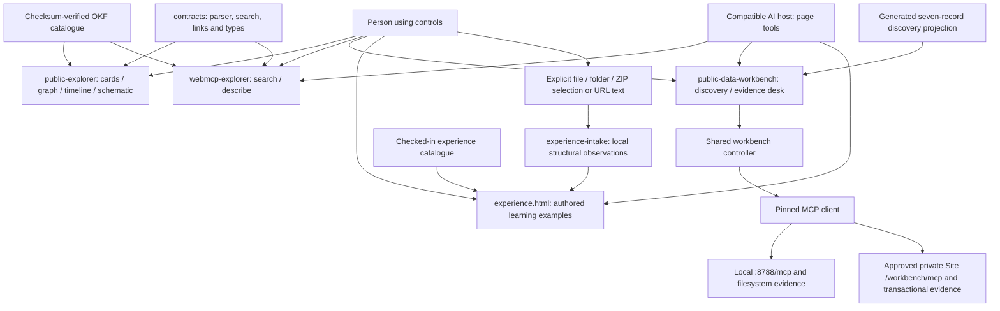
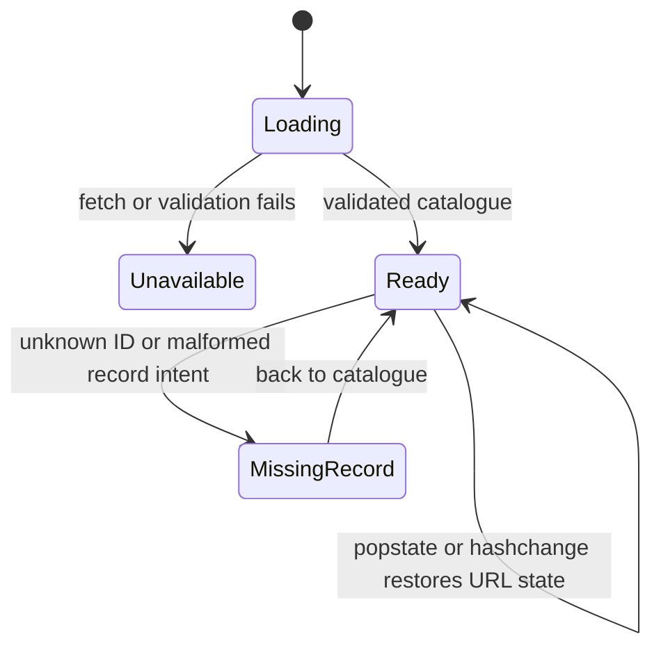
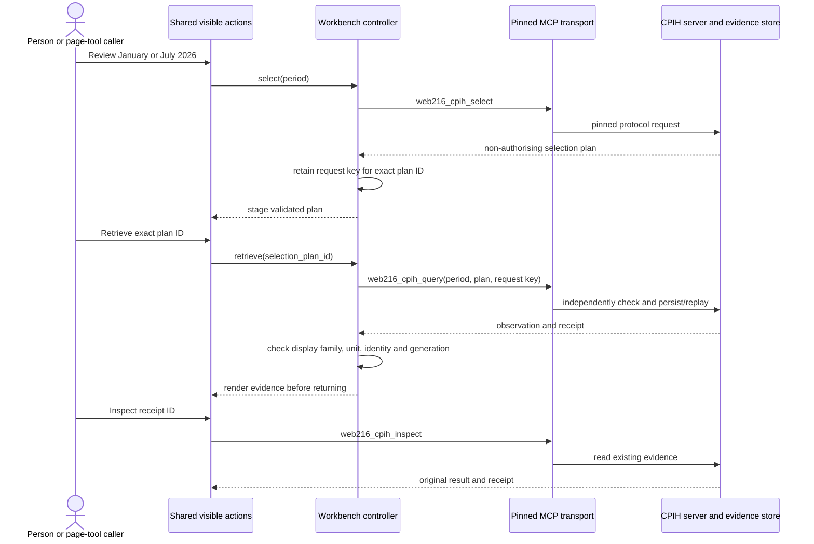
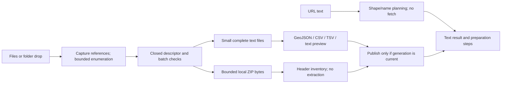

# Browser interfaces and local file intake

This chapter describes commit `97bc45635a91064cd78f06bf0848ad7636f05439`. Implementation links point to immutable Git lines. The formal rules describe observable code contracts; they are not machine-checked proofs. Known gaps are labelled as review findings.

## Application boundaries

The supported static Explorer, experimental WebMCP Explorer and experimental public-data workbench are separate builds. The workbench also contains a learning/intake page. The two Explorers read published metadata; the workbench can call a specifically selected MCP endpoint. These boundaries are deliberate in [ADR-0005][adr-static], [ADR-0013][adr-webmcp] and [ADR-0016][adr-workbench].



The two MCP destinations are mutually exclusive [build-authored modes][wb-mode]; the [transport][wb-transport] cannot choose a third server. The learning page's [returned state][learn-state] excludes file inputs and previews, and [its four tools][learn-tools] only read choices or select examples, views and explanations.

| Component | Entry and responsibility | State and effects |
| --- | --- | --- |
| Static Explorer | [Fetch and validate][pub-start], then [render four views][pub-render] | Search/facets/view in query parameters; record ID in fragment; focus/scroll hints in browser history. No provider request. |
| WebMCP Explorer | [Validate before registering tools][web-start] | Results in page memory and the visible DOM. Manual controls and AI callbacks use the same functions; no durable receipt. |
| Workbench | [Shared manual/page actions][wb-actions] | Ephemeral plan, result and request keys; receipts persist on the selected server. |
| Learning page | [Examples, personas, concepts and views][learn-render] | Feature/view fragment; [downloaded checklist][learn-download] retains unrecorded outcomes and excludes files. |
| Intake package | [Pure planner][intake-plan] and [ZIP inventory][zip] | Data-only output; no network, persistence, content execution or binary feature import. |

The Explorer's [catalogue][pub-adapter], [types][pub-types] and [link-policy][pub-links] modules are compatibility re-exports of `@gis-ai-go/contracts`, with active consumers. They are not independent implementations or dead code. The learning page currently reaches intake through a [relative source import][learn-import] rather than a declared workspace dependency in its [manifest][wb-package]; this is a coupling to consider during refactoring.

## Static Explorer: state and semantic views

[State normalisation][state-normalise] uses NFKC, collapses spaces, bounds queries and facets, and admits known tags. It preserves a well-formed unknown record ID so the [missing-record branch][pub-missing] can explain the link instead of substituting the default record. A [bare entry][pub-location] deliberately selects the INSPIRE example.



Let `C_B(s)` be canonicalisation for validated bundle `B`, `P_B(u)` URL parsing and `S_B(s,u)` URL serialisation. The implemented contracts are:

- `C_B(s).view ∈ {cards, graph, timeline, map}`. Enum facets are allowlisted, unique and sorted; more than 20 supplied values produces an empty facet. Tags must occur in `B` ([code][state-normalise]).
- `P_B` reads only documented query/fragment fields; duplicate single-value fields are discarded. Unknown well-formed record IDs survive ([parser][state-parse], [tests][state-tests]).
- `S_B` rewrites controlled parameters in stable order and removes unrelated state ([serialiser][state-serialise]).
- The desirable round-trip law `P_B(S_B(s,u)) = C_B(s)` has a **known gap, UI-02**: canonicalisation counts code points, but URL admission counts UTF-16 units. A 101-character supplementary-plane query is accepted for serialisation and discarded on reload.
- A committed action pushes history; initial setup and URL normalisation replace history. Rendering calculates matches and selected detail separately, so a directly selected record may lie outside the current filter ([history][pub-history], [selection/render][pub-render]).

Cards show rights, dates, limitations, citations and explicit sources ([detail renderer][cards]). Graph edges represent explicit source references; self-references are excluded from both SVG and the complete semantic adjacency list ([graph][graph]). Timeline distinguishes observation, modification, publication and release, showing missing dates explicitly ([timeline][timeline]). The map is an illustrative coverage schematic with no property geometry or coordinates ([map][map]).

DOM values are rendered as text, controls are labelled, results use a polite status region, and decorative diagrams have visible semantic alternatives. Tests cover [inert markup][card-tests], [graph alternatives][graph-tests], [map alternatives][map-tests], [keyboard, axe, reflow, forced colours and reduced motion][access-tests], and [JavaScript-free downloads][fallback-tests]. **UI-01 remains a focus gap**: the application [tries to focus headings][pub-history] after replacing the DOM, but rendered view/record headings lack `tabindex`. Existing journey tests [check visibility and current navigation][focus-test-gap], not the resulting active element. Passing them does not prove focus restoration.

## WebMCP Explorer: a page-tool adapter

The [registered descriptions and schemas][web-schema] are source-authored and never derived from catalogue text. Both manual controls and callbacks call `executePageSearch` or `executePageDescribe`; successful calls [render the same visible output][web-visible] before returning. [Registration][web-lifetime] requires a top-level document and `document.modelContext.registerTool`. Failure disposes the partial registration; final page hide aborts it, while a persisted back/forward-cache hide preserves it. [Tests][web-tests] exercise registration, cancellation, unsupported hosts and this lifecycle.

| Operation | Preconditions | Postconditions |
| --- | --- | --- |
| `explorer_search_catalogue` | Only `query`, optional `facets`, optional `limit`; 1–10 searchable terms, at most 256 code points, no controls/bidi; limit integer 1–5; supplied facets non-empty, closed and bounded. | `gis-ai-go.webmcp-page-result.v1`; at most `limit` compact records; total/truncation information; catalogue identity and page-only boundary. |
| `explorer_describe_record` | Only a non-empty `record_id`, at most 512 code points, exactly matching a validated record. | Same result family; record plus explicitly referenced sources, authority, access, rights, freshness and limitations. Unknown ID throws `record_not_found`. |

[Runtime parsers][web-parse] enforce these rules separately from the advertised schemas. [Result construction][web-results] caps descriptions at 240 code points, tags at eight and described limitations at eight. `provider_call`, `durable_receipt` and `persistent_service` are always false. [Closed-input tests][web-input-tests] exercise refusal. Mocked registration and callback tests establish application behaviour, not real AI-host interoperability. A page result is not a gateway receipt.

## Workbench: selection, replay and display evidence

[Discovery][wb-discovery] scores distinct ASCII English terms against generated postings for seven frozen records. It returns at most five candidates with projection provenance. A match cannot admit a dataset or period for execution.



Formal controller state is `W = (mode, busy, generation, plan, keys)`. [Mode][wb-mode-validator] is captured at construction, never inferred from a result or tool argument. `busy` admits one controller operation at a time. `generation` changes when selection starts or is invalidated. `keys[plan_id]` survives reselect/retry within the page session; it is not persistent browser storage. The current server admits two month plans ([controller][wb-controller]).

| Action | Preconditions | Success/failure rule |
| --- | --- | --- |
| Select | `¬busy`; exactly `{period}`; period in `{2026-01,2026-07}`. | Matching plan schema/period, `grants_execution=false`, correct plan-ID syntax and unchanged generation; otherwise do not stage it. |
| Retrieve | `¬busy`; exactly `{selection_plan_id}`; same staged plan and retained request key. | Call uses staged period/key. Display contract and period must match; a generation change refuses stale display even if persistence already occurred. |
| Inspect | `¬busy`; exactly `{receipt_id}` with admitted syntax. | Returned receipt ID equals requested ID. Existing evidence is read without issuing a new inspection receipt. |
| Invalidate | May occur during a pending operation. | Advance generation and clear staged plan. Cancellation cannot prove that no server receipt exists. |

[Tests][wb-controller-tests] cover missing/substituted plans, retry key reuse, overlap, generation changes and exact result identity. [Hosted tests][wb-hosted-tests] cover construction mode, family substitutions, record/event/checkpoint linkage and explicit limitations.

The [browser validator][wb-evidence] checks a **display contract**. It does not recompute all source hashes, reconstruct omitted ledger events, prove freshness or independently attest evidence. Local results require a persisted-storage marker and the local result family. Hosted results require their distinct family, selected record/event/head relationships and literal limitations describing the server's verified snapshot. Those are different contracts; neither is interchangeable with the other.

The [transport][wb-transport] pins origin, three operation names and protocol `2026-07-28`, sets a 15-second abort deadline, rejects redirects, disables caching and closes the client in `finally`. Local requests omit credentials; private-Site requests use same-origin credentials. [Transport tests][wb-transport-tests] mock the SDK to check those options. [Four page tools][wb-tools] adapt discovery plus the three server operations; each declares `readOnlyHint:false` because it changes visible state. Only retrieval changes durable server state.

## Learning and bounded local intake

The learning page renders questions/assertions from the checked-in evaluation catalogue. Persona selection changes wording through variant lookup; cards, table and evidence views change presentation, not execution status ([rendering][learn-render]). A [downloaded checklist][learn-download] keeps `observedOutcome: "not-recorded"`. [Page tools][learn-tools] accept exact feature/concept IDs or an allowed view; they cannot access file previews or generate arbitrary UI code ([tests][learn-tests]).



Folder enumeration admits 64 files, 128 entries including directories, eight path levels, 20 MiB per file, 50 MiB total and a five-second deadline. It captures drag-store references synchronously before awaiting callbacks and ignores results after abort/deadline ([enumerator][drop], [tests][drop-tests]). Intake planning separately admits 64 descriptors and eight URLs, 256 KiB per complete text preview and 1 MiB supplied preview text total ([limits and classification][intake-limits], [validation][intake-validation], [batch accounting][intake-plan]). The [UI preflights descriptors][learn-intake] before reading contents and advances a generation token when a newer selection, clear, URL or example action supersedes an old read.

For `p = planIntake(x)`, the implementation guarantees:

```text
p.policy.networkRequests = 0
p.policy.persistedFiles = 0
p.policy.executesContent = false
p.evidence.level = "local-structural-observation"
invalid descriptor shape or oversized batch => p.status = "blocked", p.items = []
empty items => p.status = "empty"
all non-empty items preview-ready => p.status = "ready"
all non-empty items blocked => p.status = "blocked"
otherwise => p.status = "attention"
```

These rules describe the [library result][intake-plan]. The browser [combines archive plans][learn-intake] and can mark the aggregate blocked; its assembled plan is not necessarily one library call's return value.

[GeoJSON preview][preview] checks JSON ambiguity, structure, finite longitude/latitude coordinates, ring closure and bounded nesting/counts. It does not establish topology, winding or suitability. CSV/TSV checks quoted cells, rectangular rows and bounded columns/cells; formulas remain literal text. Text previews are bounded excerpts. The [strict JSON parser][strict-json] refuses duplicate decoded keys, invalid surrogates, unsafe integer representations and excessive depth/value counts. Its local copy deliberately avoids a provider dependency; safe consolidation requires preserving that capability boundary.

[Shapefile grouping][shape] matches stems within folders and requires `.shp`, `.shx`, `.dbf`; absent `.prj` and `.cpg` remain explicit uncertainties. Companion names do not establish valid features. [ZIP inventory][zip] checks local/central headers, paths, duplicates, sizes, expansion ratios, descriptors and contiguous byte extents. It does not decompress or verify CRCs, and reports `contentExtracted:false` and `crcVerified:false`. [ZIP tests][zip-tests] construct real synthetic archives to exercise those rules. [URL planning][url-plan] redacts display labels, rejects local/credentialled addresses and performs no DNS or download; unsigned Shapefile URLs may yield clearly labelled candidate companion addresses.

## Contracts explained through actual examples

A contract is an agreement between caller and component: what can be supplied, what is checked, what comes back, and what effects can occur. A TypeScript interface helps developers before execution. A runtime validator checks values during execution. JSON Schema describes a machine-readable shape. None alone grants execution authority. For example, `{period:"2026-07"}` is a valid selection request, but the returned plan must say `grants_execution:false`; a later query is checked independently ([actual controller][wb-controller]).

| Contract family used here | Definition/check | Actual example or boundary |
| --- | --- | --- |
| Governed catalogue: `gis-ai-go-okf-bundle.v1`, `gis-ai-go-okf-concept.v1`; shared search/navigation types | [Parser/type exports][pub-adapter], [types][pub-types], [tests][catalogue-tests] | Public metadata with unresolved sources or protected-data flags is rejected before rendering. |
| `ExplorerState` and URL fields | [State runtime][state-normalise], [parser][state-parse], [serialiser][state-serialise] | `?view=graph&type=dataset` selects controlled state; an unknown record ID yields missing-record output. |
| View navigation callbacks | [Cards][cards-nav], [graph][graph-nav] | Views request a URL or `selectRecord`; the application owns history. |
| Two Explorer tool inputs and `gis-ai-go.webmcp-page-result.v1` | [Schemas][web-schema], [runtime][web-parse], [output][web-results] | `{query:"ONS statistics",limit:2}` is bounded; an added `endpoint` is rejected. `durable_receipt:false` is explicit. |
| WebMCP registration/execution lifetime | [Explorer adapter][web-lifetime], [workbench adapter][wb-tools], [learning adapter][learn-tools] | Only supported top-level pages register tools; final navigation disposes the registration. |
| `web216.browser-discovery.v1` | [Discovery][wb-discovery] | `consumer prices` finds candidates without admitting execution. |
| `Plan`, `EvidenceResult`, `McpCall`, `Period`, `EvidenceMode` | [Controller types/mode][wb-mode-validator], [transport][wb-transport] | Only January/July 2026 and three admitted server operations are accepted. |
| `gis-ai-go.web216-cpih-selection-plan.v1` | [Selection checks][wb-controller] | Plan ID, period and non-authorising flag must match before staging. |
| Local `gis-ai-go.web216-cpih-query-result.v1`, `gis-ai-go.public-evidence-record.v3`, `gis-ai-go.evidence-ledger-event.v1` | [Display checks][wb-evidence] | Local results require persisted storage; hosted-family substitution is refused. |
| Hosted `gis-ai-go.web216-hosted-cpih-result.v1`, `gis-ai-go.web216-cpih-result-core.v1`, `gis-ai-go.web216-cpih-receipt.v1` | [Hosted display checks][wb-evidence] | Observation, series/unit, period and receipt links must agree; no independent attestation claim. |
| `gis-ai-go.web216-transactional-record.v1`, `gis-ai-go.web216-transactional-event.v1`, `gis-ai-go.web216-transactional-head.v1`, `gis-ai-go.web216-hosted-storage-observation.v1` | [Hosted subset checks][wb-evidence] | Returned record/event/head are linked, while omitted chain and freshness remain outside the page's verification. |
| `gis-ai-go.experience-page-state.v1`, learning action arguments, `gis-ai-go.experience-checklist.v1` | [State][learn-state], [actions][learn-tools], [checklist][learn-download] | A tool changes `view` to `table`; it cannot read selected files. |
| `IntakeRequest`, `IntakePlan` / `experience-intake.v1` | [Types][intake-types], [request schema][intake-request-schema], [result schema][intake-result-schema], [runtime][intake-validation] | `{name:"visits.csv",size:21,text:"place,count\nExample,3"}` is a descriptor; output is a local observation, not an upload acknowledgement. |
| Strict JSON, ZIP and preview resource limits | [JSON][strict-json], [ZIP][zip], [previews][preview] | Duplicate keys and inconsistent headers are refused. Format recognition cannot establish licence or geometry validity. |
| Build/publication inventory, CSP and checksum contracts | [Static pre-build][pub-build], [static post-build][pub-dist], [WebMCP HTML][web-html] | Extra assets, symlinks and checksum mismatches fail the applicable build check. |

This inventory covers runtime families consumed or produced in these browser/intake components. The server's full contract catalogue is wider. Linked implementations retain the exact fields and literals; the chapter does not create a second drifting schema.

## Build and assurance

The static Explorer [copies checksum-verified catalogue bytes][pub-prepare], checks public/dist trees before building, and [checks exact distributed bytes, HTML/CSP and inventory][pub-dist] afterwards. WebMCP has a separate [generated marker/checksum copy][web-prepare], [distribution allowlist][web-dist] and [active-asset HTML checker][web-html]. Their traversal/checksum code overlaps but their policies differ.

Workbench [build modes][wb-build] choose ordinary, hosted or offline-experience entries/output paths. Hosted mode requires exact replacement of three boundary labels and fails if source labels drift. Offline packaging/browser checks are separate from Vite compilation. A passing build does not establish a live AI connection.

Assurance layers include state/contract unit tests, DOM component tests, build-boundary tests and Playwright journeys. [Public-deployment tests][pub-deploy-tests] separately check expected source identity and checksum-rooted published bytes. [Chrome preflight][chrome-preflight] reports persisted profile settings and explicitly does not prove the live API or a browser relaunch.

Review priorities are: repair heading focus and Unicode round-trips; remove only confirmed unused local helpers/parameters; extract named predicates from hosted display checks; separate learning rendering from file-read orchestration; and consolidate navigation/build primitives without merging distinct policies. These are review recommendations. The documentation/comment changes do not refactor or delete runtime behaviour.

[adr-static]: https://github.com/chris-page-gov/gis-ai-go/blob/97bc45635a91064cd78f06bf0848ad7636f05439/docs/decisions/ADR-0005-static-public-explorer.md#L9-L36
[adr-webmcp]: https://github.com/chris-page-gov/gis-ai-go/blob/97bc45635a91064cd78f06bf0848ad7636f05439/docs/decisions/ADR-0013-webmcp-page-tools-boundary.md#L35-L82
[adr-workbench]: https://github.com/chris-page-gov/gis-ai-go/blob/97bc45635a91064cd78f06bf0848ad7636f05439/docs/decisions/ADR-0016-webmcp-public-data-workbench.md#L24-L60
[wb-mode]: https://github.com/chris-page-gov/gis-ai-go/blob/97bc45635a91064cd78f06bf0848ad7636f05439/apps/public-data-workbench/src/main.ts#L17-L21
[wb-transport]: https://github.com/chris-page-gov/gis-ai-go/blob/97bc45635a91064cd78f06bf0848ad7636f05439/apps/public-data-workbench/src/mcp-client.ts#L1-L46
[learn-state]: https://github.com/chris-page-gov/gis-ai-go/blob/97bc45635a91064cd78f06bf0848ad7636f05439/apps/public-data-workbench/src/experience.ts#L24-L29
[learn-tools]: https://github.com/chris-page-gov/gis-ai-go/blob/97bc45635a91064cd78f06bf0848ad7636f05439/apps/public-data-workbench/src/experience-tools.ts#L1-L45
[pub-start]: https://github.com/chris-page-gov/gis-ai-go/blob/97bc45635a91064cd78f06bf0848ad7636f05439/apps/public-explorer/src/main.ts#L581-L598
[pub-render]: https://github.com/chris-page-gov/gis-ai-go/blob/97bc45635a91064cd78f06bf0848ad7636f05439/apps/public-explorer/src/main.ts#L457-L534
[web-start]: https://github.com/chris-page-gov/gis-ai-go/blob/97bc45635a91064cd78f06bf0848ad7636f05439/apps/webmcp-explorer/src/main.ts#L145-L187
[wb-actions]: https://github.com/chris-page-gov/gis-ai-go/blob/97bc45635a91064cd78f06bf0848ad7636f05439/apps/public-data-workbench/src/main.ts#L81-L118
[learn-render]: https://github.com/chris-page-gov/gis-ai-go/blob/97bc45635a91064cd78f06bf0848ad7636f05439/apps/public-data-workbench/src/experience.ts#L7-L93
[learn-download]: https://github.com/chris-page-gov/gis-ai-go/blob/97bc45635a91064cd78f06bf0848ad7636f05439/apps/public-data-workbench/src/experience.ts#L167-L173
[intake-plan]: https://github.com/chris-page-gov/gis-ai-go/blob/97bc45635a91064cd78f06bf0848ad7636f05439/packages/experience-intake/src/index.ts#L192-L228
[zip]: https://github.com/chris-page-gov/gis-ai-go/blob/97bc45635a91064cd78f06bf0848ad7636f05439/packages/experience-intake/src/zip.ts#L12-L132
[pub-adapter]: https://github.com/chris-page-gov/gis-ai-go/blob/97bc45635a91064cd78f06bf0848ad7636f05439/apps/public-explorer/src/catalogue.ts#L1-L32
[pub-types]: https://github.com/chris-page-gov/gis-ai-go/blob/97bc45635a91064cd78f06bf0848ad7636f05439/apps/public-explorer/src/types.ts#L1-L42
[pub-links]: https://github.com/chris-page-gov/gis-ai-go/blob/97bc45635a91064cd78f06bf0848ad7636f05439/apps/public-explorer/src/links.ts#L1-L4
[learn-import]: https://github.com/chris-page-gov/gis-ai-go/blob/97bc45635a91064cd78f06bf0848ad7636f05439/apps/public-data-workbench/src/experience.ts#L1-L5
[wb-package]: https://github.com/chris-page-gov/gis-ai-go/blob/97bc45635a91064cd78f06bf0848ad7636f05439/apps/public-data-workbench/package.json#L16-L25
[state-normalise]: https://github.com/chris-page-gov/gis-ai-go/blob/97bc45635a91064cd78f06bf0848ad7636f05439/apps/public-explorer/src/state.ts#L13-L99
[pub-missing]: https://github.com/chris-page-gov/gis-ai-go/blob/97bc45635a91064cd78f06bf0848ad7636f05439/apps/public-explorer/src/main.ts#L436-L470
[pub-location]: https://github.com/chris-page-gov/gis-ai-go/blob/97bc45635a91064cd78f06bf0848ad7636f05439/apps/public-explorer/src/main.ts#L543-L563
[state-parse]: https://github.com/chris-page-gov/gis-ai-go/blob/97bc45635a91064cd78f06bf0848ad7636f05439/apps/public-explorer/src/state.ts#L101-L165
[state-tests]: https://github.com/chris-page-gov/gis-ai-go/blob/97bc45635a91064cd78f06bf0848ad7636f05439/apps/public-explorer/test/unit/state.test.ts#L31-L82
[state-serialise]: https://github.com/chris-page-gov/gis-ai-go/blob/97bc45635a91064cd78f06bf0848ad7636f05439/apps/public-explorer/src/state.ts#L168-L198
[pub-history]: https://github.com/chris-page-gov/gis-ai-go/blob/97bc45635a91064cd78f06bf0848ad7636f05439/apps/public-explorer/src/main.ts#L96-L139
[cards]: https://github.com/chris-page-gov/gis-ai-go/blob/97bc45635a91064cd78f06bf0848ad7636f05439/apps/public-explorer/src/views/cards.ts#L174-L317
[graph]: https://github.com/chris-page-gov/gis-ai-go/blob/97bc45635a91064cd78f06bf0848ad7636f05439/apps/public-explorer/src/views/graph.ts#L37-L216
[timeline]: https://github.com/chris-page-gov/gis-ai-go/blob/97bc45635a91064cd78f06bf0848ad7636f05439/apps/public-explorer/src/views/timeline.ts#L12-L134
[map]: https://github.com/chris-page-gov/gis-ai-go/blob/97bc45635a91064cd78f06bf0848ad7636f05439/apps/public-explorer/src/views/map.ts#L68-L173
[card-tests]: https://github.com/chris-page-gov/gis-ai-go/blob/97bc45635a91064cd78f06bf0848ad7636f05439/apps/public-explorer/test/component/cards.test.ts#L13-L26
[graph-tests]: https://github.com/chris-page-gov/gis-ai-go/blob/97bc45635a91064cd78f06bf0848ad7636f05439/apps/public-explorer/test/component/graph.test.ts#L41-L61
[access-tests]: https://github.com/chris-page-gov/gis-ai-go/blob/97bc45635a91064cd78f06bf0848ad7636f05439/apps/public-explorer/test/browser/accessibility.spec.ts#L27-L158
[fallback-tests]: https://github.com/chris-page-gov/gis-ai-go/blob/97bc45635a91064cd78f06bf0848ad7636f05439/apps/public-explorer/test/browser/security.spec.ts#L45-L68
[focus-test-gap]: https://github.com/chris-page-gov/gis-ai-go/blob/97bc45635a91064cd78f06bf0848ad7636f05439/apps/public-explorer/test/browser/journeys.spec.ts#L293-L310
[web-schema]: https://github.com/chris-page-gov/gis-ai-go/blob/97bc45635a91064cd78f06bf0848ad7636f05439/apps/webmcp-explorer/src/webmcp-adapter.ts#L41-L137
[web-visible]: https://github.com/chris-page-gov/gis-ai-go/blob/97bc45635a91064cd78f06bf0848ad7636f05439/apps/webmcp-explorer/src/main.ts#L98-L142
[web-lifetime]: https://github.com/chris-page-gov/gis-ai-go/blob/97bc45635a91064cd78f06bf0848ad7636f05439/apps/webmcp-explorer/src/webmcp-adapter.ts#L151-L226
[web-tests]: https://github.com/chris-page-gov/gis-ai-go/blob/97bc45635a91064cd78f06bf0848ad7636f05439/apps/webmcp-explorer/test/unit/webmcp-adapter.test.ts#L9-L96
[web-parse]: https://github.com/chris-page-gov/gis-ai-go/blob/97bc45635a91064cd78f06bf0848ad7636f05439/apps/webmcp-explorer/src/catalogue-tools.ts#L130-L277
[web-results]: https://github.com/chris-page-gov/gis-ai-go/blob/97bc45635a91064cd78f06bf0848ad7636f05439/apps/webmcp-explorer/src/catalogue-tools.ts#L279-L389
[web-input-tests]: https://github.com/chris-page-gov/gis-ai-go/blob/97bc45635a91064cd78f06bf0848ad7636f05439/apps/webmcp-explorer/test/unit/catalogue-tools.test.ts#L12-L75
[wb-discovery]: https://github.com/chris-page-gov/gis-ai-go/blob/97bc45635a91064cd78f06bf0848ad7636f05439/apps/public-data-workbench/src/discovery.ts#L1-L28
[wb-mode-validator]: https://github.com/chris-page-gov/gis-ai-go/blob/97bc45635a91064cd78f06bf0848ad7636f05439/apps/public-data-workbench/src/controller.ts#L1-L33
[wb-controller]: https://github.com/chris-page-gov/gis-ai-go/blob/97bc45635a91064cd78f06bf0848ad7636f05439/apps/public-data-workbench/src/controller.ts#L113-L160
[wb-controller-tests]: https://github.com/chris-page-gov/gis-ai-go/blob/97bc45635a91064cd78f06bf0848ad7636f05439/apps/public-data-workbench/test/controller.test.ts#L58-L105
[wb-hosted-tests]: https://github.com/chris-page-gov/gis-ai-go/blob/97bc45635a91064cd78f06bf0848ad7636f05439/apps/public-data-workbench/test/controller.test.ts#L114-L220
[wb-evidence]: https://github.com/chris-page-gov/gis-ai-go/blob/97bc45635a91064cd78f06bf0848ad7636f05439/apps/public-data-workbench/src/controller.ts#L49-L112
[wb-transport-tests]: https://github.com/chris-page-gov/gis-ai-go/blob/97bc45635a91064cd78f06bf0848ad7636f05439/apps/public-data-workbench/test/mcp-client.test.ts#L27-L70
[wb-tools]: https://github.com/chris-page-gov/gis-ai-go/blob/97bc45635a91064cd78f06bf0848ad7636f05439/apps/public-data-workbench/src/webmcp.ts#L1-L59
[learn-tests]: https://github.com/chris-page-gov/gis-ai-go/blob/97bc45635a91064cd78f06bf0848ad7636f05439/apps/public-data-workbench/test/experience-tools.test.ts#L5-L33
[drop]: https://github.com/chris-page-gov/gis-ai-go/blob/97bc45635a91064cd78f06bf0848ad7636f05439/apps/public-data-workbench/src/experience-drop.ts#L1-L156
[drop-tests]: https://github.com/chris-page-gov/gis-ai-go/blob/97bc45635a91064cd78f06bf0848ad7636f05439/apps/public-data-workbench/test/experience-drop.test.ts#L32-L159
[intake-limits]: https://github.com/chris-page-gov/gis-ai-go/blob/97bc45635a91064cd78f06bf0848ad7636f05439/packages/experience-intake/src/index.ts#L6-L47
[intake-validation]: https://github.com/chris-page-gov/gis-ai-go/blob/97bc45635a91064cd78f06bf0848ad7636f05439/packages/experience-intake/src/index.ts#L81-L126
[learn-intake]: https://github.com/chris-page-gov/gis-ai-go/blob/97bc45635a91064cd78f06bf0848ad7636f05439/apps/public-data-workbench/src/experience.ts#L115-L166
[preview]: https://github.com/chris-page-gov/gis-ai-go/blob/97bc45635a91064cd78f06bf0848ad7636f05439/packages/experience-intake/src/previews.ts#L9-L157
[strict-json]: https://github.com/chris-page-gov/gis-ai-go/blob/97bc45635a91064cd78f06bf0848ad7636f05439/packages/experience-intake/src/strict-json.ts#L1-L155
[shape]: https://github.com/chris-page-gov/gis-ai-go/blob/97bc45635a91064cd78f06bf0848ad7636f05439/packages/experience-intake/src/index.ts#L128-L150
[zip-tests]: https://github.com/chris-page-gov/gis-ai-go/blob/97bc45635a91064cd78f06bf0848ad7636f05439/packages/experience-intake/test/zip.test.ts#L42-L103
[url-plan]: https://github.com/chris-page-gov/gis-ai-go/blob/97bc45635a91064cd78f06bf0848ad7636f05439/packages/experience-intake/src/index.ts#L153-L189
[catalogue-tests]: https://github.com/chris-page-gov/gis-ai-go/blob/97bc45635a91064cd78f06bf0848ad7636f05439/apps/public-explorer/test/unit/catalogue.test.ts#L20-L82
[cards-nav]: https://github.com/chris-page-gov/gis-ai-go/blob/97bc45635a91064cd78f06bf0848ad7636f05439/apps/public-explorer/src/views/cards.ts#L16-L19
[graph-nav]: https://github.com/chris-page-gov/gis-ai-go/blob/97bc45635a91064cd78f06bf0848ad7636f05439/apps/public-explorer/src/views/graph.ts#L4-L7
[intake-types]: https://github.com/chris-page-gov/gis-ai-go/blob/97bc45635a91064cd78f06bf0848ad7636f05439/packages/experience-intake/src/types.ts#L1-L87
[intake-request-schema]: https://github.com/chris-page-gov/gis-ai-go/blob/97bc45635a91064cd78f06bf0848ad7636f05439/packages/experience-intake/schema/request.v1.schema.json#L1-L54
[intake-result-schema]: https://github.com/chris-page-gov/gis-ai-go/blob/97bc45635a91064cd78f06bf0848ad7636f05439/packages/experience-intake/schema/result.v1.schema.json#L1-L60
[pub-build]: https://github.com/chris-page-gov/gis-ai-go/blob/97bc45635a91064cd78f06bf0848ad7636f05439/apps/public-explorer/scripts/build-boundary.mjs#L36-L172
[pub-dist]: https://github.com/chris-page-gov/gis-ai-go/blob/97bc45635a91064cd78f06bf0848ad7636f05439/apps/public-explorer/scripts/check-dist.mjs#L97-L198
[web-html]: https://github.com/chris-page-gov/gis-ai-go/blob/97bc45635a91064cd78f06bf0848ad7636f05439/apps/webmcp-explorer/scripts/html-boundary.mjs#L44-L120
[pub-prepare]: https://github.com/chris-page-gov/gis-ai-go/blob/97bc45635a91064cd78f06bf0848ad7636f05439/apps/public-explorer/scripts/prepare-data.mjs#L53-L130
[web-prepare]: https://github.com/chris-page-gov/gis-ai-go/blob/97bc45635a91064cd78f06bf0848ad7636f05439/apps/webmcp-explorer/scripts/prepare-data.mjs#L18-L50
[web-dist]: https://github.com/chris-page-gov/gis-ai-go/blob/97bc45635a91064cd78f06bf0848ad7636f05439/apps/webmcp-explorer/scripts/check-dist.mjs#L14-L62
[wb-build]: https://github.com/chris-page-gov/gis-ai-go/blob/97bc45635a91064cd78f06bf0848ad7636f05439/apps/public-data-workbench/vite.config.ts#L1-L22
[pub-deploy-tests]: https://github.com/chris-page-gov/gis-ai-go/blob/97bc45635a91064cd78f06bf0848ad7636f05439/apps/public-explorer/test/browser/public-deployment.spec.ts#L137-L232
[chrome-preflight]: https://github.com/chris-page-gov/gis-ai-go/blob/97bc45635a91064cd78f06bf0848ad7636f05439/apps/webmcp-explorer/scripts/chrome-preflight.mjs#L48-L120
[map-tests]: https://github.com/chris-page-gov/gis-ai-go/blob/97bc45635a91064cd78f06bf0848ad7636f05439/apps/public-explorer/test/component/map.test.ts#L6-L22
