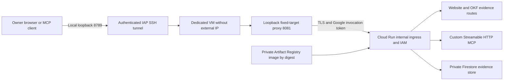

# Private GCP architecture

The GCP pilot is an additive assembly over the current GIS AI GO implementation.
It serves a website, admitted OKF/OKF+ knowledge and custom Streamable HTTP MCP
from one private origin. It preserves the original OKF, public Explorer,
loopback-only local candidate, Sites/Workers/D1 adapters and their existing gates.
See [repository discovery](REPOSITORY_DISCOVERY.md) for inspected paths, selected
consumers, actual record counts and excluded facilities.

## Personal path

The access VM uses the selected VPC/subnet with Private Google Access. SSH ingress
is limited to the documented IAP TCP forwarding range `35.235.240.0/20`, TCP 22,
and the dedicated VM target. There is no external VM address, public proxy, LAN
listener, public web firewall rule, Cloud NAT or external load balancer in the
baseline. OS Login and narrow IAP/SSH access identify the operator.

This VM provides the owner's private route into Cloud Run; it does not host the
application or evidence database. The proposed personal configuration runs it
on demand. `apply` stops it after bootstrap; an approved `connect` starts only the
owned VM and attempts to stop it on exit/error, with a one-hour tunnel limit.
An attached Compute instance schedule stops it hourly in UTC and has no start
schedule. Scheduling may be delayed by 15 minutes and has not been exercised in
GCP here. A private cooperative CLI ledger reserves 1.25 hours per session against
the configured ceiling. The example 80-hour ceiling is a proposed usage assumption,
not approved operating authority or a hard financial cap. Stopping preserves the
boot disk and does not remove DNS/storage charges.

The proxy has one fixed HTTPS Cloud Run target. It verifies TLS, sets the reviewed
upstream Host/SNI, rejects arbitrary target selection and obtains short-lived,
audience-bound Google credentials from its attached service account. Its token
is never returned to the browser. The connection script binds the laptop side to
`127.0.0.1`; forwarding through the tunnel does not weaken application Host or
Origin validation.

Cloud Run uses `internal` ingress and an explicit invoker IAM binding. The
`run.app` hostname may remain publicly resolvable: DNS resolution and a Google
edge TLS response do not establish application reachability. Acceptance must
exercise a public-origin request with an otherwise valid invocation credential,
an unauthorised project/source and the permitted inside path. A `403` without
its cause is insufficient to distinguish network denial from IAM denial.

Private Google Access, DNS, routes, service ingress and invocation IAM are
separate controls. Google documents VPC and Shared VPC source-specific semantics;
configuration alone is not proof that the selected path is internal. Personal
Google API/Firestore/JWKS traffic uses Private Google Access and the private Google
API VIP. BDUK identity traffic additionally needs the platform-approved HTTPS path
to its exact Okta discovery, authorisation, token and JWKS endpoints. The browser's
SSO redirect and server token/JWKS requests are declared identity traffic; they do
not grant live-provider or model egress. Application URL allowlisting does not
create that network route or change an enterprise firewall. A stricter
internal-IP requirement needs an approved Private Service Connect or internal
load-balancer topology. Such resources are not silently added to this pilot.

## BDUK path

The same application and release contract accepts the platform's approved
project, private network/subnet, image registry, runtime identity, storage and
logging choices through a separate profile/state. It consumes enterprise
resources rather than changing an organisation, attaching billing, creating an
unapproved Shared VPC or modifying federation. BDUK users connect through the
approved enterprise route instead of a personal VM/tunnel.

The platform must validate Cloud Run ingress recognition for that actual Shared
VPC, service project and source route. It must provide permitted DNS/routes,
Google API access, deployer identities and inside/outside test sources. Missing
platform inputs leave deployment blocked while local implementation and the
review ZIP remain usable.

## Four trust layers

| Layer | Principal or decision | Evidence required |
| --- | --- | --- |
| Network | Approved connection and network origin | Actual permitted/forbidden network-path observations |
| Transport | Google principal permitted to invoke Cloud Run | IAM binding and audience-bound invocation proof |
| Human/client | Independently verified OIDC issuer, subject, audience and claims | Real token/sign-in and forbidden identity tests |
| Application | Server-side release, classification, role/tool and ownership policy | Discovery, invocation, resource and evidence decisions |

The proxy's service account proves a workload/transport principal. It is not the
human and cannot grant everyone its privileges. Application bearer validation
must remain distinct from Google invocation authentication. The proxy uses the
separate invocation header and preserves the application `Authorization` header;
it must reject or replace client attempts to inject trusted proxy credentials.
Runtime acceptance checks both tokens independently and rejects caller-written
identity, group, purpose and role assertions.

The first personal milestone is `single-owner-transport-pilot`. Local verified
identity fixtures can test policy logic, but the deployed service has no public
role-switch route and does not accept query/header role claims. The optional browser adapter in `gcp-oidc-browser.ts` uses maintained
`openid-client` 6.8.8 for exact-issuer discovery, S256 PKCE, state/nonce and code
grant validation. `/auth/login` creates a five-minute flow; `/auth/callback`
consumes it once using a Firestore compare-and-swap and issues an encrypted
`__Host-gis-browser` cookie with Secure, HttpOnly and SameSite=Lax. Cookie sessions
have a five-minute maximum, verified token/subject binding and server-side session
state. Mutating cookie-authenticated requests and POST `/auth/logout` require the
canonical Origin; logout revokes the stored session. Flow/session expiry prevents use. Storage uses 256 fixed slots for each family
(512 documents total), reusing expired slots through compare-and-swap with bounded
attempts; it does not accumulate an unlimited collection of expired flows. Slot
reuse is not a backup/deletion or retention guarantee.

This implementation requires approved exact discovery/authorisation/token/JWKS
endpoints, callback and client registration. Runtime keys/client secrets come from
pinned Secret Manager version references, never from the release manifest. The
personal transport profile has `identity.browser: null`; BDUK deployment requires
the configured approved registration. Real hosted browser sign-in, token/group
revocation, OAuth resource/server discovery, client registration and an independent
authenticated MCP client remain distinct acceptance gates.

Google Workforce Identity Federation with Okta requires a Google Cloud
organisation. Okta OIDC/SAML workforce federation determines Google access; an
application OIDC integration determines application identity. They are different
architectures. SAML upstream federation does not become the bearer token contract
for `/mcp`, and arbitrary Okta claims are not assumed to appear in IAP headers.
The approved exact issuer, audiences, tenant/group mapping, token lifetime and
revocation model must be supplied and tested in BDUK.

## Release and data flow

Only allowlisted source/public outputs enter the generated build context. The
prepare step records source/working-tree identity, dependency locks, file hashes,
rights, bundle/content roots and consumers. Public metadata projections remain
separate from private original archives. The original OKF build supplies 36 records and the expanded OKF+ build supplies
30,833 retained metadata records plus its verified context outputs. The prepared
image also includes the admitted cached CPIH projection and all three existing
Explorer/workbench distributions. These are different count grains. The current
OKF+ corpus is included;
serving only the older 36-record OKF catalogue does not meet this contract.

An immutable container digest pins the release. The additive image uses a pinned
Debian-based Node image; it does not inherit the older hardened UBI candidate
image's acceptance. Record actual build/provenance/scan and resource measurements
for this pilot. The full metadata outputs are hundreds of MiB; preparation must
measure context/image size and runtime startup/memory before hosted sizing is
approved. Admitted bundle outputs may be
baked into that image for this bounded pilot; any private bucket publication must
use uniform bucket-level access, public access prevention, read-only runtime IAM
and verified content identities. No shareable signed URL replaces policy-controlled
bundle/API/evidence access. A rollback restores an explicitly compatible image,
bundle and policy combination rather than a mutable `latest` folder.

No external model or live-provider operation is required. Captured statistical
observations keep their original source dates and cached status. Metadata/schema
access does not grant licensed feature or secure-data access. Browser assets are
same-origin; actual runtime and page-network checks must establish the declared
egress boundary. All outputs sent to an external AI client are onward transfer,
even when the server/storage stay in GCP; only admitted public/synthetic material
is permitted for initial personal client tests.

## Transactional state

[ADR-0019](../../decisions/ADR-0019-network-private-gcp-pilot.md) selects Firestore
for GCP claim/receipt persistence. Cloud Run files and a Cloud Storage FUSE mount
are not transactional stores. The adapter must preserve canonical evidence,
principal/operation-scoped idempotency, conflict fingerprints, compare-and-swap
semantics and loss-of-response reconciliation. Request handlers never create a
new history to hide missing/corrupt state.

The Firestore adapter uses strong reads and an atomic single-document commit
with an exact `updateTime` compare-and-swap precondition. Its closed compatibility
layer reuses the maintained CPIH snapshot contract without executing SQL or
requiring a D1 binding. State retries must not repeat an external action. The baseline has no external provider side effects. Successful
responses require persisted evidence; cancellation or acknowledgement loss after
an issued write remains uncertain until reconciled. Local emulation/injected
storage tests do not prove hosted persistence, cross-revision reads or recovery.
The complete store has a bounded pilot capacity. The receipt retention boundary
is enforced on read/replay; that does not physically delete retained records.
There is no claimed automatic deletion, backup/restore objective or independent
rollback anchor unless separately
configured and exercised. Retention decisions survive application rollback.

## Official sources

Reviewed as architecture sources on 5 October 2026; exact flags/topology still
require validation in the selected project:

- [Custom MCP hosting on Cloud Run](https://docs.cloud.google.com/run/docs/host-mcp-servers)
- [Cloud Run private networking](https://docs.cloud.google.com/run/docs/securing/private-networking)
- [Cloud Run ingress semantics](https://docs.cloud.google.com/run/docs/securing/ingress)
- [IAP TCP forwarding](https://docs.cloud.google.com/iap/docs/using-tcp-forwarding)
- [Okta workforce federation](https://docs.cloud.google.com/iam/docs/workforce-sign-in-okta)
- [Cloud Run container contract](https://docs.cloud.google.com/run/docs/container-contract)
- [Cloud Storage volume limitations](https://docs.cloud.google.com/run/docs/configuring/services/cloud-storage-volume-mounts)
- [MCP authorisation, pinned 2026-07-28 specification](https://modelcontextprotocol.io/specification/2026-07-28/basic/authorization)
