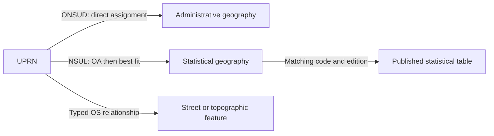

# Explain geography, dates and classifications

Method version: 2. Reviewed: 21 October 2026.
This guide defines proposed explanation and chart-suggestion rules. It adds no
executor, dataset, provider request or claim about an implemented service.

A place name, a boundary and a statistic answer different questions. Start with
the question, then choose a published relationship or lookup that answers it.
Use geometry when the question needs it, rather than recalculating a relationship
that an authoritative source already supplies.

## Choose the relationship before a spatial calculation

A Unique Property Reference Number (UPRN) identifies an addressable object. It
is not a person, household count or building outline. Three routes are useful:

| Question | Published route | Meaning to retain |
| --- | --- | --- |
| Which administrative assignment is supplied for an address point? | ONS UPRN Directory (ONSUD) | Point-based allocation to the specified geography edition, with documented exceptions. |
| Which statistical area should represent the address? | National Statistics UPRN Lookup (NSUL) | Address-point allocation to an Output Area (OA), then Census-population best fit to higher areas. |
| Which street or topographic feature is associated with this identifier? | OS Linked Identifiers or a documented native reference | The particular relationship, direction, feature types and endpoint versions. |

ONS describes the first two methods in its
[national statistics address products guidance](https://www.ons.gov.uk/methodology/geography/geographicalproducts/nationalstatisticsaddressproducts).
ONSUD and NSUL cover Great Britain; do not extend that scope to Northern Ireland.
An NSUL higher-area assignment does not prove that the point lies inside that
higher-area polygon. The [ONSUD Epoch 128 September 2026 user guide (ZIP)](https://www.arcgis.com/sharing/rest/content/items/be9d01d5afd7444c90a4dff39088df15/data),
pages 5 to 7, describes boundary-offset and nearest-area exceptions. Some fields
are derived through OA, LSOA or local-authority assignments rather than allocated
directly. The guide covers current and previous UPRNs, so it does not justify an
unfiltered current-only list. An ONSUD assignment does not establish containment
of every part of a property or building footprint.

The diagram shows different relationship types, not interchangeable routes.
A published lookup can also select its UPRN rows by area code without a new local
spatial join. Preserve one-to-many results, unmatched records and source dates.
The [OS Linked Identifiers documentation](https://docs.os.uk/os-apis/accessing-os-apis/os-linked-identifiers-api.md)
and [bridge acceptance method](OS_IDENTIFIER_GEOGRAPHY_BRIDGES.md) explain why
an association does not automatically establish building containment, road access
or a missing link in a chain. Use a separately justified spatial method when
published relationships do not answer the question.

## Show four dates, not one “last updated” label

| Date | What it tells the reader |
| --- | --- |
| Reference date or period | When the population, condition or measurement is represented. |
| Geography date or edition | Which boundary and code system the observation uses. |
| Product release or version | Which lookup, classification or statistical publication was supplied; retain address epochs separately where present. |
| Retrieval date | When the application obtained that version. |

A catalogue-page edit is not a new statistical reference period. A later download
does not make older boundaries current. Record the source's date labels and
unresolved conflicts rather than replacing them with one convenient date.
[Census geography guidance](https://www.ons.gov.uk/methodology/geography/ukgeographies/censusgeographies/census2021geographies)
describes changes between geography editions; the
[ONS Census quality and methodology guidance](https://www.ons.gov.uk/peoplepopulationandcommunity/populationandmigration/populationestimates/methodologies/qualityandmethodologyinformationqmiforcensus2021)
explains the statistical basis separately.

## Codes and local government reorganisation

Use the Register of Geographic Codes (RGC) for code and entity-type reference,
and the Code History Database (CHD) for published history, including live and
terminated entities. A name or code prefix is not a reliable parent relationship.
A type dictionary alone does not establish predecessor, successor or boundary
continuity. See [ONS names, codes and lookups](https://www.ons.gov.uk/methodology/geography/geographicalproducts/namescodesandlookups)
and the [CHD method](https://www.ons.gov.uk/methodology/geography/geographicalproducts/namescodesandlookups/codehistorydatabasechd).

Retain source-native validity dates wherever supplied, separately from the four
observation and publication dates above. Require the verified source field and
its definition before labelling a date “valid from” or “valid to”; missing dates
remain unknown. A proposed reorganisation does not make a successor code valid
before its effective date. Keep predecessor and successor relationships rather
than rewriting historical observations with today's code.

For local government reorganisation (LGR), distinguish the administrative change
from the statistical reporting geography. Require a dated correspondence for
splits, mergers or transferred areas. That correspondence does not itself provide
population weights or a valid statistical conversion. Prefer an official
higher-area table; otherwise explain the allocation method, coverage and limits.
The [ONS best-fit population methodology](https://www.ons.gov.uk/peoplepopulationandcommunity/populationandmigration/populationestimates/methodologies/methodologynoteonproductionofpopulationestimatesbyoutputareaselectoralhealthandothergeographiesenglandandwales)
shows why reporting areas and exact boundaries can differ.

## Offer settlement areas as a different selection

A built-up area (BUA) can answer a settlement question that an administrative
boundary does not. Keep the requested area, the drawn boundary and the statistical
reporting area visible. ONS's revised England and Wales BUA geography has a London
exception and is not directly comparable with the 2011 BUA geography. The
[ONS BUA explanation](https://www.ons.gov.uk/peoplepopulationandcommunity/housing/articles/townsandcitiescharacteristicsofbuiltupareasenglandandwales/census2021)
and [May 2026 towns analysis](https://www.ons.gov.uk/peoplepopulationandcommunity/populationandmigration/populationestimates/articles/understandingtownsinenglandandwalesinvestigatingsocioeconomictrends/may2026)
state their geography and analysis scopes.

OS Open Built Up Areas covers Great Britain and offers three feature types:
Built Up Areas, Built Up Extents and Non Built Up Extents. These describe
settlements and their components, not individual building footprints. The
[product overview](https://docs.os.uk/os-downloads/products/areas-and-zones-portfolio/os-open-built-up-areas/os-open-built-up-areas-overview)
sets a minimum area of 20 hectares. The
[feature definition](https://docs.os.uk/os-downloads/products/areas-and-zones-portfolio/os-open-built-up-areas/os-open-built-up-areas-technical-specification/feature-types/built-up-areas)
describes notional polygons derived from a 25 m by 25 m grid. A drawn settlement
edge therefore has a different meaning from a property or administrative boundary.

Use a confirmed release as well as the published schedule. The
[public product catalogue](https://api.os.uk/downloads/v1/products/BuiltUpAreas)
advertised version `2026-04` on 21 October 2026. The
[download catalogue](https://api.os.uk/downloads/v1/products/BuiltUpAreas/downloads)
provides CSV and GeoPackage options through the public product route; this route
does not require a custom download package. The
[product supply guidance](https://docs.os.uk/os-downloads/products/areas-and-zones-portfolio/os-open-built-up-areas/os-open-built-up-areas-overview/product-supply)
states a two-year release schedule. A schedule alone does not prove that a new
release exists, and an advertised checksum is a transfer check, not semantic or
geometry validation.

Retain the product, edition, native code and allocation method in comparisons.
A GSS code or matching area name alone does not establish a join between a lookup
and a different boundary edition. Prefer a documented identifier or lookup
relationship when it answers the question; explain unmatched codes and any
required dated correspondence. Keep settlement extent separate from local-authority
responsibility. ONS boundary products and OS products require their own release
evidence. An amalgamated BUA also has a specific published method; do not infer
one merely from nearby shapes.
The [Rural Urban Classification method](https://www.ons.gov.uk/methodology/geography/geographicalproducts/ruralurbanclassifications/2021ruralurbanclassification)
explains its use of these settlements.

## Classifications describe areas, not individuals

Use category colours for Rural Urban Classification (RUC) and Output Area
Classification (OAC), with the exact category dictionary and geography level.
Their codes are labels, not quantities to average. RUC2021 covers England and
Wales; OA, super output area and local authority categories have different rules.
RUC does not describe every resident's circumstances or classify a landscape.
See the [RUC2021 guidance](https://www.ons.gov.uk/methodology/geography/geographicalproducts/ruralurbanclassifications/2021ruralurbanclassification).

The [UK 2021/2022 residential area classifications](https://www.ons.gov.uk/methodology/geography/geographicalproducts/areaclassifications/2021and2022residentialbasedareaclassifications)
use OAs in England, Wales and Scotland, and Data Zones in Northern Ireland for
OAC. Use the edition's hierarchy and units. A cluster portrait is not a prediction
about a person, and its informal rural or urban wording is not the RUC taxonomy.

Deprivation ranks are a different kind of information: relative positions within
one index and jurisdiction. These published examples have different comparison
universes and must not be combined into one UK rank scale:

| Source edition | Geography used by that edition |
| --- | --- |
| [England IoD/IMD 2025](https://www.gov.uk/government/statistics/english-indices-of-deprivation-2025/english-indices-of-deprivation-2025-statistical-release) | English 2021 LSOAs. |
| [WIMD 2025](https://www.gov.wales/welsh-index-multiple-deprivation-wimd-2025-technical-report-html) | Welsh LSOAs specified by WIMD2025. |
| [SIMD 2020](https://data.gov.scot/dataset/scottish_index_of_multiple_deprivation_2020) | Scottish 2011 Data Zones. |
| [NIMDM 2017](https://www.nisra.gov.uk/statistics/deprivation-and-poverty/northern-ireland-multiple-deprivation-measure-2017-nimdm2017) | Northern Ireland Super Output Areas. |

These are named editions, not a promise that each will remain the newest release.
Check the source before use. A rank is not an amount: rank 100 is not twice the
deprivation of rank 200. Use each publisher's higher-area summary method rather
than a generic average of ranks. Area-level deprivation does not classify every
household, and similar category names do not establish comparability over time.

## Suggest a chart only when its meaning is supported

Census availability depends on the published table, topic, population, geography
and disclosure controls. In England and Wales, OAs nest within lower layer super
output areas (LSOAs), then middle layer super output areas (MSOAs). Do not assume
every cross-tabulation exists for every area, or that this structure applies
throughout the UK. A boundary or lookup supplies no missing statistic. The
[ONS custom-area profile tool](https://www.ons.gov.uk/visualisations/customprofiles)
distinguishes requested shapes from statistical areas; the
[Census map explanation](https://www.ons.gov.uk/peoplepopulationandcommunity/populationandmigration/populationestimates/articles/censusmaps/2022-11-02)
explains that a shaded result describes an area, not the building beneath a label.

Apply these proposed acceptance rules before drawing a result:

1. Link the exact source table and method. State jurisdiction, population or other
   comparison universe, all four dates, field meanings, units and reuse limits.
2. Check typed geography codes, editions, join method, duplicates and unmatched
   rows. Show the requested area separately from a best-fit reporting area.
3. For a category map, retain the dictionary and missing category. For a
   deprivation map, use one index and edition with its documented rank direction.
4. Sum only compatible additive counts over complete, disjoint units. Recompute
   a rate from compatible numerators and denominators; do not average percentages,
   category codes, medians or ranks as a generic aggregation rule.
5. For a trend or comparison, establish consistent measures and geography, or
   show the documented crosswalk, weights and breaks in the series. Keep unknown,
   suppressed, unavailable and true zero distinct.
6. Explain why the view is suggested. Provide a table and keyboard alternative.
   If evidence is missing, state the missing table or method; do not manufacture
   values or silently launch acquisition when a suggestion is selected.

A proposed explanation panel might say:

> **What this shows:** the published RUC category for the selected Output Area.
> **Geography and method:** the area is selected through a dated published lookup;
> a higher-area link is labelled “best fit” where applicable.
> **Dates:** show the classification reference year, boundary edition, lookup
> release and retrieval date separately.
> **Limit:** this describes the area, not each resident. Counting category areas
> does not measure how many people live in each category.

For an unverified population chart, say “Population table not yet verified for
this geography and period” and link the required official source. This is a
source-backed explanation and suggestion contract, not a claim that data have
been acquired or the view has been implemented.
