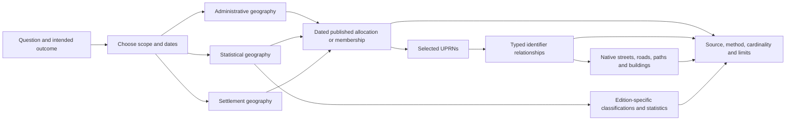

# Combine views for a geographical question

The three-pane experience separates choosing a task, doing it and keeping its
definitions or evidence in view. The groups below describe conceptual data and
activities. They are not Docker containers or a claim that all data is loaded.
The owner requested this design on 21 October 2026 for
[issue #153](https://github.com/chris-page-gov/gis-ai-go/issues/153).

The [presentation overlay and host contract](../../examples/geography-task-experience/README.md)
implement the screen organisation. Its [personas and stories](../../examples/geography-task-experience/STORY-MATRIX.md)
link each task to an observable outcome, a learning stage and just-in-time help.
These are authored design hypotheses; human evaluation is a separate gate.

## Three meanings of a container

| Kind | Purpose | Combination rule |
| --- | --- | --- |
| Interface pane | Task navigator, focused workspace, pinned reference | Change the workspace while keeping relevant help or evidence visible. Fold either side pane. |
| Conceptual data group | Dated geography, allocation, identifiers, native features, classifications or evidence | Select groups according to the question and an evidenced relationship; names do not establish a join. |
| Execution or storage container | Local preview, approved processing environment, transient inputs and retained knowledge | Technical isolation and persistence only. These do not add geographical meaning or entitlement. |

## Relationship map

Arrows describe task dependencies, not universal geographical containment or
guaranteed provider relations. A council organisation and its administrative
area are separate objects. OA, LSOA and MSOA relationships depend on nation and
edition. Settlements can cut across administrative areas. Building parts, sites,
streets and networks have their own typed relationships and cardinalities.

Use an existing source-owned identifier relationship before proposing spatial
matching. An absent relationship is a recorded gap; it does not authorise an
invented join. A spatial fallback needs its own question, geometry, CRS, date,
method and acceptance criteria. A nearest-road relationship is not proof of
access, service or containment.

## Task-specific combinations

| Question | Groups to combine | What to inspect together | JIT explanation |
| --- | --- | --- | --- |
| Which properties are allocated to this area? | Geography, published membership/allocation, UPRNs | Native area code and edition; allocation method; current/previous-address scope | Direct allocation and OA-based best fit answer different questions. |
| Which roads or paths relate to these properties? | UPRNs, Linked Identifiers, streets and network features | Method and direction; source/target identifiers and versions; missing targets | Correlation is not access, walkability or routing topology. |
| Which building is associated with this property? | Native building references, UPRNs, optional typed identifier associations | Exact feature type and identifier namespace; cardinality and query outcome | An addressable location is not always a building; topographic association is not universal building containment. |
| What does this height mean? | Building/part or network feature, field schema, units and datum | Native value, null/absence, measurement method and version | Maximum height, relative height, elevation gain and ordinate values differ. |
| How does this settlement compare with a council area? | BUA edition, administrative geography, explicit lookup or reviewed geometry method | Join field, both dates, not-covered category and denominator | A BUA is not a council boundary; no historical-to-current crosswalk is assumed. |
| What can we say about the area's residents? | Statistical geography, chosen Census table, classifications and denominator | Table availability, reference period, population universe and publication scope | An area category does not classify every resident; UPRNs are not population. |
| How deprived or rural is this area? | National scheme/edition, native classification or rank, its geography | Category definition, rank/score distinction and jurisdiction | Do not average ranks or compare national indices as one scale. |
| Has this area changed? | Code instances, published successors/equivalences, dated boundaries | Native validity fields, release/reference dates and explicit relationship rows | A repeated code or a metadata update does not prove unchanged geometry. |
| Can I reproduce or explain this finding? | All selected groups plus source and processing evidence | Complete selected-input scope, provenance, known omissions and review state | A demonstration or successful selection is not full coverage. |

The [bridge method](OS_IDENTIFIER_GEOGRAPHY_BRIDGES.md) and
[date/classification guide](GEOGRAPHY_DATES_AND_CLASSIFICATIONS.md) contain the
source-backed boundaries. The [term finder](GEOSPATIAL_TERM_DISCOVERY.md) keeps
native terminology and alternative search forms accessible. The authored learning
journey is goal → activity → observable outcome → safeguard → source; contextual
help is available at the decision point, with no hover-only explanation.

Human evaluation remains required. Authored personas and story coverage are
design evidence, not proof of comprehension, accessibility or task success.
