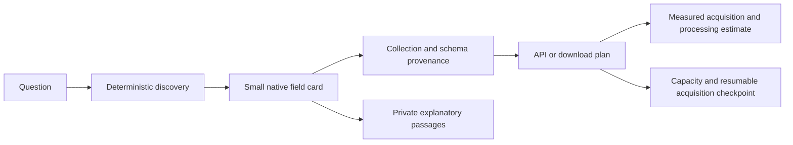

# OS knowledge and acquisition recovery

Tracking: [issue #153](https://github.com/chris-page-gov/gis-ai-go/issues/153).
Owner instruction and observation date: 19 October 2026. Local implementation
from `f8292cbb`; no deployment, installed connector registration or protected-main
acceptance is implied. The initial working tree was clean. No execution log for
the quoted failed prompt was supplied, so its precise failure cause is unknown.

The [geography and identifier bridge method](OS_IDENTIFIER_GEOGRAPHY_BRIDGES.md)
defines acceptance for the proposed authority, statistical-area, property, road
and building journey, including relationship-first investigation and separate
native-feature, height, tile and retention evidence.

The [API coverage and usage guide](OS_API_COVERAGE_AND_USAGE.md) explains the
public PSGA product-table basis, service execution gaps and usage-accounting
boundaries. Read it before interpreting a zero or missing API usage figure.

## Objective and authority

Preserve small, rich OKF+ evidence files with Linked Data. A question should locate
the relevant native field and its explanatory evidence without requiring the
model to consume a whole catalogue. Keep source identifiers, version, units,
nulls, quality, measurement methods, datum, applicability, rights and provenance
distinct. Missing explanations remain missing rather than being inferred.

The owner clarified the objective: process available feature data transiently,
retain semantic knowledge and reproducible efficient methods, then discard feature
payloads after verified processing. Permanent national feature storage is not a
prerequisite. Bounded staging capacity, complete processing evidence and verified
cleanup are required for each selected acquisition. An archive host is a deferred
fill-in if a later operation needs it; no new storage service is selected here.

The owner confirmed government PSGA rights and authorised the existing key for
private retrieval. This authority persists during unattended execution. It does
not require another approval for each request. Existing restrictions on public
licensed payloads, new services and chargeable overage remain. No secret value
was printed or placed in a URL, source file or receipt.

## Confirmed starting point

- The last accepted metadata checkpoint reports 30,833 Markdown/Linked Data
  records. The recovery build reproduced that count and retained 2,915 NGD field
  nodes; its 12 known schema findings remain visible.
- Live NGD discovery returned 94 versioned collections. This is the returned API
  catalogue, not all OS data or the complete PSGA entitlement.
- Authenticated Downloads discovery returned 47 configured packages containing
  374 version references. Configured packages do not enumerate every product the
  government can order or every API operation the key can invoke.
- The official [rate policy](https://docs.os.uk/os-apis/core-concepts/rate-limiting-policy)
  states 600 transactions/minute for live projects and 50 for development
  projects, per API and project. Project mode is unconfirmed. The private API
  inventory uses at most about 30 starts/minute, no redirects or automatic retries,
  and stops on 429. Other consumers of the same project can still consume capacity.
- About 30 GB was available locally. The first 34 inspected versions alone listed
  about 328 GB of compressed file entries. This includes historical releases and
  is not a deduplicated current national-data requirement. Keeping that archive
  cohort locally would exceed available capacity. Transient processing can use
  bounded selections and staging; these counts do not prove a national scan.

The initial documentation requests returned HTTP 403 with the default client
user agent. The documented metadata client identity then succeeded normally;
no proxy, access check or TLS verification was bypassed.

## Implemented evidence path



The diagram describes the intended connected evidence path. The tools below are
local maintenance operations, not new hosted MCP tools. Live feature execution,
complete graph traversal and installed Ask OKF admission remain separate work.

| Operation | Concrete behaviour | Material limit |
| --- | --- | --- |
| Existing build/search | Retains and searches complete `okfp:field` metadata with the parent record. | Whole-record retrieval can still omit an oversized collection explicitly. |
| `field_cards.py` | Exports 2,915 independent JSON-LD field cards, about 3–12 KB each, with parent/schema/source hashes, rights and limitations. Bounded search returns whole cards. | Evidence derives from retained schemas; no missing definitions, units or datum are invented. The optional machine index is larger than an individual card. |
| `passages.py` | Splits original Markdown losslessly into bounded JSON-LD passages with source digest, heading context, line and byte/character offsets. Reconstruction is exact, including Unicode and original line endings. | Private original text remains untrusted evidence. A manifest is an ordered index and may exceed the individual-passage ceiling. |
| `field_passages.py` | Creates private candidate explanation links for all 2,915 retained fields across 94 collection versions, using source-bound headings and explicitly reviewed exceptions. All candidates matched in the final export; its 3,347 indexed files are at most 16,383 bytes. | A navigation match does not establish documentation-version or semantic equivalence. Source-explicit former names remain evidence, never executable query aliases. Ambiguous matches are refused. |
| `os_document_sync.py` | Captures only the 2,303 exact URLs in three frozen committed documentation indexes, with separate private ledger, one-writer lock, budgets, failures and resumable passage verification. | The frozen October index may omit later pages. A bounded batch is not full documentation coverage. No page-discovered links are followed. |
| `os_private_inventory.py` | Retrieves fixed catalogue and validated native package-version metadata routes, retaining private checksum-backed receipts. | File URLs are recorded privately, never executed. Inventory is not feature acquisition or proof of complete entitlement. |
| `retrieval_plan.py` | Compares acquisition and processing estimates from explicit counts, page sizes, rate ceilings, latency, archive sizes and measured throughput. | Missing measurements yield unknown estimates. Comparison requires matching coverage. It does not execute a provider call. |
| `query_planner.py` | Builds offline candidate recipes from explicit native field identities, coverage and evidenced mappings/capabilities. | No inferred join, cross-collection capability, field equivalence or execution grant. |
| `ngd_extract.py` | Acquires bounded NGD selections with checkpoints and integrity checks; disposal requires a complete selection-bound profile. | Pagination and a complete bounded selection do not establish a full national scan. |
| `transient_profile.py` | Profiles bounded GeoJSON or streaming NDJSON without retaining feature contents in its report. | Input deletion is opt-in after complete success and restricted to ignored artefacts; retention intent alone does not prove cleanup. |
| `route_comparison.py` | Compares supplied route observations with explicit identity paths, context and reviewed mappings; prepares candidate support drafts. | Draft only: no automatic OS support submission, semantic equivalence decision or source-independence guarantee. |
| Query capability profiles | Small source-bound [NGD](../../okf-plus/profile/os-ngd-query-capabilities.json), [WFS](../../okf-plus/profile/os-wfs-query-capabilities.json) and [Downloads](../../okf-plus/profile/os-download-query-capabilities.json) registries. | Documented, observed and unverified claims remain separate; profiles grant no execution authority. |

The operation-output contract is
[`recovery-operations.schema.json`](../../okf-plus/schemas/recovery-operations.schema.json).
It provides optional structural assurance, not upstream byte verification or
execution permission. Owner: repository owner. Threats include source instructions,
credential leakage, redirects, unsafe paths, checksum substitution, oversized
responses, rate exhaustion and false completeness. Policy: fixed routes and source
scope, private evidence, whole-evidence byte limits, no source execution and no
public account/licensed data. Synthetic tests exercise refusal and preservation.

Passage directories are staged and verified before atomic publication, so an
interrupted write does not publish a partial final directory. Existing destinations
are preserved even if created concurrently. This publication currently requires
Linux `renameat2`; unsupported hosts fail closed. The managed acquisition host
passed these checks. This does not establish a cross-platform capture guarantee.

## User example acceptance boundaries

- **Pavement width:** actual native fields include
  `presenceofpavement_averagewidth_m` and
  `presenceofpavement_minimumwidth_m`. Road Link and Pavement Link are distinct
  parents; source attribution must establish which is appropriate.
- **Building height:** `height_absolutemax_m`, `height_absolutemin_m` and
  `height_absoluteroofbase_m` differ from relative heights. Absolute maximum can
  include a chimney; absolute minimum describes underlying ground. Do not replace
  the documented datum with an assumed sea-level reference.
- **Road height above sea level:** `elevationgain_indirection` and
  `elevationgain_againstdirection` describe gain, not absolute elevation. Finding
  them is useful discovery, not a successful answer to the original question.
  Geometry dimension, heighting method, datum, bridge/tunnel behaviour, accuracy
  and any terrain-derived estimate need their own source-backed checks.

A private bounded Road Link v5 request subsequently returned HTTP 200 in about
1.0 second with two finite 3D LineStrings and a matching EPSG:7405 response header.
The official CRS guidance defines this as British National Grid plus ODN Height.
Both sampled methods were Interpolated Bridge. This demonstrates an ODN-height
retrieval route, not direct survey accuracy, bridge clearance, instantaneous sea
level or a complete area dataset. Building v4 and Pavement Link v1 requests also
returned two features each, with the selected height/quality/date and width fields
present and non-null. All three had next-page links. Their receipts remain private under `artifacts/okf-plus/private-ngd-samples/`;
raw bodies are disposed only after complete sample profiling and verified
knowledge-file publication, or preserved when publication cannot complete.

The captured Road Link definition confirms non-null 3D LineString geometry.
`heightingmethod` describes its origin and derivation; the separate code list
currently lists DTM, Interpolated Bridge and Interpolated Tunnel with no definitions
for the values. The presence of a method label does not establish its algorithm.
Pavement guidance distinguishes algorithmically derived Road Link attribution
(including both sides) from the separate Pavement Link features for each side.
Those links coincide with the road geometry and are not pavement centre lines or
a routable pavement network. These distinctions must survive an answer.

Do not silently transfer legacy Building Height Attribute rules into NGD Building.
The legacy product documents excluded residential chimneys from its maximum-height
rule, whereas the NGD Building description says maximum height can include a chimney.
Product, version and provenance must qualify a seemingly identical measurement.

Literal substring matching of native compounds supports “pavement width”,
“building height” and “road elevation”; it adds no synonyms or physical inference.
Definitions in the private documentation are richer than the public structural
schema projection. Linking each field/version to the correct passage is a separate
semantic assertion and must remain distinguishable from lexical discovery.

## Query capabilities and route comparisons

The captured NGD contract documents `filter-lang=cql-text` for row selection,
with collection-specific queryables, at most 100 features per page and one
collection per items path. It does not advertise field projection, multi-collection
queries or server-side joins. This absence is not universal proof of rejection:
an unknown parameter may simply be ignored. WFS separately documents
`propertyName` field projection; do not transfer that parameter to NGD.

The WFS spatial/attribute rule is different from NGD: the
[OS filtering guide](https://docs.os.uk/os-apis/accessing-os-apis/os-features-api/technical-specification/filtering.md)
states that a separate `bbox` parameter takes precedence over a purely
attribute-based XML `filter`, which is then ignored. Put spatial and attribute
conditions together in one XML filter. Evidence: committed API-contract snapshot
`/records/67`; fresh source SHA256
`bddec074009554c5217c60106b1f1b0860c281c8b21288de451707d7339792d9`,
lines 23–25 of that fresh body, retrieved 19 October 2026. The committed record
binds the earlier catalogue capture; it is not the hash for these fresh line
references. The private documentation checkpoint binds the fresh capture.
The guide treats fields returned by DescribeFeatureType as attribute-filter
candidates; that does not validate every operator or complex path.

The captured capabilities response explicitly advertises standard, spatial and
temporal joins, remote resolution, feature versioning and stored-query management
as **false**. Sorting, resource IDs and minimum XPath are advertised true but have
not been validated as arbitrary retrieval methods. These are source assertions,
not live tests of every path. Evidence: capabilities SHA256
`7bb714cb6471633a8d53fb436907143141361ad439de89f0c918311c789bc687`, named
`ows:Constraint` values; private `wfs-capabilities-receipt.json` binds the capture.
Multi-type union remains a separate undocumented question.

| Advertised WFS operation | Bounded evidence status |
| --- | --- |
| GetCapabilities | HTTP 200 metadata observed: 44 types, seven operation advertisements. |
| DescribeFeatureType | All 44 advertised native schemas captured; external imports not followed. |
| GetFeature | OS contract and bounded Road Link GET controls; generic product/format/POST coverage unproven. |
| GetPropertyValue | A controlled HTTP 200 reproduction again returned 682 bytes of malformed XML at line 11, column 24. Failed input retained; successful value retrieval unverified. |
| GetGmlObject | Advertised only; no invocation or captured OS-specific contract. Object identity/protocol/parameters and field-extraction utility remain unknown. |
| ListStoredQueries | One GET returned HTTP 200 with an empty native query list; no stored-query retrieval established. |
| DescribeStoredQueries | One GET returned HTTP 200 with no query definitions; no arbitrary query contract established. |

Four bounded operation calls were made on 19 October 2026. The two stored-query
responses were valid empty metadata. The initial GetPropertyValue body failed XML
parsing before its HTTP status was persisted, then was prematurely deleted after
diagnostic text profiling; this was not successful native value processing.
One authorised controlled reproduction persisted status, headers and the body
before parsing: HTTP 200, the same byte count and parser position, but a different
response hash. Its failed raw input remains private. It does not reconstruct the
lost original bytes or status. Native value/record counts remain unknown.
Private receipts under `private-wfs-operations/` preserve this distinction.
Empty stored-query responses do not establish a reusable query route.
No GetGmlObject request was made. These findings leave property-value identity,
output type/null handling and any efficiency advantage unresolved.

GET and POST links in a capabilities document do not prove that the OS gateway
accepts both encodings for every operation. The
[WFS capability profile](../../okf-plus/profile/os-wfs-query-capabilities.json)
keeps source assertions, observations and unknowns separate and grants no execution.

Live WFS metadata requests returned HTTP 200. The `Highways_RoadLink` schema
exposes `RoadWidthAverage`, `RoadWidthMinimum` and `RoadWidthConfidenceLevel`;
`Topography_TopographicArea` exposes `TOID`, BHA version/process date, absolute
and relative height fields and confidence. These observations correct the earlier
uncertainty about their presence, but do not prove equality with NGD measurements.
Private schema receipts remain under `private-route-comparisons/`.

NGD Road Link `toid` explicitly refers to the MasterMap feature identifier and
is a candidate identity bridge. OSID is not a TOID; NGD Building has no established
direct TOID mapping in this review. Compare exact identity, feature grain, source
version/time, CRS, units, datum, measurement definitions and quality before
claiming agreement or disagreement. Legacy and NGD chimney rules already differ.
A bounded live comparison retrieved two identical native WFS road IDs through
full-record and projected requests. `RoadWidthAverage`, `RoadWidthMinimum` and
`RoadWidthConfidenceLevel` agreed for both records. Including `SHAPE` in the
projection reduced the response from 4,668 to 2,084 bytes; mandatory extra fields
remained. This is measured agreement within WFS, not statistical confidence or
proof of WFS/NGD semantic equivalence. WFS numeric widths were strings, reinforcing
the need to preserve native types.

The same-bbox WFS projection omitting `SHAPE` returned HTTP 200 but malformed
GeoJSON; full-record and geometry-including controls parsed normally. Separately,
NGD `IN` returned 500 while equivalent equality-OR selection returned both records.
Private unsent support drafts preserve sanitised exact calls, source references,
response hashes, parser/status observations and methodology. These are candidate
issues with bounded reproduction, not a conclusion that every collection fails.
Valid comparison payloads were fully profiled and discarded; evidence receipts,
small knowledge files and minimum diagnostic excerpts remain private.

Use evidence status rather than an invented numerical confidence: documented
capability, observed behaviour, corroborated within a controlled comparison, or
unresolved equivalence. Agreement from a shared provider backend is not independent
validation. Route comparisons and candidate OS support notes are drafts for review;
no external message or definitive cross-product equivalence is implied.

## Output intent and scoped availability

The owner extended the same recovery objective with
[presentation-aware retrieval research](OS_RETRIEVAL_PRESENTATION_RESEARCH.md) and
[availability reporting](OS_DATA_AVAILABILITY.md). The small
[output-intent profile](../../okf-plus/profile/os-output-intents.json) records
required geometry, units, datum, time, grain, aggregation, quality and portrayal
understanding. VizQL and related visual query approaches are research leads,
separate from OS NGD CQL-text and WFS; Tableau-hosted pages remain blocked, but a vendor-published OpenAPI contract
was verified through the official GitHub repository at a pinned commit. It
documents data/model queries; deployed service access remains unverified.

`query_planner.py` accepts optional output requirements for table, map or analysis
with explicit `native-values`, `geometry` and/or `portrayal` capability evidence.
It filters unsuitable or unproven candidates before comparing acquisition and
processing costs. A map intent alone implies neither a renderer nor geometry
fidelity; portrayal-only evidence cannot satisfy native-value requirements.

`availability.py` produces private, offline per-source/version/selector/field
assessments with evidence hashes. Access, expected presence, observed presence and
retrieval completion are separate. Null, zero, absent property, outside coverage,
complete empty filtering, uncollected data, unavailable product, incomplete paging
and request failure remain distinct. Missing planner candidates leave data presence
unknown. Request-level HTTP 401/403 rejection is retained separately from PSGA
licence rights. Source claims are evidence, not independently established facts.
Normal responses describe the exact requested scope, avoiding irrelevant coverage
boilerplate.

All-collection explanation linking uses exact frozen collection/document titles
and native field headings, retaining every field's match or unresolved reason.
It creates candidate links rather than asserting current documentation applies to
older collection versions. Every explanation reference file is bounded to 16 KB,
with lossless manifests when references span multiple files.

Two title exceptions have explicit source-reviewed candidate bindings in the
[small binding registry](../../okf-plus/profile/os-collection-document-bindings.json):
GB Postcode Unit Point is distinguished from the identically schemed NI source by
native collection and documented geographic/API scope; RoutingStructure is matched
to Routing Structure using the source definition. Neither curation asserts
version equivalence. Registry bytes, source records and receipt hashes are checked.

Six checksum-and-line-bound primary-heading reviews resolve repeated `osid` and
`usrn` headings. Source-explicit former-name annotations and native array/container
labels provide additional candidate navigation, preserving original labels,
definitions, source hashes and the matching method. Whitespace removal and
casefolding for container labels require a checksum-matched top-level array/items
definition; no general synonym or cross-field equivalence is inferred. The final
export has no missing or ambiguous candidate headings. Historical-version
alignment and source meanings that the provider has not documented remain open.

Query planning refuses credential-bearing request descriptors or evidence URLs.
Availability receipt adapters bind every response, including failures, to the
requested collection and selection digest before using it. Known failed capture
receipts cannot be hidden by later pending ledger entries and retried blindly.

## Unattended continuation

The owner explicitly authorised continuation through the night. The
[bounded supervisor](../operations/OS_UNATTENDED_RECOVERY.md) waits for an existing
document writer, resumes unresolved targets under the same cumulative request
ceiling, audits captured checksums and passage reconstruction, and exports final
all-field candidate links. It records partial completion when a known redirect
failure remains. Its default wall budget is eight hours and it does not guarantee
workspace lifetime. Closing the laptop should not itself stop cloud processes,
but a saved status is not proof that a process survives or is still running.

The current metadata refresh captured all 94 collection queryables and all 94
schemas in 188 successful bounded requests. It retained complete native schema
metadata, 840 queryable-property cards, 2,915 returned-property cards and a
collection card for each response. Comparable retained definitions match the
2 October baseline. There are 2,075 returned-field entries outside the current
queryables catalogue; this limits filtering, not returned-value availability.
Provider-native schema IDs are preserved separately from endpoint URLs.

## Completed accessible pass and retained evidence

The documentation traversal and subsequent offline exports have finished. No
documentation or feature-acquisition job remains active at this checkpoint.
`finished_partial` deliberately retains the one original redirect failure.

| Evidence lane | Verified result | Scope and remaining limit |
| --- | --- | --- |
| Frozen documentation | All 2,303 targets accounted for: 2,302 captured, one HTTP 307, zero unresolved; 216,765 bounded passages reconstruct 17,481,795 source bytes exactly. | The old Sites known-issues URL redirects to a newer page captured in the separate six-page current-navigation supplement. The frozen denominator is preserved. |
| NGD metadata | All 94 queryables and 94 schema responses captured; 840 queryable and 2,915 returned-property cards, with complete native annotations. | Same-version comparable retained structural definitions match the earlier snapshot; this does not prove unchanged unretained historical prose. |
| Field explanations | All 2,915 fields have matched candidate explanation navigation; all 3,347 output files hash-verified and bounded to 16 KB. | Candidate navigation is complete for these retained fields; documentation-version and semantic equivalence are not independently proven. |
| NGD response structures | All 94 first-page responses fully processed: 186 records, one empty page, 3,968 observed/declared structure cards; all raw feature payloads disposed and no feature files remain. | Ninety-three pages advertised more data. No subsequent page was requested in this sampling lane, and no complete area or national selection is claimed. |
| WFS schemas | All 44 advertised type schemas retained: 42 fresh requests and two verified reused schemas; 1,728 declaration cards, 606 element declarations and 172 lossless XML parts. | No feature calls in this lane. Imported GML definitions were not followed; zero declared enumeration constraints is not proof of unconstrained real-world values. |
| Configured downloads | All 47 packages and 374 version references inventoried: 4,973 file entries, 1,812,526,102,609 compressed bytes including history/repetition. | Configured packages do not establish the full PSGA entitlement denominator. Archive payload processing remains deferred. |

The native schema audit retained 2,899 non-empty description strings and 16 null
descriptions on array-parent definitions; nested descriptions remain intact. It
also retained 883 direct enum definitions and all source-native constraints. A
missing direct unit keyword does not mean that prose contains no unit information.

The broader sample review separates 80 optional enum fields observed as null,
two Water Link `primacy` string/integer differences and one non-standard declared
`long` type whose compatibility is unknown. These are scoped observations, not
complete JSON Schema conformance findings. A third private, unsent support draft
records the Water Link calls, schema definitions, hashes and methodology. The
existing IN/OR and WFS serialisation drafts remain unsent. No numerical confidence
or cross-product equivalence has been invented from these samples.

Private receipts and small knowledge files remain under ignored paths:

- `artifacts/okf-plus/private-os-documents/diagnostics/followthrough-final-integrity.json`
- `artifacts/okf-plus/private-current-documentation-supplement/`
- `artifacts/okf-plus/private-ngd-queryables/` and `private-ngd-schemas/`
- `artifacts/okf-plus/private-ngd-collection-samples/coverage.json` and `offline-verification.json`
- `artifacts/okf-plus/private-wfs-schemas/coverage.json`
- `artifacts/okf-plus/private-recovery-supervisor/checkpoint.json`

The supervisor checkpoint identifies the latest immutable export and source HEAD.
Read its receipt before claiming an exact committed producer: earlier local runs
can predate the commit containing their working-tree changes. Source and public
methodology are synced to GitHub; private account metadata and licensed evidence
are not a GitHub backup. Their workspace lifetime is a separate operational limit.

## Run and resume

From the checkout root, with locked development dependencies:

```sh
uv sync --locked --group dev --cache-dir .uv-cache
uv run --locked --cache-dir .uv-cache python -m scripts.okf_plus.field_cards \
  --question 'pavement width' --max-records 3 --max-bytes 16384
uv run --locked --cache-dir .uv-cache python -m scripts.okf_plus.field_passages
uv run --locked --cache-dir .uv-cache python -m scripts.okf_plus.os_private_inventory \
  --max-requests 500 --wall-seconds 1800
uv run --locked --cache-dir .uv-cache python scripts/okf_plus/os_document_sync.py \
  --max-requests 3000 --max-documents 100 --deadline-seconds 1800
```

Private outputs remain under ignored `artifacts/okf-plus/private-os-inventory/`
and `artifacts/okf-plus/private-os-documents/`. Repeat the same commands to reuse
verified successes and continue. Never launch competing writers. The package
inventory's exclusive lock is removed on ordinary completion; after a hard crash,
prove no writer remains before removing a stale lock. A prior 429 requires a
separately reviewed capture after the provider's retry window; do not erase the
receipt to force continuation. A changed frozen documentation scope requires a
new preserved capture lane. Local files are not a durable off-machine backup.

The package inventory's ceilings are cumulative: 500 attempts in the command
above, 128 MiB total, 8 MiB per response and 25-second per-request wall limit.
Documentation uses the existing capture bounds: 256 MiB total, 16 MiB per response,
0.75-second pacing, stop on 429 and a between-document run deadline. One in-flight
request can finish after the documentation run deadline.

The live navigation comparison found unchanged API (152) and NGD (478) URL sets,
but the Downloads index now contains 1,678 URLs: six added and one removed against
the frozen 1,673-target snapshot. Preserve the frozen run and record the six new
pages separately under `private-current-documentation-supplement/`; do not silently
change its denominator or treat a removed navigation link as deletion authority.
This comparison alone does not prove that unchanged URLs have unchanged content.

Before fulfilling a dataset request, state its geographical, temporal, version,
field and format coverage; estimate acquisition and processing separately; compare
the equivalent download where available; and label unknowns. Metadata timings
alone are not feature-transfer throughput. A large request needs a known archive
size or feature count, a bounded processing plan, sufficient transient staging
capacity and a verified disposal path. Permanent national storage is not required.
An archive host remains deferred unless a concrete operation needs one; do not
buy storage or select a cloud account implicitly.

## Remaining work and separate acceptance gates

1. Deferred archive fill-in requires adding only
   `omseprd3ngdenginestore.blob.core.windows.net` to the existing network allowlist.
   The local `artifacts/okf-plus/OS-archive-network-change.json` preserves other
   domains. The earlier draft save was rejected as uneditable; no environment
   change was applied. This addition permits archive reads, introduces no storage
   service or new spending, and must not forward the OS key to Azure.
2. After that change, process bounded representative archive formats and structures
   transiently; preserve complete selected-input knowledge, FULL/COU dependencies,
   coverage and disposal evidence. Measure equivalent API/download throughput
   before promising an efficient national or arbitrary-area recovery time.
3. Full PSGA entitlement discovery, independently version-matched historical
   semantics and unpublished provider definitions remain unproven. The completed
   catalogue, schemas, documentation and samples do not certify every possible
   value or every conceivable question. Use the retained unknown states and
   support drafts when the available evidence cannot answer a request.
4. Hosted Ask OKF/installed-client acceptance and any new visualisation service
   remain separate roadmap gates. Local maintenance tools do not activate them.
   Complete canonical repository assurance before integration; do not infer a
   deployment from a merged source change.

No finite question set proves that every conceivable question can be answered.
The measurable goal is complete retained-source coverage, precise discovery,
source-backed explanations and honest retrieval/derivation limits.

## Local verification and integration

The final affected Python discovery run passed all 353 tests. Complete offline OKF+
verification passed source/import consistency, the 30,833-record build, the declared
retrieval corpus, all-record consumer-schema validation, whole-corpus audit and
four pinned-engine cases. Four existing context-required questions remain
unassessed. Its retained report is
`artifacts/okf-plus/recovery-b68d8674-verification/verification.json`; the report's
source revision and exact input digest distinguish the retained-input observation
from later helper/schema changes and canonical final-source acceptance. The final
helper changes are covered by the affected suite, an independent all-output audit
and an actual complete offline export. Canonical GitHub checks are tracked on
[PR #154](https://github.com/chris-page-gov/gis-ai-go/pull/154).

The existing public OKF build and repository contract checks also passed. Link,
secret and changelog checks are separate from feature or hosted acceptance.
Oversized nested field definitions are retained as bounded, lossless canonical-JSON
text fragments with checksum-backed manifests and child-card navigation; the full
definition can be reconstructed exactly. Oversized statistics/navigation still
fail closed and preserve the input. The optional transient and route-comparison
schemas validate the corresponding producer outputs and refuse authority claims.

No required CI gate, independent image derivation or deployment criterion was
relaxed. Acquisition has stopped at its recorded scope; integration assurance is
tracked separately from the deferred archive work and semantic unknowns.
